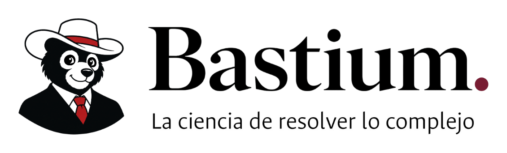

<p align="center">
  
</p>

<p align="center">
  <b>Liquidaciones judiciales colombianas, calculadas con rigor forense y explicadas paso a paso.</b>
</p>

<p align="center">
  <a href="docs/GUIA_USUARIO.md">Guía de usuario</a> ·
  <a href="docs/FUNCIONALIDADES.md">Qué calcula</a> ·
  <a href="https://github.com/users/JoseMsD21/projects/1">Tablero Kanban</a> ·
  <a href="docs/Preguntas-Para-Abogado-Abiertas.md">Preguntas al despacho</a> ·
  <a href="CONTRIBUTING.md">Cómo contribuir</a> ·
  <a href="docs/MAPA_DOCUMENTACION.md">Toda la documentación</a>
</p>

<p align="center">
  <a href="https://github.com/JoseMsD21/BASTIUM-CALCULOS/actions/workflows/ci.yml"></a>
  
  
  <a href="LICENSE"></a>
</p>

> [!WARNING]
> BASTIUM es una herramienta de **apoyo**: no sustituye la asesoría de un abogado ni garantiza exactitud jurídica.
> Verifica los resultados contra la norma vigente antes de usarlos en un proceso real
> ([aviso legal completo](docs/SECURITY.md#aviso-legal)).

## Qué es

BASTIUM es una aplicación de escritorio para abogados y despachos en Colombia. Registras un expediente con sus
deudas (obligaciones) y pagos (abonos), y el programa calcula la liquidación: capital, intereses, indexación y
saldo final. Cada número sale con su fecha, su tasa y la norma que lo sustenta, y se exporta a PDF o Word con el
membrete de BASTIUM.

**Tus datos no salen de tu computador.** Todo se guarda en un archivo local (`bastium.db`). No hay cuentas, nube ni
telemetría ([por qué](docs/ARQUITECTURA_ADR.md#adr-005-sin-telemetría-ni-analítica-remota)). La única consulta a
internet es opcional: la TRM certificada para obligaciones en dólares.

## Qué calcula

| Área | Lo principal |
|---|---|
| **Civil / Familia** | Interés legal del 6 % anual (Art. 1617 C.C.), indexación IPC, Suma Única con abonos tramo a tramo, cuotas alimentarias con reajuste anual y vigencia por edad, fruto civil |
| **Comercial** | Tasas pactadas, tope de usura (1,5 × IBC) con sanción, obligaciones en dólares con TRM por fecha, anatocismo solo cuando la ley lo permite |
| **Laboral** | Liquidación final (cesantías, intereses, prima, vacaciones), indemnizaciones de los Arts. 64 y 65 CST, horas extra (Ley 2466), seguridad social, salarios dejados de percibir |
| **Tributario** | Impuesto, sanciones con piso de 10 UVT, interés moratorio del Art. 635 E.T., imputación de pagos propia del área |
| **Sancionatorio** | Multas en SMLMV o UVT según la fecha del hecho (Ley 1955/2019) |
| **Honorarios / Litigio** | Honorarios y cuota litis con el tope del 50 % (Ley 1123/2007) |

Además, en todas las áreas:
- **Imputación de pagos** en el orden legal de cada área (costas → intereses → capital en Civil).
- **Alertas de prescripción y caducidad** para 13 tipos de acción.
- **Parámetros legales versionados** (tasas, SMLMV, IPC, UVT, usura) editables sin tocar código.
- **Historial de auditoría:** cualquier liquidación pasada se reconstruye exactamente con doble clic.
- **Precisión forense:** `Decimal` en todo el dinero, nunca `float`, y redondeo `ROUND_HALF_UP`.

El detalle completo, área por área, está en [Funcionalidades](docs/FUNCIONALIDADES.md). Lo que todavía no hace está
en la [Guía de usuario, sección 8](docs/GUIA_USUARIO.md#8-funciones-pendientes-o-en-desarrollo).

## Para usuarios: instalar y abrir

**En Windows (recomendado):**

1. Instala [Python 3.15](https://www.python.org/downloads/) (marca "Add Python to PATH"). También sirven 3.12,
   3.13 y 3.14.
2. Descarga el proyecto (botón verde **Code → Download ZIP**, o `git clone`).
3. Haz doble clic en **`Iniciar BASTIUM.bat`**. La primera vez crea el entorno e instala todo solo (tarda unos
   minutos); las siguientes abre directo.

La base de datos se actualiza sola al abrir: no hay que correr scripts ni borrar `bastium.db`. Para actualizar a una
versión nueva, descarga la nueva versión (o `git pull`) y vuelve a abrir con el mismo `.bat`.

¿Algo falla? La [Guía de usuario](docs/GUIA_USUARIO.md#2-instalación-paso-a-paso) explica la instalación paso a
paso y tiene una sección de problemas frecuentes (por ejemplo, qué hacer si `PySide6` no termina de
instalarse).

## Para el equipo de desarrollo

```bash
py -3.15 -m venv .venv && .venv\Scripts\activate    # Python 3.12 o más nuevo; recomendado 3.15
pip install -r requirements.txt
python main.py                                      # abre la aplicación
python -m pytest -q                                 # más de 2.000 pruebas
python -m ruff check .                              # estilo (la CI lo exige)
```

**Cómo trabajamos:**
- `main` está protegida: cada cambio va en su rama y entra por Pull Request con la CI en verde y la aprobación del
  responsable. Paso a paso en [CONTRIBUTING.md](CONTRIBUTING.md).
- **Tablero Kanban público:** [BASTIUM - Kanban](https://github.com/users/JoseMsD21/projects/1). Una tarjeta = un
  issue = una rama = un PR. Columnas Backlog → Listo → En progreso → En revisión → Hecho, más **Bloqueado** para lo
  que espera respuesta del despacho.
- **Google Drive del equipo** (acceso solo para el equipo): actas de reunión y avances en la
  [carpeta de actas](https://drive.google.com/drive/project/1Vf9_sVuHZXNbO3Z8IKPsw2zZyB8jVodV); propuestas,
  mockups y auditorías en la [carpeta de propuestas](https://drive.google.com/drive/folders/1ZYauFW9pEKFfjMCC1RIHtDJ2pwrut78f).
  Lo que se decide en Drive se pasa al repositorio (docs o issues), que es la fuente de verdad.
- **Dudas jurídicas:** nunca se resuelven en el código por cuenta propia. Van a
  [Preguntas abiertas](docs/Preguntas-Para-Abogado-Abiertas.md) y, con la respuesta del despacho, a
  [Respondidas](docs/Preguntas-Para-Abogado-Respondidas.md).

**Estructura del proyecto:**

```
app/
  engine/       Motores de cálculo puros (interés, indexación, tiempo, pagos, laboral...)
  services/     Estrategia de liquidación por área del derecho
  views/        Pantallas (PySide6)
  reports/      PDF y Word
  assets/       Fuentes (Ancizar Sans) y logos oficiales (marca/)
database/       Modelos SQLAlchemy y migraciones automáticas
scripts/        Migraciones idempotentes y utilidades
tests/          Pruebas automáticas (pytest)
docs/           Documentación del proyecto (ver el mapa)
```

## Documentación

| Si buscas... | Lee |
|---|---|
| Usar la aplicación | [Guía de usuario](docs/GUIA_USUARIO.md) |
| Qué calcula, área por área | [Funcionalidades](docs/FUNCIONALIDADES.md) |
| Hacia dónde va el producto | [Visión y alcance](docs/VISION_Y_ALCANCE.md) (incluye el mapa de flujo) |
| Colores, logos, tipografía y mockups | [Guía de identidad](docs/identidad/GUIA_DE_IDENTIDAD.md) |
| Por qué está construido así | [Decisiones de arquitectura (ADR)](docs/ARQUITECTURA_ADR.md) |
| Qué falta y en qué va cada sprint | [Pendientes](docs/Pendientes.md) y el [tablero Kanban](https://github.com/users/JoseMsD21/projects/1) |
| Qué cambió en cada versión | [CHANGELOG](CHANGELOG.md) |
| Cualquier otro documento | [Mapa de documentación](docs/MAPA_DOCUMENTACION.md) |

## Estado actual (2026-11-23)

- **Sprint 122:** identidad visual oficial. Logos en `app/assets/marca/`, ícono de ventana, monograma en el panel
  lateral, membrete con logo en PDF y Word, y la [guía de identidad](docs/identidad/GUIA_DE_IDENTIDAD.md) del
  equipo.
- **Noviembre (Sprints 117-121):** interés civil lineal confirmado por el despacho (el caso real Radicado 2224
  cuadra al centavo); costas sin intereses; usura sin extrapolar; horas extra, fruto civil y Suma Única con abonos
  en pantalla; tipo de proceso y título ejecutivo en el expediente.
- **En revisión:** el [parche de plataforma del 17-nov](docs/REVISION_PLATAFORMA_2026-11-17.md) (API con sello
  SHA-256 y gestor de casos), a la espera de la decisión del equipo.
- **Esperando al despacho:** las preguntas de los Sprints 18, 79, 97/98 y 118-122.

Historia completa en el [CHANGELOG](CHANGELOG.md).

## Licencia y seguridad

Código bajo [Apache 2.0](LICENSE). Para reportar una vulnerabilidad, ver [SECURITY.md](docs/SECURITY.md). Los logos
y la mascota de BASTIUM son la identidad del proyecto: no los uses para otro producto.

> **Mantenimiento:** cuando un sprint cambia lo que la aplicación hace, se actualizan este README,
> [Funcionalidades](docs/FUNCIONALIDADES.md) y la [Guía de usuario](docs/GUIA_USUARIO.md) en el mismo PR.
