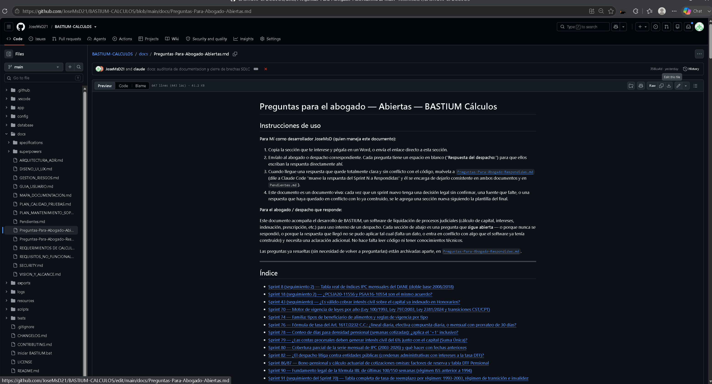
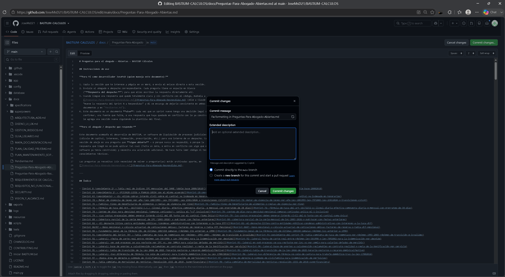

# Preguntas para el abogado — Abiertas — BASTIUM Cálculos

## Instrucciones de uso

**Para Mí como desarrollador JoseMsD (quien maneja este documento):**

1. Copia la sección que te interese y pégala en un Word, o envía el enlace directo a esta sección.
2. Envíalo al abogado o despacho correspondiente. Cada pregunta tiene un espacio en blanco
   ("**Respuesta del despacho:**") para que ellos escriban la respuesta directamente ahí.
3. Cuando llegue una respuesta que quede totalmente clara y sin conflicto con el código, muévela a
   [`Preguntas-Para-Abogado-Respondidas.md`](Preguntas-Para-Abogado-Respondidas.md) (dile a Claude Code
   "mueve la respuesta del Sprint N a Respondidas" y él se encarga de dejarlo consistente en ambos
   documentos y en `Pendientes.md`).
4. Este documento es un documento **vivo**: cada vez que un sprint nuevo tenga una decisión legal sin
   confirmar, una fuente que falte, o una respuesta que haya quedado en conflicto con lo ya construido, se
   le agrega una sección nueva siguiendo la plantilla del final.

**Para el abogado / despacho que responde:**

Este documento acompaña el desarrollo de BASTIUM, un software de liquidación de procesos judiciales
(cálculo de capital, intereses, indexación, prescripción, etc.) para uso interno de un despacho. Cada
sección de abajo es una pregunta que **sigue abierta** — o porque nunca se respondió, o porque la
respuesta que llegó no se pudo aplicar tal cual (falta un dato, o entra en conflicto con algo que el
software ya tenía construido) y necesita una aclaración adicional. No hace falta leer código ni tener
conocimientos técnicos.

Las preguntas ya resueltas (sin necesidad de volver a preguntarlas) están archivadas aparte, en
[`Preguntas-Para-Abogado-Respondidas.md`](Preguntas-Para-Abogado-Respondidas.md).

### Cómo guardar tu respuesta en GitHub (paso a paso)

Una vez hayas escrito tus respuestas directamente en este documento dentro de GitHub, sigue estos pasos
para guardarlas correctamente. Esto deja tu respuesta lista para que yo (JoseMsD) la revise y la apruebe
antes de que quede incorporada de forma definitiva — no se publica sola apenas la guardas.

1. **Abre el archivo en GitHub.** Entra al repositorio y ubica `docs/Preguntas-Para-Abogado-Abiertas.md`.
   Verás el documento en modo lectura, con las pestañas **Preview / Code / Blame** arriba del contenido.

   

2. **Haz clic en el ícono del lápiz (✏️)**, ubicado en la esquina superior derecha del visor de archivo
   (junto a los íconos de copiar/descargar). Al pasar el mouse por encima aparece el mensaje
   "**Edit this file**". Haz clic ahí para entrar al modo de edición.

   

3. **Escribe tu respuesta** en el espacio en blanco que dice "**Respuesta del despacho:**", justo debajo de
   cada pregunta que estés contestando. No borres ni modifiques las preguntas, encabezados o enlaces del
   resto del documento — agrega tu texto únicamente en el espacio indicado. Puedes usar la pestaña
   **Preview** (arriba del editor) para revisar cómo se ve tu respuesta antes de continuar.

   

4. **Cuando termines, haz clic en el botón verde "Commit changes..."** (arriba a la derecha del editor).
   Se abrirá una ventana emergente para confirmar el guardado.

5. **En el campo "Commit message"**, borra el texto que sugiere GitHub y escribe algo que identifique
   claramente qué respondiste, por ejemplo:
   `Respuestas Sprint 82 y 90 - [tu nombre o el del despacho]`
   En "Extended description" puedes agregar, opcionalmente, una nota breve como "Se respondieron 2
   preguntas pendientes."

6. **Muy importante — selecciona la segunda opción**, "**Create a new branch for this commit and start a
   pull request**" (en vez de "Commit directly to the main branch", que viene marcada por defecto). Esto
   es lo que permite que yo vea tu respuesta como una propuesta de cambio y la apruebe antes de que se una
   al documento oficial. Puedes dejar el nombre de rama que GitHub sugiere automáticamente.

   

7. **Haz clic en "Propose changes"** para confirmar. GitHub te llevará automáticamente a la pantalla de
   creación del Pull Request — ahí haz clic en "**Create pull request**" para enviarlo.

8. **Listo.** Recibiré una notificación del Pull Request y podré revisar exactamente qué agregaste
   (resaltado en verde frente al texto original). Si la respuesta queda clara y sin conflicto con el
   código, la apruebo y la fusiono ("merge") al documento oficial. Si necesito una aclaración adicional, te
   la pido ahí mismo como comentario dentro del mismo Pull Request.

---

## Índice

- [Sprint 18 (seguimiento 3) — Discrepancia numérica entre la tabla granular verificada (PSAA16-10554) y las "tarifas duras" que aportó el despacho](#sprint-18-seguimiento-3--discrepancia-numérica-entre-la-tabla-granular-verificada-psaa16-10554-y-las-tarifas-duras-que-aportó-el-despacho)
- [Sprint 79 (repregunta) — Prelación de pagos: ¿intereses antes que indexación? Contradice la regla general vigente](#sprint-79-repregunta--prelación-de-pagos-intereses-antes-que-indexación-contradice-la-regla-general-vigente)
- [Sprint 97/98 (datos pendientes) — Tablas completas de mortalidad de inválidos (hombres y mujeres) de la Superfinanciera](#sprint-9798-datos-pendientes--tablas-completas-de-mortalidad-de-inválidos-hombres-y-mujeres-de-la-superfinanciera)
- [Sprint 118 — Paquete de noviembre: seis reglas que cambiarían resultados (vacancia, festivo nuevo, redondeo, pagos anticipados, notificación y vacancia por despacho)](#sprint-118--paquete-de-noviembre-seis-reglas-que-cambiarían-resultados-vacancia-festivo-nuevo-redondeo-pagos-anticipados-notificación-y-vacancia-por-despacho)
- [Sprint 119 — Cinco dudas que surgieron al aplicar las respuestas del 16/11/2026](#sprint-119--cinco-dudas-que-surgieron-al-aplicar-las-respuestas-del-16112026)
- [Sprint 120 — Dudas surgidas al implementar los Sprints 84, 85, 86/87, 94, 100, 105, 106 y 107](#sprint-120--dudas-surgidas-al-implementar-los-sprints-84-85-8687-94-100-105-106-y-107)
- [Sprint 121 — Horas extra, fruto civil y Suma Única con abonos: cuatro confirmaciones](#sprint-121--horas-extra-fruto-civil-y-suma-única-con-abonos-cuatro-confirmaciones)
- [Sprint 122 — Guía de identidad y material del equipo: tres confirmaciones](#sprint-122--guía-de-identidad-y-material-del-equipo-tres-confirmaciones)
- [Sprint 123 — Gestor de casos propuesto: ocho decisiones (solo si el equipo lo adopta)](#sprint-123--gestor-de-casos-propuesto-ocho-decisiones-solo-si-el-equipo-lo-adopta)
- [Sprint 124 — Cuatro decisiones de identidad, plataforma y publicación](#sprint-124--cuatro-decisiones-de-identidad-plataforma-y-publicación)
- [Sprint 129 — Formato de las cifras: ¿estilo colombiano?](#sprint-129--formato-de-las-cifras-estilo-colombiano)
- [Plantilla para sprints futuros](#plantilla-para-sprints-futuros)

---

## Sprint 18 (seguimiento 3) — Discrepancia numérica entre la tabla granular verificada (PSAA16-10554) y las "tarifas duras" que aportó el despacho

**Contexto:** la pregunta de seguimiento 2 (¿PCSJA20-11556 y PSAA16-10554 son el mismo acuerdo?) ya se
contestó (22/08/2026, ver `Preguntas-Para-Abogado-Respondidas.md`, Sprint 18): el despacho confirmó que
"el marco tarifario unificado obligatorio se rige por el Acuerdo PSAA16-10554" — coincide exactamente con
lo ya implementado y verificado contra la fuente oficial (ramajudicial.gov.co), así que no hubo que tocar
código por ese punto. La misma respuesta también confirmó, sin ambigüedad, que las agencias en derecho se
tasan con "ponderación inversa: a mayor valor, menor porcentaje, respetando los topes" — exactamente la
aproximación que ya usa `_interpolar_dentro_de_rango` (`app/engine/costs/agencias_en_derecho.py`), citando
el mismo fundamento (Parágrafo 3, Art. 3 del Acuerdo). Ninguno de esos dos puntos requiere cambio de
código.

La respuesta agregó además, bajo el encabezado "Qué podría hacerse", una tabla de "tarifas duras" para 3
categorías (Procesos Declarativos, Procesos Ejecutivos, Sucesiones y Liquidaciones) con rangos min/max que
**no coinciden** con los ya transcritos en `TARIFAS_AGENCIAS_EN_DERECHO` desde el texto oficial del Acuerdo
(ej. la respuesta da "Procesos Declarativos, Primera Instancia, Mayor Cuantía: 0.03-0.075", un rango
distinto al que trae la tabla granular actual para esa misma categoría). Como la tabla granular actual fue
verificada independientemente contra la fuente oficial del acuerdo, y como el propio despacho ya se
equivocó una vez citando un número de acuerdo inexistente ("PCSJA20-11556", Sprint 18 original) y ahora
enmarca esta tabla como una sugerencia tentativa ("por ahora se sabe", "qué **podría** hacerse", no una
instrucción categórica de reemplazo), esta rutina NO sobrescribió la tabla ya verificada con estos números
nuevos — el riesgo de introducir una cifra legal incorrecta sin una fuente primaria que la respalde es
mayor que el de dejar la pregunta abierta.

**Pregunta:** ¿la tabla de "tarifas duras" de la respuesta del 22/08/2026 debe **reemplazar** la tabla
granular ya implementada (transcrita y verificada contra el texto oficial del Acuerdo PSAA16-10554 en
ramajudicial.gov.co), o es una aproximación/resumen que no debe usarse tal cual? Si debe reemplazarla,
¿pueden confirmar la fuente exacta de esos números (para volver a verificarlos contra el texto oficial
antes de tocar el motor de cálculo)?

**Qué necesito exactamente:** un sí/no sobre si se reemplaza la tabla granular actual, y si es sí, el
artículo/página exacto del Acuerdo (o la fuente que corresponda) de donde salen esos rangos, para
verificarlos igual que se hizo con la tabla que ya está implementada.

**Respuesta del despacho:** No, la tabla de "tarifas duras" NO debe reemplazar la tabla granular oficial. La tabla granular del Acuerdo PCSJA20-11556 (que actualizó al PSAA16-10554) es el motor maestro obligatorio (Art. 366, num. 4, CGP). El rango sugerido (ej. 3% a 7.5%) corresponde exclusivamente al Artículo 2, numeral 1 para "Procesos Declarativos Verbales en Primera Instancia con pretensiones pecuniarias de Mayor Cuantía". El software debe usar la tabla granular como base y, si se permite un override manual, emitir una alerta de validación si se sale de los rangos del Acuerdo.

**Fecha:** 16/11/2026

**Repregunta (2026-11-19) — por qué:** la primera parte de la respuesta es clara y ya coincide con el software
(la tabla granular manda; las "tarifas duras" no la reemplazan; no hay cambio de código por eso). Pero la
respuesta llama a la tabla "del Acuerdo **PCSJA20-11556** (que actualizó al PSAA16-10554)", y el 22/08/2026 el
mismo despacho confirmó por escrito que el marco vigente es el **PSAA16-10554**, que es el que está
transcrito y verificado contra ramajudicial.gov.co. Si de verdad existe un acuerdo posterior que modificó
las tarifas, el software podría estar usando porcentajes desactualizados.

**Qué necesito exactamente:** (a) ¿existe el Acuerdo PCSJA20-11556 y modificó las tarifas de agencias en
derecho del PSAA16-10554? Si es así, el texto oficial (enlace o PDF) para transcribir y verificar la tabla
nueva. Si fue una confusión de número, basta con "rige el PSAA16-10554". (b) Sobre el "override manual con
alerta": confirmar que se puede permitir un porcentaje manual de agencias en derecho siempre que el software
muestre una alerta cuando quede fuera del rango del Acuerdo (sin bloquear).

**Respuesta del despacho:** No se debe reemplazar la tabla granular. La "tabla de tarifas duras" es sòlo un resumen y no tiene fuente primaria.
El Acuerdo PCSJA20-11556 no es de tarifas. Es del periodo de suspensión de términos por COVID-19 en 2020. Lo que rige realmente es el PSAA16-10554 del 5/08/2016; la tarifa está en su artìculo 5. Por lo que la cita del numeral 1 del artículo 2 que se respondió recientemente fue errónea teniendo en cuenta que el artículo 5 fue adicionado por el Acuerdo PCSJA25-12355 del 28/11/2025, que agregó tarifas de la Sección Cuarta del Consejo de Estado y tribunales para medios de control tributarios y de cobro coactivo.
Override manual: sí, con alerta que no bloquea. El juez fija las agencias según el Art. 366 num. 4 del CGP; el software solo debe sugerir.

Es decir, que aunque el Acuerdo PSAA16-10554 de 2016 sigue siendo la norma base (y el PCSJA20-11556 de 2020 nunca lo modificó), sí fue adicionado el 28 de noviembre de 2025 por el Acuerdo PCSJA25-12355. Por tanto, el validador de alertas no bloqueantes (Soft Warning) del campo agencias_derecho_override debe cargar los 11 numerales de la tabla anterior, soportando tanto rangos porcentuales puros, rangos en SMMLV y rangos porcentuales con techo absoluto en SMMLV (Numeral 11).

Regla para el motor:

Fuente única verificada: TARIFAS_AGENCIAS_EN_DERECHO (transcrita del PSAA16-10554) mientras surge un nuevo acuerdo que cambie la regulación. Cada fila guarda acuerdo, articulo, y vigencia_desde. La idea es que los càlculos sean extremadamente precisos mientras los usuarios ven todo de forma muy simple e intuitiva con confianza.

Reglas del PCSJA25-12355 (28/11/2025) para el área de Tributario y cobro coactivo en contencioso administrativo:
1. ALCANCE MATERIAL (numeral 11)
Categoría (i) - Asuntos tributarios y de cobro coactivo:
Medios de control de simple nulidad y de nulidad y restablecimiento del derecho que versen sobre actos administrativos relativos a impuestos y contribuciones fiscales y parafiscales, excluyendo lògicamente las tasas.
Medios de control de nulidad y restablecimiento del derecho contra las resoluciones que fallen las excepciones y ordenen llevar adelante la ejecución dentro de procesos de cobro administrativo (cobro coactivo).
Recursos extraordinarios de revisión contra sentencias de única instancia dictadas por tribunales administrativos en estas mismas materias.

Categoría (ii) - Actos administrativos no laborales de 5 entidades específicas: 
Procesos de nulidad y nulidad y restablecimiento del derecho (excluyendo asuntos de carácter laboral) contra actos expedidos por el Consejo de Política Económica y Social (CONPES), la Superintendencia Financiera de Colombia, la Junta Directiva del Banco de la República, el Ministerio de Comercio, Industria y Turismo y el Fondo de Garantías de Instituciones Financieras (FOGAFÍN).

Categoría (iii) - Enajenación estatal: 
Procesos relacionados con actos administrativos dictados para la enajenación de la participación del Estado en una sociedad o empresa.   

2. Techo duro (Hard Cap) de 6 SMMLV
A diferencia de los procesos declarativos ordinarios, donde los porcentajes sobre pretensiones no tienen techo en salarios mínimos, el Numeral 11 introduce una fórmula híbrida con límite absoluto en única o primera instancia:
Juzgados Administrativos (única o primera instancia):
Rango_Min = 0.04 x Pretensiones ; Rango:Max = min (0.10 x Pretensiones, 6 x SMMLV)

Tribunales Administrativos (ùnica o primera instancia):
Rango_Min = 0.03 x Pretensiones ; Rango_Max = min (0.075 x Pretensiones, 6 x SMMLV)

Regla de borde cuando el 4% o el 3% superan los 6 SMMLV: Dado que la norma ordena "sin llegar a superar nunca el monto de seis (6) salarios mínimos mensuales legales vigentes", si incluso el porcentaje mínimo excede 6 * SMMLV, el motor debe acotar ambos extremos (Rango_Min y Rango_Max) a 6 * SMMLV.

Segunda instancia (Tribunales Administrativos y Consejo de Estado) y procesos sin cuantía: Rango fijo de 1 a 3 SMMLV (no de 1 a 6 SMMLV como en los declarativos civiles).   

3. Bifurcación en procesos ejecutivos, liquidatorios y especiales, por sentido de la sentencia en Procesos Ejecutivos (Numeral 4):

Si sentencia == "SEGUIR_ADELANTE_EJECUCION": el porcentaje (5%-15% mínima cuantía; 4%-10% menor cuantía; 3%-7.5% mayor cuantía) se calcula sobre la suma determinada (sin perjuicio del parágrafo 5° del art. 3° del Acuerdo PSAA16-10554).

Si sentencia == "EXCEPCIONES_TOTALMENTE_FAVORABLES_DEMANDADO": el porcentaje se calcula sobre el valor total que se ordenó pagar en el mandamiento de pago.

Disparadores condicionales por oposición (hubo_oposicion == True):

Proceso Monitorio (Numeral 3): Solo genera agencias en derecho (hasta el 5% del valor pedido, sin perjuicio de la multa del art. 421 CGP) si se contesta la demanda con oposición.

Jurisdicción Voluntaria y asimilables (Numeral 6): Solo genera agencias en derecho (0.5 a 6 SMMLV en única/primera instancia; 1 a 6 SMMLV en segunda) cuando se formule oposición.

Cambio de base económica en Procesos Liquidatorios (Numeral 5):

En Sucesiones (5.1) y Liquidación de Sociedades Conyugales/Patrimoniales (5.2), las agencias no se liquidan por el mero trámite, sino en el incidente de objeciones: sobre el valor definitivo de los activos (objeciones a inventarios y avalúos) o sobre el valor de los activos (objeciones a la partición).

En Liquidación de Sociedades (5.3), Insolvencia patrimonial (5.4) y Otros procesos de liquidación (5.5), las objeciones a inventarios/avalúos o distribución/adjudicación (3% a 15%) se calculan exclusivamente sobre el valor total del interés de quien objeta, no sobre el patrimonio total liquidado.

4. Rangos oficiales:

Num.	Tipo de Proceso / Actuación	Instancia / Sub-supuesto	Tarifa Mínima	Tarifa Máxima	Base de Cálculo / Tope
1	Declarativos en general	Única instancia (pecuniario)	5%	15%	Valor de lo pedido
1	Declarativos en general	Única instancia (sin cuantía)	1 SMMLV	8 SMMLV	Tarifa fija en SMMLV
1	Declarativos en general	1.ª instancia — Menor cuantía	4%	10%	Valor de lo pedido
1	Declarativos en general	1.ª instancia — Mayor cuantía	3%	7.5%	Valor de lo pedido
1	Declarativos en general	1.ª instancia — Sin cuantía	1 SMMLV	10 SMMLV	Tarifa fija en SMMLV
1	Declarativos en general	2.ª instancia	1 SMMLV	6 SMMLV	Tarifa fija en SMMLV
2.1	Expropiación	1.ª instancia	3%	7.5%	Valor fijado para indemnización
2.1	Expropiación	2.ª instancia	1 SMMLV	6 SMMLV	Tarifa fija en SMMLV
2.2	Deslinde y amojonamiento	Única (mínima cuantía)	5%	15%	Avalúo catastral inmueble demandante
2.2	Deslinde y amojonamiento	1.ª instancia — Menor cuantía	4%	10%	Avalúo catastral inmueble demandante
2.2	Deslinde y amojonamiento	1.ª instancia — Mayor cuantía	3%	7.5%	Avalúo catastral inmueble demandante
2.2	Deslinde y amojonamiento	2.ª instancia	1 SMMLV	6 SMMLV	Tarifa fija en SMMLV
2.3	Divisorios	Única (mínima cuantía)	5%	15%	Avalúo que quedó en firme
2.3	Divisorios	1.ª instancia — Menor cuantía	4%	10%	Avalúo que quedó en firme
2.3	Divisorios	1.ª instancia — Mayor cuantía	3%	7.5%	Avalúo que quedó en firme
2.3	Divisorios	2.ª instancia	1 SMMLV	6 SMMLV	Tarifa fija en SMMLV
3	Proceso Monitorio	Con oposición en contestación	0% (discrecional)	5%	Valor pedido en la demanda (+ multa art. 421 CGP)
4	Ejecutivos (dinerarios)	Única / 1.ª — Mínima cuantía	5%	15%	Suma determinada / Valor mandamiento
4	Ejecutivos (dinerarios)	Única / 1.ª — Menor cuantía	4%	10%	Suma determinada / Valor mandamiento
4	Ejecutivos (dinerarios)	Única / 1.ª — Mayor cuantía	3%	7.5%	Suma determinada / Valor mandamiento
4	Ejecutivos (no dinerarios)	Única / 1.ª instancia	1 SMMLV	6 SMMLV	Tarifa fija en SMMLV
4	Ejecutivos (todos)	2.ª instancia	1 SMMLV	6 SMMLV	Tarifa fija en SMMLV
5.1	Sucesión (objeciones)	Única (mínima) — Inv. / Partición	5%	15%	Valor definitivo activos / valor activos
5.1	Sucesión (objeciones)	1.ª Menor — Inv. / Partición	4%	10%	Valor definitivo activos / valor activos
5.1	Sucesión (objeciones)	1.ª Mayor — Inv. / Partición	3%	7.5%	Valor definitivo activos / valor activos
5.1	Sucesión	2.ª instancia	1 SMMLV	6 SMMLV	Tarifa fija en SMMLV
5.2	Liq. Soc. Conyugal/Patrimonial	1.ª — Excepciones	1 SMMLV	6 SMMLV	Prosperan o fracasan excepciones
5.2	Liq. Soc. Conyugal/Patrimonial	1.ª — Objeciones Inv. / Partición	3%	15%	Valor definitivo activos / valor activos
5.2	Liq. Soc. Conyugal/Patrimonial	2.ª instancia	1 SMMLV	6 SMMLV	Tarifa fija en SMMLV
5.3	Liquidación de sociedades	1.ª — Objeciones Inv. / Distrib.	3%	15%	Valor total interés de quien objeta
5.3	Liquidación de sociedades	2.ª instancia	1 SMMLV	6 SMMLV	Tarifa fija en SMMLV
5.4	Insolvencia Pers. Natural	Objeciones acuerdo / créditos	0.5 SMMLV	6 SMMLV	Negociación, reforma, convalidación, créditos
5.4	Insolvencia Pers. Natural	Objeciones Inv. / Adjudicación	3%	15%	Valor total interés de quien objeta
5.5	Otros procesos liquidación	1.ª — Objeciones Inv. / Distrib.	3%	15%	Valor total interés de quien objeta
5.5	Otros procesos liquidación	2.ª instancia	1 SMMLV	6 SMMLV	Tarifa fija en SMMLV
6	Jurisdicción voluntaria	Única / 1.ª (solo con oposición)	0.5 SMMLV	6 SMMLV	Tarifa fija en SMMLV
6	Jurisdicción voluntaria	2.ª instancia (solo con oposición)	1 SMMLV	6 SMMLV	Tarifa fija en SMMLV
7	Recursos contra autos	Cualquier instancia	0.5 SMMLV	4 SMMLV	Tarifa fija en SMMLV
8	Incidentes (art. 365-1 CGP)	Trámites no regulados aparte	0.5 SMMLV	4 SMMLV	Tarifa fija en SMMLV
9	Recursos extraordinarios	Único	1 SMMLV	20 SMMLV	Tarifa fija en SMMLV
10	Exequátur	Único	1 SMMLV	20 SMMLV	Tarifa fija en SMMLV
11	Contencioso-Admin. Especial	Única / 1.ª — Juzgados Admin.	4%	10%	Pretensiones (techo duro: máx. 6 SMMLV)
11	Contencioso-Admin. Especial	Única / 1.ª — Tribunales Admin.	3%	7.5%	Pretensiones (techo duro: máx. 6 SMMLV)
11	Contencioso-Admin. Especial	2.ª instancia	1 SMMLV	3 SMMLV	Tarifa fija en SMMLV
11	Contencioso-Admin. Especial	Procesos sin cuantía	1 SMMLV	3 SMMLV	Tarifa fija en SMMLV


Única instancia/primera, juzgados administrativos	con tarifa del 4% – 10% de las pretensiones, con tope de 6 SMMLV
Única instancia /primera, tribunales administrativos	3%–7,5%, con tope de 6 SMMLV
Segunda instancia	1–3 SMMLV
Sin cuantía	1–3 SMMLV

Cabe aclarar que su fecha de expedición fue del 28/11/2025, y que estos son solo rangos, el juez fija el punto exacto. Por lo que el motor no puede devolver un número único sino un rango.

Reglas del Motor:
tarifa_agencias: tabla en datos (no en código), con la norma, vigente_desde, vigente_hasta, min, max, tope_smmlv.
Entrada obligatoria: porcentaje_fijado_por_juez (o monto fijado). Sin ese dato, salida = rango [mínimo, máximo] con ambos cálculos, nunca un punto.
Tope = 6 SMMLV del año relevante (parámetro anio_smmlv).
Sin norma de transición: parámetro fecha_corte_tarifa con alerta si el proceso es anterior. Aplicación a condenas anteriores = [?].
Regla del sprint: ninguna tabla se carga sin test que compare cada celda con el PDF oficial transcrito por una persona.
Con el criterio de los desarrolladores se puede verificar un override_pct permitido; si pct fuera de [min,max] → Alerta(NIVEL=AVISO, "Fuera del rango del Acuerdo; el juez decide"). Nunca excepción.
Interpolación "a mayor valor, menor porcentaje" se mantiene (_interpolar_dentro_de_rango).

La alerta puede decir algo como:
"Agencias en derecho: rango según el Acuerdo PCSJA25-12355. El valor definitivo lo fija el despacho."

Los arts. 1629 y 2495 CC no fijan el orden de imputación, el 1629 trata los costos del pago; el 2495 los créditos privilegiados. El orden se sustenta en el art. 1653 CC (intereses antes que capital. «Costas primero» es una convención, flag costas_primero=True, visible.

Pago sin indicación: Primero va la más antigua y luego proporcional. En materia tributaria el art. 804 del E.T. prevé la imputación proporcional.

Para responder concretamente, no se reemplaza. La tabla granular actual se conserva como sugerencia por defecto, y se agrega: (a) una anulación manual agencias_derecho_override con alerta no bloqueante; (b) el módulo de rangos del numeral 11 del Acuerdo PCSJA25-12355 para la jurisdicción de lo contencioso administrativo; (c) la regla de tope de 6 salarios mínimos.

Esto se respaldó con el art. 5 del Acuerdo PSAA16-10554 (jurisdicción ordinaria); el numeral 11 del Acuerdo PCSJA25-12355 (contencioso administrativo). Puede descargarse el PDF del Consejo Superior de la Judicatura y guardar una copia en docs/fuentes/ con su huella SHA-256.

Regla del motor:

Jurisdicción ordinaria, procesos declarativos (PSAA16-10554, art. 5): única instancia 5 % a 15 % de lo pedido; primera instancia de mayor cuantía 3 % a 7,5 %; segunda instancia 1 a 6 salarios mínimos mensuales. Parámetros: pct_min, pct_max, smmlv_min, smmlv_max.
Procesos ejecutivos: el rango depende del sentido de la sentencia (seguir adelante con la ejecución, o excepciones que prosperan total o parcialmente). Se programa como tabla de datos tarifas_ejecutivos con una fila por sentido de sentencia.
Contencioso administrativo (PCSJA25-12355, numeral 11): juzgados administrativos 4 % a 10 %, con tope de 6 salarios mínimos; tribunales 3 % a 7,5 %, con tope de 6 salarios mínimos; segunda instancia y procesos sin cuantía 1 a 3 salarios mínimos.

Fórmula de los topes:
Rango_Max_juzgado = min(0,10 × pretensiones, 6 × SMMLV).
Rango_Max_tribunal = min(0,075 × pretensiones, 6 × SMMLV).
Rango_Min_juzgado = 0,04 × pretensiones y Rango_Min_tribunal = 0,03 × pretensiones, también limitados a 6 × SMMLV.
Si incluso el mínimo supera 6 × SMMLV, ambos extremos quedan en 6 × SMMLV y el rango se muestra como un solo valor.
El motor propone el valor y el abogado fija el definitivo dentro del rango. Si el valor digitado queda fuera del rango, la alerta es de advertencia (no bloquea): «Valor fuera del rango del Acuerdo (número del acuerdo); confirme que la providencia lo justifica».
Ponderación inversa (PSAA16-10554, art. 3, parágrafo 3): cuando la norma permite fijar porcentajes distintos según la cuantía, a mayor cuantía corresponde un porcentaje menor dentro del rango. El motor ofrece como sugerencia el extremo bajo para cuantías altas, y el abogado decide.
Vigencia: el Acuerdo PCSJA25-12355 rige desde su publicación en la Gaceta del Consejo Superior y no trae régimen de transición. Parámetro fecha_corte_tarifa, que por defecto es la fecha de la providencia que fija las agencias en derecho. La alternativa (fecha de presentación de la demanda) se ofrece como interruptor, porque la norma no la resuelve.
Ejemplo. Juzgado administrativo, pretensiones $200.000.000, SMMLV 2026 $1.750.905. Mínimo: 4 % = $8.000.000. Máximo: min(10 % = $20.000.000; 6 × 1.750.905 = $10.505.430) = $10.505.430. Rango mostrado: $8.000.000 a $10.505.430.

Se puede mandar una alerta visible que diga algo como "Agencias en derecho: valor sugerido dentro del rango oficial; usted puede fijar otro y quedará registrado".

El tope usa el SMMLV del año de fecha_corte_tarifa, tomado de la tabla smmlv_historico.
Se tratarán como la categoría del acuerdo que corresponda al proceso que se vuelve contencioso. El selector de proceso pide esa categoría; si el usuario no la elige, el motor no sugiere valor y lo avisa.

Es necesario transcribir la tabla del art. 5 de PSAA16-10554 (ejecutivos, monitorio, jurisdicción voluntaria, liquidatorios) desde el PDF oficial a tarifas.csv y escribir una prueba por fila. Hasta entonces esas filas bloquean con "Tabla oficial pendiente de carga".


**Fecha:** 27/11/2026

---

## Sprint 79 (repregunta) — Prelación de pagos: ¿intereses antes que indexación? Contradice la regla general vigente

**Contexto:** el 16/11/2026 el despacho respondió el Sprint 79 (ver `Preguntas-Para-Abogado-Respondidas.md`):
las costas nunca generan intereses (regla general) y la prelación de pagos es **1° costas, 2° intereses
moratorios, 3° indexación/reajuste, 4° capital**. La parte de las costas se está implementando.

**Por qué se repregunta:** desde el inicio del proyecto el software imputa cada abono en el orden
**indexación → intereses → capital**, en **todas** las áreas (es el "orden legal general" del motor). La
respuesta pone los intereses **antes** que la indexación. Cambiarlo altera el resultado de cualquier
liquidación con abonos e indexación, en las 6 áreas. Además, en Tributario el software usa ese mismo primer
lugar para las **sanciones** (orden sanciones → intereses → impuesto), aunque el Sprint 84 ya confirmó que en
Tributario la imputación debe ser proporcional (Art. 804 E.T.).

**Pregunta:** ¿confirman que, después de las costas, el abono debe ir primero a **intereses** y luego a
**indexación**, en todas las áreas (salvo Tributario, que va proporcional)? ¿O el orden indexación → intereses
→ capital que usa hoy el software es correcto y la respuesta del 16/11 fue un orden ilustrativo?

**Qué necesito exactamente:** "intereses antes que indexación" o "indexación antes que intereses", y si hay
áreas con orden distinto, cuáles.

**Respuesta del despacho:**
Cuando el usuario liquide agencias en derecho en un proceso contencioso-administrativo de nulidad o nulidad y restablecimiento del derecho tributario (sobre impuestos o contribuciones fiscales/parafiscales, excluidas las tasas) o contra resoluciones que fallen excepciones y ordenen llevar adelante la ejecución en cobro coactivo, el motor NO debe aplicar la tarifa general de declarativos (3% a 10% sin techo), sino el Numeral 11 del Art. 5° (4%-10% en juzgados administrativos; 3%-7.5% en tribunales administrativos, siempre con tope máximo de 6 SMMLV en primera/única instancia, y 1 a 3 SMMLV en segunda instancia o sin cuantía).

Es decir, intereses antes que indexación. El orden actual del software (indexación → intereses → capital) debe revisarse.

El Art. 1653 C.C. ordena imputar primero a intereses y después a capital. La indexación no es un rubro autónomo, es el capital actualizado. Por eso va dentro del capital, no antes de los intereses.

Regla para el motor para el orden de imputación de cada abono:

Área	Orden
Civil, Comercial, Laboral, Pensional, Sancionatorio: 1° costas aprobadas → 2° intereses vencidos → 3° capital (con su indexación incluida)
Tributario: Proporcional al período e impuesto que el contribuyente indique, en la misma proporción en que participan sanciones actualizadas, intereses, anticipos, impuestos y retenciones dentro de la obligación total al momento del pago según el Art. 804 inciso 1 del Estatuto Tributario). Se debe eliminar el orden "sanciones → intereses → impuesto" (C-1441/00).

Costas "primero" se puede llegar a mantener con un flag (costas_primero=True).
Si el pagador no indica período/impuesto (Tributario), imputar a la deuda más antigua. [?] documentar.
Intereses moratorios e indexación no se acumulan sobre el mismo capital en el mismo período segùn la doctrina de la Sala Laboral CSJ, el interés moratorio ya cubre la pérdida de poder adquisitivo. Si ambos están activos → alerta.
Pruebas de regresión: toda liquidación con abonos e indexación cambia; regenerar valores de oro (601.643,84; 249.863,01; 350.017,10; 10.299.880,11 del informe del 12/11) y dejar el diff documentado.

En el art. 62 de la Ley 4/1913 se dice que en los plazos de días se suprimen feriados y vacantes; meses y años se cuentan por calendario, y si el último día es feriado o vacante el plazo se extiende al primer día hábil. Es la regla general citada por Función Pública.
Art. 829 C.Co. para negocios mercantiles dice que el plazo que vence en feriado pasa al día siguiente, el día de vencimiento es hábil hasta las 6 de la tarde, los plazos de días de la ley son hábiles y los convencionales, comunes.
El art. 59 de la Ley 4/1913 dice que los plazos terminan a medianoche, pero algunos doctrinantes dicen que esa regla no rige el proceso civil, que lo civil se gobierna por el código de procedimiento. Por eso el cierre se debe parametrizar como (modo_cierre_plazo).

acceso = entrega técnica, no lectura. se aplica el art. 109 CGP también a notificaciones entre particulares por conservadurismo; es parámetro, no norma. (impugnación de tutela en vacancia), (datos internos: áreas de práctica, hora de cierre de despachos), La norma determina que los plazos señalados en días excluyen los feriados y de vacantes a menos que se disponga lo contrario, mientras que los plazos por meses o años se rigen por el calendario, extendiéndose al primer día hábil si el vencimiento cae en día no laborable.

Ley procesal en el tiempo. El art. 624 CGP reformó el art. 40 de la Ley 153 de 1887: las leyes de ritualidad prevalecen desde que empiezan a regir, pero los términos que empezaron a correr, las notificaciones en curso y las diligencias iniciadas se rigen por la ley vigente cuando comenzaron. Consecuencia: el motor debe fijar la ley aplicable al término en la fecha de inicio del término, no en la fecha de cálculo.

Nuevo Código Procesal del Trabajo (Ley 2452/2025). El art. 330 dispone que los procesos iniciados antes de su vigencia continúan por las normas anteriores, y la Sala Laboral de la Corte (STL9085-2026) lo aplicó según la fecha de presentación de la demanda. Conflicto de fuentes sobre la fecha de vigencia: la Rama Judicial anunció el 6 de abril de 2026; otras fuentes dicen 2 de abril. → parámetro fecha_vigencia_cpt con valor 06/04/2026 (fuente institucional) y alerta que pida cotejo con el Diario Oficial.

La nueva regla (24 meses + 1 día hasta la ejecutoria inclusive suspendidos; se reanuda ejecutoria + 1) difiere en un día del motor anterior → parámetro borde_suspension, resultado alterno visible.
«11 días» = 10 de apelación + 1, hábiles judiciales; se prefiere la ejecutoria real de la constancia; la estimada se marca como estimada.
(cita C-549/1993).
Art. 634 par. 2 ET: suspensión 2 años desde la admisión hasta la ejecutoria; el texto no trae «11 días».

Regla para el motor:

PerfilCalendario (JUDICIAL_ORDINARIO, TUTELA/HABEAS_CORPUS, ADMINISTRATIVO, PENAL, MERCANTIL_CONVENCIONAL).
Vacancia judicial 20-dic→10-ene (Ley 31/1971 art. 1 lit. b). Festivos: Ley Emiliani + Pascua; Chiquinquirá según Ley 2578/2026 art. 6 (13/07/2026, 12/07/2027, 10/07/2028). O para evitar enredos, proponer la inclusión de un proveedor de calendario con los festivos aprobados oficialmente y luego contemplar la información en local.
Hitos de K-5 calculados hacia atrás desde el vencimiento en el perfil correcto.
ley_aplicable(fecha_inicio_termino).
Test dorado: plazo que vence en vacancia pasa al 11-ene; plazo de meses que cae en festivo pasa al primer hábil; término mercantil de días convencionales cuenta días comunes.

P1. Concretamente, el parámetro para la orden_imputacion tendrá dos perfiles:

CIVIL: art. 1653 del Código Civil. Primero intereses, después capital. Aplica a obligaciones civiles y mercantiles que no tengan regla especial.
TRIBUTARIO: Según el art. 804 del Estatuto Tributario, inciso 1: el pago se aplica proporcionalmente entre impuesto, sanciones e intereses. La norma anterior (orden transitorio del Decreto 425 de 2004) fue superada por la Ley 1066 de 2006, art. 6. ratificado por el Concepto DIAN 6513 de 2024.

Con el perfil CIVIL y el indicador costas_primero activo, las costas se imputan antes que los intereses. Se activa únicamente si una providencia lo ordena, debe mantenerse opcionalmente remanente.

Alerta visible: "Imputación aplicada: (perfil elegido). Si una providencia decide que debe haber otro orden, active el parámetro correspondiente".

La regla del "período más antiguo" no altera la proporcionalidad interna de cada abono, pues opera en un paso anterior al reparto entre capital, intereses y sanciones.
Criterio de antigüedad (qué deuda se paga primero). El artículo 804 del Estatuto Tributario nacional señala que el pago se imputa al período e impuesto que indique el contribuyente. La regla de aplicar el dinero al período más antiguo proviene de versiones anteriores de la norma, de estatutos tributarios municipales (como Predial o ICA) cuando el deudor no especifica el año a pagar, o del orden en que la DIAN incluye deudas vencidas dentro de una facilidad de pago.
Criterio de proporcionalidad (cómo se reparte el dinero dentro de ese período). Una vez seleccionado el período (ya sea porque usted lo eligió o porque es el más antiguo), el abono debe distribuirse obligatoriamente en las mismas proporciones en que participan los impuestos (o retenciones/anticipos), los intereses moratorios y las sanciones actualizadas dentro de la deuda total de ese período específico al momento del pago.

Por ejemplo, supongamos que se adeudan dos períodos vencidos y se realiza un abono de $1.000.000 sin indicar a qué año aplicarlo (o bajo un acuerdo que exige cubrir primero lo más viejo):

Período	Impuesto	Intereses	Sanción	Deuda total del período	Participación porcentual
2023 (Más antiguo)	$1.200.000	$600.000	$200.000	$2.000.000	60% imp. / 30% int. / 10% sanc.
2024 (Más reciente)	$1.500.000	$300.000	$200.000	$2.000.000	75% imp. / 15% int. / 10% sanc.

Aplicación del pago ($1.000.000):
1. Selección del período. El pago va íntegramente al período 2023 por ser el más antiguo. No se mezcla la deuda de 2023 con la de 2024 para sacar un promedio global.
2. Reparto proporcional. Dentro de 2023, el millón se divide exactamente según el peso de cada rubro en ese año: $600.000 a impuesto (60%), $300.000 a intereses (30%) y $100.000 a sanción (10%).
3. Remanente. Si el pago hubiera sido de $2.500.000, los primeros $2.000.000 extinguirían por completo el período 2023 y los $500.000 sobrantes pasarían al período 2024, aplicando allí la proporción propia de 2024 (75%, 15% y 10%).
Si se realiza el pago en un recibo oficial indicando un período distinto al más antiguo (en impuestos nacionales ante la DIAN), la entidad respeta el período marcado, pero reimputará automáticamente los valores internos si no guardan la proporción legal de ese período.

P2. Plazos
Se debe aplicar el Art. 867-1 del E.T. (Indexación IPC): Suspensión de la indexación por falta de Tasa de Usura certificada. Un plazo fijado en días calendario por contrato o ley que venza en día inhábil pasa al siguiente hábil (Ley 4 de 1913, art. 62; C.Co., art. 829). Plazos procesales en días: solo días hábiles.

Regla del motor:
calcular_vencimiento (inicio, cantidad, unidad, perfil) devuelve fecha, trazabilidad (lista de días saltados con su motivo).

P3. Ley procesal en el tiempo y Ley 2452 de 2025

Se debe aplicar el Acuerdo PCSJA25-12355 (28/11/2025): Tarifas de Agencias en Derecho y fecha de aplicación. El art. 330 de la Ley 2452 de 2025 establece el régimen de vigencia y aplicación. La Rama Judicial publica como fecha de vigencia el 6 de abril de 2026; otras fuentes citan el 2 de abril de 2026. El motor usa 6 de abril de 2026 (fuente oficial de la Rama) y expone fecha_vigencia_cpt para cambiarla. Esto se respalda en la sentencia STL9085-2026 de la Sala Laboral de la Corte Suprema.

Por lo que la alerta puede ser "Término iniciado antes de la vigencia del nuevo Código Procesal del Trabajo: se aplica la ley vigente al iniciar el término".

P4. Bordes de suspensión

Parámetro borde_suspension:

INCLUSIVO_INICIO_Y_FIN (por defecto): el día de inicio de la suspensión y el día de reanudación cuentan como suspendidos; el término sigue contando el día siguiente.
EXCLUSIVO_FIN: el día de reanudación cuenta como término corrido. El documento imprime siempre el borde elegido.

P5. Perfiles de calendario
Lista cerrada: JUDICIAL_ORDINARIO, TUTELA, HABEAS_CORPUS, ADMINISTRATIVO, PENAL, MERCANTIL_CONVENCIONAL. Cada perfil es una fila de datos con: días hábiles de la semana, vacancias que aplica, y reglas especiales. Agregar un perfil nuevo no exige cambiar código.

**Fecha: 27/11/2026**

---

## Sprint 97/98 (datos pendientes) — Tablas completas de mortalidad de inválidos (hombres y mujeres) de la Superfinanciera

**Contexto:** el 16/11/2026 el despacho respondió el Sprint 97 (ver `Preguntas-Para-Abogado-Respondidas.md`):
el fruto civil va en el área Civil, sobre el rendimiento real del activo indexado por IPC, y las tablas de
mortalidad de inválidos "son dependencias de datos externos (SFC) que deben importarse como tablas
parametrizadas".

**Por qué se sigue preguntando:** la respuesta confirma cómo usarlas, pero el software todavía **no tiene los
datos**: la tabla de hombres inválidos está incompleta y la de mujeres inválidas no existe. Sin ellas no se
pueden programar los cálculos que dependen de la mortalidad de inválidos (Sprints 97/98 y la renta vitalicia
del Sprint 89).

**Qué necesito exactamente:** el archivo oficial (PDF o Excel de la Superintendencia Financiera, Resolución
1555 de 2010 o la vigente) con las tablas completas de mortalidad de inválidos, hombres y mujeres, por edad.

**Respuesta del despacho:**
La Resolución 1555 de 2010 NO sirve para esto, actualiza solo las tablas de rentistas válidos, hombres y mujeres.
La tabla de mortalidad de inválidos, y la de invalidez de activos, la adoptó la Resolución 0585 de 1994 de la Superintendencia Financiera que se encuentra en https://www.superfinanciera.gov.co/loader.php?lServicio=Tools2&lTipo=descargas&lFuncion=descargar&idFile=1044586 y se actualizó en la Resolución 1555 de 2010. Se produjo un documento completo analizando ambas resoluciones y sus reglas actualizadas, teniendo en cuenta que en la nueva resolución de 2010 solo se reemplazó lo concerniente a rentistas válidos.
[Análisis de las Resoluciones de la Superintendencia Financiera de Colombia R. 0585 de 1994 y la R. 1555 de 2010.pdf](https://github.com/user-attachments/files/35535126/Analisis.de.las.Resoluciones.de.la.Superintendencia.Financiera.de.Colombia.R.0585.de.1994.y.la.R.1555.de.2010.pdf)

Se propone como regla para el motor, la tabla mortalidad_invalidos(sexo, edad, qx, fuente, fecha_fuente) cargada desde CSV versionado + SHA-256 del PDF. El cálculo de Sprints 97/98/89 queda bloqueado con alerta ("tabla no cargada") hasta que haya ambas tablas completas (hombres y mujeres). Nunca se debe interpolar ni completar con la tabla de válidos, revisar bien los datos de la tabla para que funcionen bien los càlculos.

Las fórmulas simplificadas (TR = 65,5 − 0,5·SR/SMMLV) no coinciden con la fórmula del Decreto 1296/2022, que trae términos adicionales con semanas. Se debe transcribir literalmente del PDF del decreto las fórmulas exactas:[Decreto_1296_de_2022 (1).pdf](https://github.com/user-attachments/files/35536446/Decreto_1296_de_2022.1.pdf)


Prorrateo del DTF Pensional
Capitalización: El prorrateo de días opera de forma EXPONENCIAL con la tasa efectiva de base 365,25, aunque esto se debe revisar y mejorar contrastando con las fórmulas exactas del Decreto 1296 de 2022.
La tabla FAC1/SMN no se acepta porque cita un valor sin respaldo. Prueba obligatoria contra el ejemplo oficial de Colpensiones/UGPP.
Datos de apoyo: 52,18 semanas por año; cumpleaños d1/d2 en el decreto; Decreto 1225/2024 art. 20.
Inválidos: Res. 585/1994 (SFC idFile=1044586) para inválidos; Res. 1555/2010 solo rentistas válidos. Las tablas del Sprint 97/98 siguen pendientes de transcripción.
Ley 2381: parcialmente suspendida por el Memorando Colpensiones 0007/2026 → alerta.

Regla del motor:
Tablas en archivos de datos con hash; ninguna carga sin test «celda por celda» contra la fuente; la fórmula del decreto en un módulo aparte con docstring que cita artículo y parágrafo.

Puede mostrarse una alerta como:
"Cálculo actuarial sujeto a tabla X (resolución Y). Verificada contra ejemplo oficial: sí/no."

Concretamente,
P1. Tablas de mortalidad de inválidos

Para la mortalidad de rentistas válidos aplica la Resolución 1555 de 2010 de la Superintendencia Financiera. Para la mortalidad de inválidos aplica la Resolución 585 de 1994.

Regla del motor:
Las tablas se cargan desde CSV transcrito del documento oficial, con doble digitación y comparación automática entre las dos transcripciones. El módulo falla si las dos digitaciones difieren.
Deben descargarse los PDF oficiales, transcribir y verificar las tablas, comparar y guardar el CSV con su huella SHA-256.

P2. Fórmulas del Decreto 1296 de 2022
Aplica el Decreto 1296 de 2022 modifica los arts. 2.2.4.4.3 y 2.2.4.4.4 del Decreto 1833 de 2016 (reserva actuarial y cálculo actuarial por omisión de afiliación). La fórmula literal y los anexos son la única fuente. El anexo oficial se encuentra en el sitio de la Función Pública (salario de referencia: SR = SB × SMN_FR / SMN_FC, con las definiciones de TR del anexo).

Regla del motor:
El motor no deriva la reserva: recibe PR (parámetro de la resolución de la entidad) y calcula con la fórmula literal. No se usa la versión simplificada que circuló.

Tarea: Transcribir la fórmula literal y su exponente de base de días desde el anexo, y probar el módulo contra un ejemplo resuelto publicado por Colpensiones o la UGPP. Si no existe ejemplo oficial, pensar en uno realista y dejar el módulo marcado "sin contraste oficial" para después.

**Fecha: 27/11/2026**
---

## Sprint 118 — Paquete de noviembre: seis reglas que cambiarían resultados (vacancia, festivo nuevo, redondeo, pagos anticipados, notificación y vacancia por despacho)

**Contexto (explicado desde cero):** el equipo recibió un paquete de cambios al motor de cálculo ("BASTIUM
VERSION NOVIEMBRE", auditoría del 12/11/2026). Se integraron solo las mejoras que **no cambian ninguna cifra**
(ver `Pendientes.md`, Sprint 118). Las seis reglas de abajo **sí cambiarían plazos o montos**, así que no se
aplican hasta que el despacho las confirme. Cada pregunta explica por qué se hace.

**Pregunta 1 — Último día de la vacancia judicial de fin de año (repregunta del Sprint 6).**
El 27/07/2026 el despacho respondió por escrito: *"Excluir del 20 de diciembre al **11** de enero de cada año
(inclusive). El 12 de enero es hábil"*, y así funciona hoy el software. El paquete de noviembre sostiene que la
norma (Ley 31 de 1971, art. 1) fija la vacancia del 20 de diciembre al **10** de enero, inclusive.
*Por qué se vuelve a preguntar:* las dos fuentes se contradicen, y la diferencia mueve vencimientos reales. Por
ejemplo, un término de 5 días hábiles contado desde el 05/01/2028 vence hoy el **18/01/2028**; con la regla del
10 de enero vencería el **17/01/2028**. Pasa en los años en que el 11 de enero cae entre semana y no es festivo
(2024, 2028, …).
¿Cuál es el último día de vacancia: el 10 o el 11 de enero?

**Pregunta 2 — Festivo nuevo: Día de Nuestra Señora del Rosario de Chiquinquirá.**
La librería de festivos que usa el software (versión 0.108) incluye desde 2026 este festivo, trasladado al
lunes: 13/07/2026, 12/07/2027. El calendario propio que traía el paquete **no lo tiene**.
*Por qué se pregunta:* si es un festivo oficial vigente, el software ya lo aplica bien y el calendario del
paquete está desactualizado; si no lo es, hoy el software estaría corriendo plazos un día de más. Por ejemplo,
3 días hábiles desde el 09/07/2026 vencen hoy el **15/07/2026**; sin ese festivo vencerían el **14/07/2026**.
¿Es un festivo nacional oficial desde 2026? Si es posible, indiquen la norma.

**Pregunta 3 — Redondeo del interés: ¿por día o una sola vez?**
Hoy el software calcula el interés de cada día y lo redondea a centavos antes de sumarlo. El paquete propone
sumar sin redondear y redondear una sola vez por tramo, que es lo que da una calculadora o un Excel. Ejemplo del
paquete ($10.000.000 al 6 % anual, abono de $300.000 el 01/06/2024, corte 01/01/2025): intereses causados
**$599.879,94** hoy frente a **$599.880,11** redondeando una vez, que es el valor verificado a mano.
*Por qué se pregunta:* la diferencia es de centavos o pocos pesos, pero hace que la liquidación no se pueda
reproducir exactamente a mano por el juez o la contraparte. Cambiarlo altera todas las liquidaciones.
¿El despacho liquida (a) redondeando solo el total del período, o (b) redondeando cada día? Si no hay
criterio, ¿se adopta (a)?

**Pregunta 4 — Pagos anticipados.**
Un abono hecho **antes** del primer vencimiento, cuando todavía no hay nada exigible: ¿se imputa a las cuotas
que vencen después (reduce el capital futuro) o queda como saldo a favor del deudor hasta que exista una
obligación exigible? El paquete lo trata como saldo a favor con una alerta.
*Por qué se pregunta:* ninguna respuesta anterior lo cubre, y cada opción da un saldo distinto.

**Pregunta 5 — Notificación por mensaje de datos.**
El software asume que la notificación digital se entiende surtida **2 días hábiles después del envío** (regla
tomada del documento de requisitos, pág. 4), sin citar artículo.
*Por qué se pregunta:* el paquete la marca como supuesto no confirmado. ¿Cuál es la norma exacta (¿art. 8 de la
Ley 2213 de 2022?) y el cómputo: los dos días, ¿empiezan al día hábil siguiente al envío? Un ejemplo con fechas
ayudaría.

**Pregunta 6 — ¿La vacancia aplica igual en todos los despachos?**
Hoy la vacancia (fin de año y Semana Santa) se aplica a todos los términos por igual. El paquete señala que no
aplica igual a tutela, hábeas corpus, algunos despachos penales ni a términos administrativos.
*Por qué se pregunta:* si el bufete lleva procesos donde los términos corren en vacancia, el software los
estaría alargando.
¿Con qué tipos de proceso o despacho trabaja el bufete en los que la vacancia **no** suspende los términos?

**Relacionado (no se repite aquí):** la convención de tasa del art. 1617 C.C. (lineal 6 %/365 frente a la
plantilla mensual) sigue abierta en la sección Sprint 76 de este archivo. El paquete también la necesita.

**Qué necesito exactamente:** una respuesta corta por pregunta: (1) "10" u "11"; (2) sí/no y la norma; (3) "a"
o "b"; (4) "imputar" o "saldo a favor"; (5) el artículo y un ejemplo con fechas; (6) la lista de tipos de
proceso o despacho en los que la vacancia no suspende términos, o "ninguno".

**Respuesta del despacho:**
P1 - Último día de vacancia: el 10 de enero. (Ley 31 de 1971, art. 1, literal b: "20 de diciembre … y el 10 de enero siguiente, inclusive"). La respuesta anterior ("11") fue un errorsito. Verificado con código: 5 días hábiles desde 05/01/2028 → 17/01/2028 (con "10") frente a 18/01/2028 (con "11"). Reyes Magos 2028 cae el lunes 10/01 (festivo trasladado). Regla: VACANCIA_FIN_ANIO = (12-20 → 01-10) inclusive. Regenerar pruebas de 2024 y 2028.

P2 - Chiquinquirá: sí, es festivo nacional. Ley 2578 del 1/06/2026, art. 6: 9 de julio de cada año, aplicando la Ley 51 de 1983 (traslado al lunes). Vigente desde su promulgación. Fechas: 2026 → lun 13/07; 2027 → lun 12/07; 2028 → lun 10/07; 2029 → lun 09/07; 2030 → lun 15/07; 2031 → lun 14/07 (calculadas con la regla Emiliani; "si no cae lunes, pasa al lunes siguiente"). Regla: agregar al calendario propio solo desde 2026; no retroactivo. Con esto 3 días hábiles desde 09/07/2026 vencen el 15/07/2026.

P3 - Redondeo: (a), una sola vez por tramo. [C] No existe norma que ordene redondear por día. Lo reproducible por el juez y la contraparte (calculadora/Excel) es redondear el tramo. El ejemplo del paquete da 599.880,11. Regla: PoliticaCausacion.EXACTA_POR_PERIODO es el valor por defecto; LEGADA_DIARIA_REDONDEADA queda solo para reproducir documentos viejos y se marca en el dictamen. Dentro del tramo, Decimal con precisión ≥ 28; ROUND_HALF_UP a centavos una vez.

P4 - Pagos anticipados: imputar, no saldo a favor. Art. 1552 C.C.: lo que se paga antes de cumplirse el plazo no está sujeto a restitución. Excepciones relevantes: Art. 1554 C.C. (el deudor puede renunciar al plazo salvo pacto contrario o perjuicio manifiesto del acreedor) y, en mutuo con intereses pactados, Art. 2229 C.C. / Art. 694 C.Co. (modificados parcialmente por el Decreto 1368 de 2014, art. 7 num. 6, vigente desde el 22 de julio de 2014. Regla: abono anticipado → se imputa a la(s) cuota(s) por orden de vencimiento, reduciendo capital futuro y los intereses que se causarían sobre él. Si el crédito es mutuo con intereses remuneratorios pactados → alerta "posible perjuicio al acreedor (Art. 1554/2229)" y el usuario decide. Flag: pago_anticipado_modo = IMPUTAR | SALDO_A_FAVOR (default IMPUTAR).

P5 - Notificación por mensaje de datos. Según el Art. 8 inc. 3, Ley 2213 de 2022, la notificación personal se entiende realizada transcurridos dos días hábiles siguientes al envío del mensaje; los términos corren desde el día siguiente a esa notificación. La Corte Constitucional (C-420/2020) la declaró exequible condicionada a que se pruebe que el destinatario recibió/accedió al mensaje (acuse de recibo o constancia equivalente). La CSJ aplica los dos pasos "concatenados". Por ejemplo, envío lunes 02/03/2026 → días hábiles siguientes: mar 03 y mié 04 → notificado el mié 04 → el término empieza el jue 05/03. Regla: fecha_envio (día del envío no cuenta) → notificada = fecha_envio + 2 días hábiles → inicio_termino = notificada + 1 día hábil. Campo obligatorio prueba_acuse (archivo/fecha); sin él, alerta "notificación no acreditada (C-420/2020)". Si el envío es un día inhábil, los dos días hábiles se cuentan desde el siguiente hábil.

P6 — La vacancia no aplica igual en todos los despachos. Lista para el motor (PerfilCalendario):


JUDICIAL_ORDINARIO (civil, laboral, familia, contencioso, comercial)	excluye sábados, domingos, festivos, vacancia colectiva 20/dic–10/ene, y Semana Santa (los de la semana; lun–mié si no son festivos)	Ley 31/1971 art. 1 lit. a y b; Decreto 1660/1978 arts. 107–108.

TUTELA y HABEAS_CORPUS, no excluye nada: "todos los días y horas son hábiles" para interponer la tutela; los plazos de decisión son hábiles solo en el sentido de la ley, no se suspenden por vacancia	Decreto 2591/1991 art. 1 (para el cómputo de impugnación y fallo, usar DIAS_HABILES_SIN_VACANCIA y verificar posteriormente según cada caso.

ADMINISTRATIVO (derechos de petición, DIAN, UGPP, Colpensiones, trámites, disciplinarios)	excluyendo sábados, domingos, festivos; sin vacancia judicial, pues la vacancia es régimen de la Rama Judicial.

PENAL	Algunos despachos penales y de menores están exceptuados en la propia Ley 31/1971; para procesos penales no calcular automáticamente, mejor pedir el perfil por despacho y calcular días por defecto según lo anterior y la Ley 31/1971 art. 1.

Regla: perfil_calendario obligatorio por actuación, no global. Si el usuario no lo elige, mejor usar: JUDICIAL_ORDINARIO + alerta si el tipo de proceso es tutela/penal/administrativo. El bufete debe responder una sola cosa: ¿lleva procesos penales o de menores? Si no → ignorar. 

Salario mínimo y auxilio. Auxilio de transporte 2026 = $249.095 (Decreto 1470 de 2025, expedido el 29/12/2025, rige desde 1/1/2026). Ese decreto derogó al Decreto 1573 de 2024, que fijó $200.000 para 2025. SMMLV 2026 = $1.750.905; tope 2 SMMLV = $3.501.810.

Serie histórica. 
Valores oficiales decretados por el Gobierno Nacional:

* **2010:** $61.500 (Decreto 5054 de 2009)
* **2011:** $63.600 (Decreto 034 de 2011)
* **2012:** $67.800 (Decreto 4966 de 2011)
* **2013:** $70.500 (Decreto 2739 de 2012)
* **2014:** $72.000 (Decreto 3069 de 2013)
* **2015:** $74.000 (Decreto 2732 de 2014)
* **2016:** $77.700 (Decreto 2553 de 2015)
* **2017:** $83.140 (Decreto 2210 de 2016)
* **2018:** $88.211 (Decreto 2270 de 2017)
* **2019:** $97.032 (Decreto 2452 de 2018)
* **2020:** $102.854 (Decreto 2361 de 2019)
* **2021:** $106.454 (Decreto 1786 de 2020)
* **2022:** $117.172 (Decreto 1725 de 2021)
* **2023:** $140.606 (Decreto 2614 de 2022)
* **2024:** $162.000 (Decreto 2293 de 2023)
* **2025:** $200.000 (Decreto 1470 de 2024)
* **2026:** $249.095 (Decreto 0159 de 2026, reajuste sobre SMMLV de $1.750.905).

Los valores 2010–2026 coinciden con la serie verificada, pero por seguridad y precisión se debe cargar cada valor solo con test por decreto verificado en la página de Función Pública.

Horas extras. Num. 1 del art. 192 CST; incluir siempre en cesantías, prima e indemnización (promedio); excluir de vacaciones. Sin flag de habitualidad.

Valor día. La afirmación "salario diario × 30" no tiene fuerte respaldo, por lo que debe revisarse DEVENGADO_MES (favorable al trabajador), con TIEMPO_COMPLETO como sensibilidad; revisar conceptos del Ministerio del Trabajo. Sobre el auxilio de transporte en trabajo por días y salario mensual aplica al salario mensual; fórmula (auxilio/30) × días.

Recargo festivo (Ley 2466/2025): 80% desde 1/7/2025, 90 % en 2026, 100 % en 2027. HEFD = 1 + recargo + 0,25; HEFN = 1 + recargo + 0,75. Con 90 %: HEFD = 2,15; HEFN = 2,65.

L-9 (intereses art. 141 Ley 100). Texto literal del art. 141: tasa máxima de interés moratorio vigente en el momento en que se efectúe el pago. Los tribunales lo citan así. Existe discusión sobre si debe liquidarse mesada por mesada con la tasa de cada periodo (un Tribunal de Neiva analizó ese punto). La sentencia SL1681-2020 existe y trata la finalidad resarcitoria de los intereses y su procedencia; no se verificó que fije «tasa al pago», así que la afirmación del adjunto queda [?]. Decisión: defecto VIGENTE_AL_PAGO (literal), switch POR_PERIODO, total alterno siempre visible. Mora desde el vencimiento del plazo legal (4 meses, Ley 797 art. 9 par. 1; 2 meses, Ley 717/2001).

Contribuciones: pensión 13,5/14,5/15/15,5/15,5/16 % (2003–2008+); salud 12 %→12,5 % (2007). Decreto 0320/2026 (bonificación servicios prestados, tope $2.968.262).

Civil/comercial (C-1…C-12).

C-2: regla coherente (comercial: IBC mora, sin IPC; civil 6 % + IPC permitido; contratación estatal permitida). Citas jurisprudenciales y Ley 80 art. 4 num. 8 sin verificar.
C-5: un decreto no deroga un Código; resultado en Consejo de Estado sobre Decreto 1368/2014 art. 7 num. 6 → [?].
C-10 (el adjunto está equivocado): dice que la buena fe de frutos corre desde la notificación del auto admisorio por art. 94 CGP. Contradice el texto del art. 964 CC. Regla del despacho: desde la contestación de la demanda (fallback: notificación). El art. 94 trata interrupción de prescripción/caducidad. Se conserva la regla verificada y se marca el conflicto.
C-11: canon comercial × meses «indexados por IPC» riesgo de doble indexación → [C].
C-3, C-7 (art. 886 C.Co.), C-8, C-9, C-12 [V].
Art. 1653 CC: intereses antes que capital; indexación = capital actualizado. Cláusula penal: tope art. 867 C.Co. (no mayor al principal); civil, duplo.
Prescripción: art. 2536 CC, ejecutiva 5 años, ordinaria 10; art. 94 CGP: notificación dentro de 1 año.

Posible regla para el motor:
Flags con alerta: costas_primero, modo_tasa_art141 = VIGENTE_AL_PAGO | POR_PERIODO, valor_dia_modo, pago_anticipado_modo, tope_auxilio_base, modo_buena_fe_frutos. Cada flag tiene valor por defecto documentado y test dorado con ambos resultados. Valores dorados vigentes: 601.643,84; 249.863,01; 350.017,10; 10.299.880,11. Tasa mensual i = 1,06^(1/12) − 1 = 0,004867550565…

Alerta visible:
"Intereses del art. 141: modo VIGENTE_AL_PAGO. Con modo POR_PERIODO el total sería $X. Criterio jurisprudencial pendiente de verificación."

Concretamente,

P1. Vacancia judicial de fin de año
Del 20 de diciembre al 10 de enero, ambos incluidos. El 10 de enero es el último día de vacancia; el primer día hábil de término es el 11 de enero si cae en día hábil, o el siguiente hábil. Fuente. Ley 31 de 1971, art. 1; Decreto 1660 de 1978, arts. 107 y 108. Regla del motor. Tabla vacancias(perfil, desde, hasta, norma). Los perfiles TUTELA y HABEAS_CORPUS no la aplican. Alerta visible: "El término estuvo suspendido por vacancia judicial (20/12 a 10/01)".

P2. Festivo de Chiquinquirá (Ley 2578 de 2026)
El motor no cargará ningún festivo nuevo mientras la ley no esté verificada en el Diario Oficial. La tabla festivos_extra(fecha_o_regla, norma, verificado) solo se aplica si verificado = verdadero. Comparar con la Ley 2578 de 2026 en el Diario Oficial o en la Secretaría del Senado; anotar si crea un festivo, su regla de fecha (fija o trasladada por Ley Emiliani) y su vigencia; entregar la fila lista para la tabla.

P3. Redondeo
Regla T1: una vez por tramo, ROUND_HALF_UP a dos decimales (centavos). Las tasas se calculan con 28 dígitos y no se redondean. En el documento se muestran los parciales ya redondeados y su suma coincide exactamente con el total.

P4. Pagos anticipados
Parámetro pago_anticipado_modo:

IMPUTAR (por defecto): el pago anterior al vencimiento se imputa a la obligación más próxima según T-imputación del Sprint 79.
SALDO_A_FAVOR: se registra como saldo a favor y se aplica en la fecha de vencimiento. Alerta visible: WPago anticipado imputado a la obligación más próxima".

P5. Notificación por mensaje de datos

Según el art. 8 de la Ley 2213 de 2022, la notificación personal se entiende surtida pasados dos días hábiles desde el envío del mensaje, y los términos corren desde el día hábil siguiente. La Corte Constitucional (C-420 de 2020) condicionó la norma, indicando que los términos corren desde que el iniciador reciba acuse de recibo o pueda constatarse por otro medio el acceso del destinatario. Regla del motor. Campos fecha_envio, fecha_acuse (opcional). Con acuse: inicio_termino = primer hábil después de max(fecha_envio + 2 hábiles, fecha_acuse). Sin acuse: se calcula con el envío y se muestra advertencia. Alerta visible. «Sin constancia de acuse o acceso: el término podría computarse desde una fecha posterior».

P6. Perfiles de calendario
### **Art. 804 E.T.: Imputación de pago no especificado a la deuda más antigua**

* **Confirmación técnica:** **Es CORRECTO y jurídicamente SÓLIDO.**
  * El Artículo 804 del Estatuto Tributario impone la regla de que todo abono se distribuye **proporcionalmente** entre sanciones, intereses e impuestos/anticipos dentro de la obligación[1].
  * Cuando el contribuyente o deudor realiza un pago sin especificar el impuesto ni el período gravable al que aplica, el principio general del derecho administrativo de cobro exige imputar el ingreso a la **deuda o título ejecutivo exigible MÁS ANTIGUO** (prioridad por orden de antigüedad/vencimiento) para evitar la prescripción de las deudas fiscales anteriores[4].
  * Una vez asignado el pago al período/impuesto más antiguo, el motor ejecuta la **imputación proporcional interna del Art. 804 E.T.** (repartiendo el monto en la proporción que representan las sanciones, intereses e impuesto dentro de ese saldo consolidado)

Teniendo en cuenta que el bufete de Bastium llevará todo tipo de casos, principalmente de familia, penales, civiles, laborales, tributarios, administrativos y de derecho público como tutelas o sancionatorios, debe tenerse en cuenta que los despachos penales/y de menores están excluidos de vacancia judicial según la Ley 31 de 1971. Ver la normatividad estatutaria de la administración de justicia (Ley 270 de 1996) y los códigos de procedimiento penal para complementar.

Datos laborales base (muy importantes)
Tabla smmlv_historico y auxilio_historico. Cada fila tiene vigente_desde, vigente_hasta, valor, norma. Valores 2026: salario mínimo $1.750.905; auxilio de transporte $249.095 (Decreto 1470 de 2025, que derogó el Decreto 1573 de 2024, de $200.000 para 2025); tope del auxilio 2 SMMLV = $3.501.810. La serie de años anteriores la carga un desarrollador desde los decretos anuales; cada fila exige su norma. Tarea S118-2 (desarrollador). Cargar 2000 a 2025 desde los decretos oficiales (Presidencia de la República) y verificar cada fila contra una segunda fuente (Ministerio del Trabajo).

Recargos festivos y horas extra. Recargo dominical y festivo: 75% hasta el 30 de junio de 2025; 80% desde el 1 de julio de 2025; 90% desde el 1 de julio de 2026; 100% desde el 1 de julio de 2027 (Ley 2466 de 2025). Fórmulas: HEFD = 1 + recargo + 0,25 y HEFN = 1 + recargo + 0,75.

Período	Recargo	Hora extra diurna festiva	Hora extra nocturna festiva
Hasta 30/06/2025	75 %	2,00	2,50
01/07/2025 a 30/06/2026	80 %	2,05	2,55
01/07/2026 a 30/06/2027	90 %	2,15	2,65
Desde 01/07/2027	100 %	2,25	2,75

Jornada nocturna. Desde el 25 de diciembre de 2025 va de 7:00 p. m. a 6:00 a. m. según el art. 10 de la Ley 2466 de 2025; antes iba de 9:00 p. m. a 6:00 a. m. con recargo nocturno ordinario de 35%. Divisores de la jornada (Ley 2101 de 2021). Horas mensuales para hallar el valor hora: 235 (desde 15/07/2023), 230 (desde 15/07/2024), 220 (desde 15/07/2025), 210 (desde 15/07/2026). Ejemplo con el salario mínimo 2026: $1.750.905 / 220 = $7.959 (hasta el 14/07/2026) y $1.750.905 / 210 = $8.338 (desde el 15/07/2026). Las cifras se muestran redondeadas; el cálculo guarda todos los decimales hasta el final del tramo.

**Fecha:**
27/11/2026
---

## Sprint 119 — Cinco dudas que surgieron al aplicar las respuestas del 16/11/2026

**Contexto:** con las respuestas del 16/11/2026 se implementaron los Sprints 70/91, 76, 79, 95, 96 y 110 (ver
`Pendientes.md`, Sprint 119). Al programarlos aparecieron cinco puntos que las respuestas no cubren. En todos se
aplicó la opción más conservadora y se dejó anotada aquí; nada de esto bloquea el uso actual.

**Pregunta 1 — Horas extra festivas antes del 1-jul-2025 (Sprint 95).**
El despacho dio los factores de HEFD/HEFN desde el 1-jul-2025 (tramos de la Ley 2466). *Por qué se pregunta:* para
horas causadas antes de esa fecha el software no tiene un factor confirmado y hoy exige que el usuario lo ingrese a
mano. La práctica tradicional (recargo festivo del 75 %) daría HEFD = 2,00 y HEFN = 2,50. ¿Se usan esos factores
antes del 1-jul-2025?

**Pregunta 2 — Auxilio de transporte en trabajo doméstico por días (Sprint 96).**
*Por qué se pregunta:* la respuesta fija la fórmula, pero no estos detalles, que cambian el resultado:
(a) el tope de 2 SMMLV, ¿se compara contra el salario mensual **proporcional** a los días trabajados (lo que hace hoy
el software) o contra el salario de tiempo completo (salario diario × 30)?; (b) ¿aplica también a contratos con
salario **mensual** (hoy solo se aplica al salario pactado por día)?; (c) ¿entra en la base de **vacaciones** (hoy
solo cesantías y prima, como dice la respuesta)?; (d) por favor verificar la serie de valores anuales cargada, de
$61.500 (2010) a $249.095 (2026), contra los decretos.

**Pregunta 3 — Vigencia de la Ley 797/2003 (Sprint 70).**
La respuesta fija su vigencia el **29/01/2003**. *Por qué se pregunta:* la plantilla P9 del despacho y la versión
anterior del software aplicaban la fórmula de la Ley 797 "desde 2004". Con la fecha nueva, una pensión causada entre
el 29/01/2003 y el 31/12/2003 cambia de fórmula. ¿Se confirma el 29/01/2003?

**Pregunta 4 — Indexación IPC del Art. 867-1 E.T. después del último mes de usura certificado (Sprint 110).**
Se aplicó "nunca extrapolar": el interés se calcula solo hasta el último día certificado. *Por qué se pregunta:* la
indexación IPC del rubro de impuesto está topada por la usura plena, y sin tasa certificada no se puede comprobar ese
tope, así que también se suspendió. ¿Es correcto suspender la indexación, o debe seguir corriendo sin tope hasta el
corte?

**Pregunta 5 — Tasas comerciales pactadas (Art. 884 C.Co.) (Sprint 76).**
El interés civil del 6 % y las tasas pactadas simples ya usan la fórmula lineal. *Por qué se pregunta:* las tasas
remuneratorias y moratorias **pactadas** en Comercial se dejaron en efectiva compuesta, porque se pactan como
efectivas anuales y se comparan contra la usura. La respuesta habla del "cobro del 6 % en litigios comerciales
simples" pero no de las tasas pactadas. ¿Las tasas pactadas en Comercial siguen en efectiva compuesta?

**Qué necesito exactamente:** (1) sí/no a 2,00/2,50; (2) a: "proporcional" o "tiempo completo", b: sí/no, c: sí/no,
d: confirmación o valores corregidos; (3) sí/no; (4) "suspender" o "seguir sin tope"; (5) sí/no.

**Respuesta del despacho:**
P1 - Horas extra festivas antes del 1-jul-2025: sí, 2,00 y 2,50, que coincide con la práctica del recargo festivo del 75% anterior a la Ley 2466/2025. Fórmula general para el motor: HEFD = 1 + recargo_festivo(fecha) + 0,25 y HEFN = 1 + recargo_festivo(fecha) + 0,75, con recargo_festivo: 0,75 hasta 30/06/2025; 0,80 desde 01/07/2025; 0,90 desde 01/07/2026; 1,00 desde 01/07/2027 (Ley 2466/2025). (tramos) Resultado: antes de 1/07/2025 → 2,00/2,50; 2025-26 → 2,05/2,55; 2026-27 → 2,15/2,65; desde 2027 → 2,25/2,75. Eliminar la entrada manual.

P2 - Auxilio de transporte, trabajo doméstico por días.

(a) Tope de 2 SMMLV: no hay norma ni doctrina oficial que lo resuelva. Como criterio interpretativo, no como fuente verídica, puede usarse: "salario diario × 30". Regla: parámetro tope_auxilio_base = DEVENGADO_MES | TIEMPO_COMPLETO; por defecto DEVENGADO_MES (el cálculo actual; es la lectura que no le quita al trabajador un derecho sin norma). Si el resultado cambia entre las dos bases → alerta visible en el dictamen.
(b) Sí aplica a salario mensual: el derecho depende de ganar hasta 2 SMMLV, no de cómo se pacte el pago (Ley 15/1959). Quitar la restricción "solo salario por día".
(c) No entra en la base de vacaciones. Sí entra en cesantías y prima. (una práctica unánime que puede confirmarse mejor con el texto del Artículo 192 del CST en la base de datos normativa).
(d) Serie anual: no verificada. Solo estos valores tienen respaldo: 2025 = $200.000, 2026 = $249.095 (Decreto 1470/2025; 2 SMMLV = $3.501.810 con SMMLV 2026 = $1.750.905). Los valores 2010–2024 deben cargarse desde cada decreto, con un test que compare cada celda contra el PDF. Los números del archivo "DATOS" (decretos 2011–2025) y el "Decreto 0159/2026" como fuente del auxilio son incorrectos: el 0159/2026 es el decreto transitorio del salario mínimo (mismo valor que el 1469/2025, que el Consejo de Estado suspendió provisionalmente el 12/02/2026 y volvió a dejar vigente el 17/07/2026). Regla: el SMMLV 2026 es $1.750.905 bajo cualquiera de los dos decretos; por lo que no hay recálculo.

P3 - Vigencia de la Ley 797/2003: sí, 29/01/2003, con tres salvedades.

Cada artículo con vigencia propia la conserva (ej. el escalonamiento de semanas desde 2005). El "2004" que usaba el software viene de ahí, no de la vigencia general.
Invalidez no se rige por la Ley 797 (art. 11 declarado inexequible por la Sentencia C-1056/2003): para pensión de invalidez se debe usar la Ley 860/2003 desde el 26/12/2003, y la regla anterior (texto original del Art. 39 Ley 100) para causaciones previas; tras la C-428/2009 desaparece la exigencia de "fidelidad".
En cálculo actuarial, aplicar los cortes de fecha literales del Decreto 1296/2022 (su fórmula de tasa de reemplazo distingue por fecha de la edad de referencia); no los de la plantilla P9.

P4 - Indexación IPC (Art. 867-1 E.T.) sin usura certificada: suspender. Correcto no extrapolar. Regla: sin tasa certificada para el mes → ni interés ni indexación topada ese mes; el dictamen sale marcado PROVISIONAL con "pendiente de certificación para [mes]". Permitir ingresar la tasa cuando se certifique y recalcular; el sello cambia de versión.

P5 - Tasas comerciales pactadas (Art. 884 C.Co.): sí, siguen efectivas compuestas cuando se pactan efectivas anuales. Pero la regla es "respetar la forma de expresión pactada": campo forma_tasa = EFECTIVA_ANUAL | NOMINAL_PERIODO | SIMPLE_MENSUAL. Si se pactó "2 % mensual simple", liquidar simple. Sin capitalización de intereses (anatocismo) salvo que el título la permita expresamente y dentro de las condiciones legales (Art. 886 C.Co.).

Concretamente,
P1. Recargos festivos antes del 1 de julio de 2025
La tabla anterior (primera fila) irá con 2,00 y 2,50. La fecha de cada hora trabajada decide la fila; un turno que cruza la fecha de cambio se parte en dos tramos.

P2. Auxilio de transporte del trabajador doméstico por días
El auxilio se paga por los días efectivamente laborados cuando el trabajador devenga hasta 2 SMMLV. Parámetro tope_auxilio_base:

DEVENGADO_MES (por defecto): se compara lo realmente devengado en el mes con 2 SMMLV.
TIEMPO_COMPLETO: se compara el salario convertido a jornada completa. Regla del motor. auxilio = valor_mensual / 30 × días_laborados. Alerta visible: "Auxilio calculado con base devengada en el mes. Existe una lectura alternativa por tiempo completo". A futuro se complementará esto con la línea jurisprudencial actualizada de la Sala Laboral de la Corte Suprema sobre domésticas por días y se confirmará cuál es la base que prevalece; si hay cambio, solo se modifica el valor por defecto del parámetro.

P3. Aportes pensionales por período (Ley 797 de 2003)
La tarifa depende del período de causación, no de la fecha de pago. Vigencia de la Ley 797: 29 de enero de 2003.

Año	Pensión total (% IBC)
2003	13,5
2004	14,5
2005	15,0
2006	15,5
2007	15,5
2008 en adelante	16,0

Salud: 12% hasta 2006 y 12,5% desde 2007 (Ley 1122 de 2007, art. 10). Fuente de las tarifas 2007 y 2008: Decreto 4982 de 2007. Limitaciones que deben respetarse:

No hay tabla verificada para los períodos anteriores a 2003 y está dificil de conseguir; el módulo puede bloquear esos períodos con la alerta "Tarifa anterior a 2003 pendiente de carga".
El Fondo de Solidaridad Pensional suma un punto adicional a quienes devengan 4 o más SMMLV; es un módulo aparte, apagado por defecto.
La parte del empleador y la del trabajador se calculan por separado, con la proporción de la ley vigente del período. A futuro se obtendrá la tabla de tarifas pre-2003 y la escala completa del Fondo de Solidaridad, con norma por fila.

P4. Indexación por IPC cuando falta tasa de usura certificada
El motor no sustituye una tasa de usura ausente por otra cifra. Si un período carece de certificación de la Superintendencia Financiera, ese período no se indexa por IPC, el resultado se marca incompleto y el documento lo debe advertir. Alerta visible: "Período sin tasa certificada: sin indexación; cargue la certificación para completar el cálculo".

P5. Forma de la tasa
Parámetro forma_tasa con tres valores:

EFECTIVA_ANUAL (por defecto): i_periodo = (1 + ea)^(días/360) − 1 con 30E/360.
NOMINAL_PERIODO: i_periodo = nominal × días / 360.
SIMPLE_MENSUAL: i_mes = tasa_mensual, sin capitalizar. El documento imprime la forma usada. Si la sentencia no la define, se usa la efectiva anual y se muestra advertencia.

Fecha: 27/11/2026
---

## Sprint 120 — Dudas surgidas al implementar los Sprints 84, 85, 86/87, 94, 100, 105, 106 y 107

**Contexto:** con las respuestas del 16/11/2026 se implementaron 8 sprints más (ver `Pendientes.md`, Sprint 120).
En cada punto de abajo el software aplicó la opción más prudente y la dejó documentada; nada de esto impide usar
lo ya construido, pero cada respuesta puede cambiar una cifra.

**Pregunta 1 — Tope suspensivo tributario (Sprint 84).** *Por qué:* la respuesta dio las fórmulas (admisión + 24
meses; notificación + 11 días) pero no los bordes. Hoy: (a) el día del tope y el día de reanudación **sí** causan
interés (solo se suspenden los días intermedios); (b) los "11 días" son calendario; (c) para marcar la demanda se
exige también la fecha de notificación de la sentencia, así que no se puede registrar una demanda en curso sin
sentencia. ¿Es correcto (a), (b) y cómo se liquida una demanda todavía sin sentencia?

**Pregunta 2 — Retroactivo pensional (Sprint 85).** *Por qué:* (a) el Art. 141 habla de la tasa "vigente en el
momento en que se efectúe el pago"; el software aplica la usura certificada de **cada día** de mora. ¿Cuál se
usa? (b) Se supuso que cada mesada es exigible el último día de su mes y la mora corre desde el día siguiente.
(c) El reajuste anual de la mesada (Art. 14 Ley 100) no está confirmado: hoy el usuario digita el porcentaje de
cada año. ¿Se usa el IPC del año anterior? (d) El primer mes se prorratea sobre 30 días.

**Pregunta 3 — Cálculo actuarial (Sprints 86/87).** *Por qué:* (a) la respuesta no dice cómo se obtiene la pensión
de referencia (PR), que hoy se digita; (b) no dice la base de días para pasar fechas a años en `t`, `n` y `t1`;
(c) el prorrateo de la DTF pensional se aplicó como exponente (DTF^(días/días del año)); ¿o es lineal?; (d) en
la tabla entregada, FAC1 de mujeres es exactamente FAC1 de hombres corrida 5 años, y el Salario Medio Nacional
salta de 1,006649 (13 años) a 1,135599 (14 años). ¿Pueden confirmar que la tabla está bien transcrita?

**Pregunta 4 — Contrato realidad (Sprint 94).** *Por qué:* (a) para el Decreto 0320/2026 solo se dio el tope de
2026 ($2.968.262); desde 2027 el software pide el tope. ¿Cuál es? (b) ¿El porcentaje de la bonificación se aplica
sobre asignación básica + gastos de representación? (c) ¿Aplica a todo el sector público o solo a territoriales?
(d) Salud (12,5 %) y pensión (16 %) no tienen vigencias históricas cargadas; los años anteriores a 2007/2008 usan
esos mismos porcentajes. ¿Pueden dar los históricos?

**Pregunta 5 — Fruto civil (Sprint 100).** *Por qué:* se usó el IPC de cierre de cada mes, gastos de conservación
por su valor nominal (sin indexar) y prorrateo por días calendario; el período lo fija el usuario. ¿Es correcto?
¿Y cómo se aplica la distinción del Art. 964 entre poseedor de buena y mala fe (desde cuándo se deben los frutos)?

**Pregunta 6 — Catálogo de procesos (Sprint 105).** *Por qué:* (a) la "checklist de obligaciones predefinidas"
por tipo de proceso no se definió: ¿qué obligaciones trae cada tipo? (b) El "Procedimiento Sancionatorio
Contractual (Ley 1474)" se asoció al área Sancionatorio, que hoy calcula multas en SMLMV/UVT. ¿Es correcto?

**Pregunta 7 — Título ejecutivo (Sprint 106).** *Por qué:* la fecha límite de prescripción se cuenta desde la
**fecha de exigibilidad** y las obligaciones nuevas usan esa misma fecha por defecto. ¿Es la fecha correcta en
ambos casos (o la de ejecutoria)?

**Pregunta 8 — Vista "Ver con/sin indexación" (Sprint 107).** *Por qué:* en modo "Con indexación" se enciende la
indexación IPC pero no se fuerza el interés sobre capital indexado (Suma Única). ¿Debería encenderse también?

**Qué necesito exactamente:** una respuesta corta por pregunta y letra; donde se piden datos (topes, históricos,
checklist), el valor o el documento fuente.

**Respuesta del despacho:**
P1. Suspensión de intereses moratorios tributarios durante el proceso

Según el art. 634 del Estatuto Tributario, parágrafo 2 (modificado por Ley 1819 de 2016, art. 278), los intereses de mora se suspenden desde que se cumplen 24 meses contados desde la admisión de la demanda hasta la ejecutoria de la providencia que pone fin al proceso. Según el criterio de la DIAN en los Oficios 10073 y 14743 de 2025, no existe ningún plazo de "11 días» en la norma.

Decisión y regla del motor:
Los intereses correrán hasta el día 24 contado desde la admisión de la demanda, inclusive. Quedan suspendidos desde el día siguiente hasta la fecha de ejecutoria, inclusive. Se reanudan el día siguiente a la ejecutoria. El parámetro borde_suspension (Sprint 79, P4) permite la lectura alternativa; el documento muestra la lectura elegida.
La fecha de ejecutoria se tomará de la constancia secretarial (campo fecha_ejecutoria). Si no hay constancia, el motor la estima como la fecha en que vence el término de apelación (10 días hábiles judiciales desde la notificación de la sentencia) más un día hábil, y marca el resultado «ejecutoria estimada».
Si la demanda aún no tiene sentencia, se liquidará hasta el día 24 y se muestra el estado "suspensión en curso"; fecha_ejecutoria queda vacía y es opcional.

Ejemplo: Una admisión el 10/03/2024. Mes 24 vence el 10/03/2026. Intereses corren hasta el 10/03/2026 inclusive. Ejecutoria 05/08/2026: suspendidos del 11/03/2026 al 05/08/2026; vuelven a correr el 06/08/2026.

Alerta visible: "Intereses suspendidos por el art. 634, par. 2 del E.T. desde (fecha) hasta (fecha)".

El término de apelación varía y el momento de ejecutoria también según el estatuto procesal aplicable a la demanda (CPACA o CGP):

estatuto	tipo_providencia	dias	momento_ejecutoria	norma
CPACA	Sentencia (en audiencia o escrita)	10 días (interponer y sustentar)	Al vencer los 10 días hábiles siguientes a la notificación sin interponer recurso, o al quedar en firme la providencia que resuelva los interpuestos.	Art. 247 num. 1 CPACA (Ley 1437 de 2011, mod. Ley 2080 de 2021) y Art. 302 CGP (remisión Art. 306 CPACA).
CPACA	Auto (dictado en audiencia)	0 días (inmediatamente en estrados)	Una vez notificado en estrados si no se impugna o no admite recursos.	Art. 244 num. 1 CPACA y Art. 302 CGP.
CPACA	Auto (notificado por estado)	3 días	3 días hábiles después de notificado si no se interponen recursos.	Art. 244 num. 2 CPACA y Art. 302 CGP.
CGP	Sentencia o auto (en audiencia)	0 días (inmediatamente en estrados)	Inmediatamente una vez notificada en la audiencia si no es impugnada. (Reparos concretos de sentencia: en audiencia o dentro de los 3 días siguientes).	Art. 322 num. 1 y 3 CGP; Art. 302 CGP (Ley 1564 de 2012).
CGP	Sentencia o auto (por fuera de audiencia)	3 días	3 días hábiles después de notificada si vencen los términos sin recursos, o al ejecutoriarse la providencia que los resuelva.	Art. 322 num. 1 CGP; Art. 302 CGP (Ley 1564 de 2012).


P2. Retroactivo pensional
Se tomarán los intereses de mora del art. 141 de la Ley 100 de 1993: el texto literal usa la tasa máxima de mora vigente "en el momento en que se efectúe el pago". Parámetro modo_tasa_art141 = VIGENTE_AL_PAGO (por defecto) o POR_PERIODO (interruptor). La sentencia que ordena liquidar manda sobre este valor.
Mora desde el vencimiento del plazo para reconocer: 4 meses desde la solicitud completa (Ley 797 de 2003, art. 9, parágrafo 1) o 2 meses (Ley 717 de 2001) cuando esta aplique. Para mesadas atrasadas, desde el vencimiento de ese plazo; para mesadas posteriores, desde el día siguiente a su causación.
Reajuste anual por el IPC del año anterior, con piso del salario mínimo (Ley 100, art. 14).
Mesadas adicionales: se pagan 14 mesadas a quien tenga pensión causada antes del 31 de julio de 2011 y no supere 3 SMMLV (Acto Legislativo 01 de 2005); en los demás casos, 13.
Primer mes: proporcional sobre 30 días.

La regla según la cual se aplica la tasa máxima de interés moratorio vigente al momento del pago no proviene de la sentencia SL1681-2020, sino del tenor literal del artículo 141 de la Ley 100 de 1993, criterio que la Sala de Casación Laboral aplica y reitera en fallos recientes como la SL1469-2024 y la SL2741-2024.

La sentencia CSJ SL1681-2020 unificó la regla sobre la procedencia de los intereses moratorios para todo tipo de pensiones legales reconocidas bajo el Sistema General de Pensiones, incluidas las del régimen de transición. Sin embargo, no fijó una subregla específica sobre si el cálculo debe hacerse a tasa única al pago o de forma variable por período. Por lo que, cuando la condena se extiende hacia el futuro, se aplica de forma literal la tasa máxima vigente al momento de verificarse el pago. En el cálculo de retroactivos históricos o liquidaciones en instancias inferiores y procesos ejecutivos, suele liquidarse mes a mes utilizando la tasa certificada para cada período concreto

P3. Cálculo actuarial
El motor no deriva la reserva. El valor PR entra desde la resolución de la administradora. La base de días y el exponente de la tasa técnica salen de la fórmula literal del Decreto 1296 de 2022.

P4. Contrato realidad
El motor liquida prestaciones sobre el valor real de los honorarios mensuales. El Decreto 0320 de 2026 aporta un tope de $2.968.262 que se reajusta con la asignación básica nacional (referencias del 53 % y del 38 % según la escala); entra como parámetro tope_decreto_0320 con su norma, vigencia y la forma de reajuste. Aportes: se usan las tarifas por período de Sprint 119, P3. El tope de $2.968.262 del Decreto 0320 de 2026 se aplica a la remuneración mensual conformada por la asignación básica y los gastos de representación que determinan el porcentaje (53 % o 38 %) para liquidar la bonificación por servicios prestados de los empleados públicos del nivel territorial El Artículo 1 (que modifica el artículo 1° del Decreto 2418 de 2015) establece que a partir del 1° de enero de 2026, la bonificación por servicios prestados para los empleados públicos del nivel territorial equivale al 53% del valor conjunto de la asignación básica y los gastos de representación para quienes no devenguen más de $2.968.262 mensuales por dichos conceptos, y al 38% para los demás empleados, con un incremento de un punto porcentual adicional para el año 2027.

P5. Fruto civil
Si el poseedor vencido era de buena fé, restituye frutos desde la contestación de la demanda (Código Civil, art. 964). Si era de mala fé, desde el inicio de la posesión. Parámetro modo_buena_fe_frutos con esos dos valores y fecha_buena_fe_hasta.

Tipo de erogación	Poseedor de buena fe	Poseedor de mala fe	Criterio de liquidación
Gastos ordinarios de producción (Art. 964 inc. 4)	Sí se abonan (cuando restituye frutos posteriores a la contestación).	Sí se abonan (en toda restitución de frutos).	Se descuenta el costo ordinario invertido para producir los frutos restituidos.
Expensas necesarias (Art. 965)	Sí se abonan siempre (son indispensables para conservar el bien).	Sí se abonan siempre (no importa la mala fe).	Obras materiales: lo que valgan al restituir. Inmateriales (ej. defensa judicial): en cuanto aprovechen al dueño y con mediana economía.
Mejoras útiles (Art. 966)	Sí se abonan, pero solo las hechas antes de contestar la demanda.	No se abonan en dinero (solo puede retirar materiales separables sin daño).	El dueño elige pagar: a) lo que valgan las obras al restituir, o b) el mayor valor comercial (venal) que adquirió el bien.

Tener en cuenta los artículos 964, 965 y 966 del Código Civil:

ARTICULO 964. <RESTITUCION DE FRUTOS>. El poseedor de mala fe es obligado a restituir los
frutos naturales y civiles de la cosa, y no solamente los percibidos sino los que el dueño hubiera podido
percibir con mediana inteligencia y actividad, teniendo la cosa en su poder.
Si no existen los frutos, deberá el valor que tenían o hubieran tenido al tiempo de la percepción; se
considerarán como no existentes lo que se hayan deteriorado en su poder.
El poseedor de buena fe no es obligado a la restitución de los frutos percibidos antes de la contestación
de la demanda; en cuanto a los percibidos después, estará sujeto a las reglas de los dos incisos
anteriores.

En la sentencia SC2217-2021, la Sala de Casación Civil estableció que los frutos deben restituirse indexados, con corrección monetaria, hasta la fecha del fallo o pago, para evitar que la inflación empobrezca al propietario y enriquezca injustamente al obligado. Aunque el inciso 3° fija como límite temporal la «contestación de la demanda», la jurisprudencia civil ha precisado de forma reiterada que la buena fe inicial se quiebra jurídicamente desde la notificación del auto admisorio de la demanda (momento en que el poseedor conoce formalmente la reclamación del dueño), haciéndolo responsable de los frutos desde ese instante. La Corte Constitucional declaró exequible el inciso 3° aclarando que el deber de restituir frutos después de trabada la litis no significa que la ley presuma automáticamente que el poseedor se volvió de mala fe (lo que violaría el art. 83 de la Constitución), sino que responde a una medida cautelar y de equidad procesal frente a la incertidumbre del litigio.  Frente al inciso 4° (abono de gastos ordinarios de producción en toda restitución, incluso al poseedor de mala fe), la Sala de Casación Civil precisó que aunque el poseedor tiene la carga de probar dichos gastos, si no logra acreditarlos plenamente en el expediente pero está demostrada la explotación económica que generó los frutos, el juez debe reconocer por equidad un descuento equivalente al 15 % del valor bruto de los frutos restituidos para evitar un enriquecimiento sin causa del dueño.
En toda restitución de frutos se abonarán al que la hace los gastos ordinarios que ha invertido en
producirlos.

ARTICULO 965. <ABONO DE EXPENSAS NECESARIA>. El poseedor vencido tiene derecho a que
se le abonen las expensas necesarias invertidas en la conservación de la cosa, según las reglas
siguientes: Si estas expensas se invirtieren en obras permanentes, como una cerca para impedir las
depredaciones, o un dique para atajar las avenidas, o las reparaciones de un edificio arruinado por un
terremoto, se abonarán al poseedor dichas expensas, en cuanto hubieren sido realmente necesarias; pero
reducidas a lo que valgan las obras al tiempo de la restitución.
Y si las expensas se invirtieron en cosas que por su naturaleza no dejan un resultado material
permanente, como la defensa judicial de la finca, serán abonados al poseedor en cuanto aprovecharen al
reivindicador y se hubieren ejecutado con mediana inteligencia y economía.

La Corte Suprema ha puntualizado que la oficiosidad no exonera al poseedor vencido de su carga probatoria. El juez no puede decretar expensas necesarias en abstracto o en incidente posterior si en el proceso no quedó acreditada tanto la necesidad de la obra para conservar la cosa como su cuantía actual. La jurisprudencia suele distinguir las expensas necesarias materiales o jurídicas (art. 965) del pago de impuestos prediales, valorizaciones o expensas comunes de propiedad horizontal. Estos últimos no se liquidan bajo el límite del "valor de la obra al tiempo de la restitución", sino como reembolso directo e indexado de pagos hechos por cuenta del propietario para evitar el enriquecimiento injusto.


ARTICULO 966. <ABONO DE MEJORAS UTILES>. El poseedor de buena fe, vencido, tiene
asimismo derecho a que se le abonen las mejoras útiles, hechas antes de contestarse la demanda.
Solo se entenderán por mejoras útiles las que hayan aumentado el valor venal de la cosa.
El reivindicador elegirá entre el pago de lo que valgan, al tiempo de la restitución, las obras en que
consisten las mejoras, o el pago de lo que en virtud de dichas mejoras valiere más la cosa en dicho
tiempo.
En cuanto a las obras hechas después de contestada la demanda, el poseedor de buena fe tendrá
solamente los derechos que por el inciso último de este artículo se conceden al poseedor de mala fe.
El poseedor de mala fe no tendrá derecho a que se le abonen las mejoras útiles de que habla este
artículo.
Pero podrá llevarse los materiales de dichas mejoras, siempre que pueda separarlos sin detrimento de la
cosa reivindicada, y que el propietario rehuse pagarle el precio que tendrían dichos materiales después
de separados.

La Corte Suprema aplica estas reglas a las restituciones mutuas derivadas de la nulidad, resolución o rescisión de contratos (como promesas de compraventa con entrega anticipada). En estos casos, aunque el promitente comprador sea técnicamente un mero tenedor y no un poseedor, la jurisprudencia lo trata como poseedor de buena fe para reconocerle las mejoras útiles plantadas antes de la demanda con autorización o aquiescencia del vendedor. La Corte ha cerrado la puerta a cualquier intento de reconocer mejoras útiles al poseedor de mala fe bajo la figura general del enriquecimiento sin causa, reiterando que el inciso final del art. 966 es norma especial imperativa: su único derecho es retirar los materiales si son separables sin detrimento y si el dueño rehúsa pagar su valor como escombro o material separado. En el plano procesal, la jurisprudencia exige que quien pretende el reconocimiento de mejoras útiles formule su reclamo oportunamente (en la contestación o demanda de reconvención) acompañado del juramento estimatorio, so pena de perder el derecho a su tasación, dado que la elección que el inciso 3° otorga al reivindicador (costo de la obra vs. mayor valor venal) requiere parámetros probatorios concretos debatidos en el juicio.

P6. Catálogo de procesos
Tabla de datos catalogo_procesos con las columnas: codigo, jurisdiccion, clase, categoria_cuantia, perfil_calendario, categoria_tarifa, modulo_liquidacion. Filas iniciales: laboral ordinario, ejecutivo laboral, pensional, nulidad y restablecimiento, reparación directa, ejecutivo civil, declarativo civil, monitorio, tutela, tributario. Agregar un proceso es agregar una fila.

P7. Título ejecutivo
El motor no califica el título: genera una lista de verificación con alertas. Civil: obligación clara, expresa y exigible, proveniente del deudor o de una providencia (CGP, art. 422). Contencioso: CPACA, art. 297. Campos obligatorios: fecha_exigibilidad, fecha_ejecutoria (si es sentencia), valor_liquido. Sin alguno de ellos, el módulo de mora queda bloqueado.

P8. Vistas con y sin indexación
Dos vistas independientes y no sumables: (A) capital más intereses moratorios; (B) capital indexado por IPC sin intereses moratorios. Un banner fijo advierte: «Indexación e intereses moratorios compensan el mismo fenómeno; no se suman salvo orden expresa de la providencia». Si la providencia ordena ambos, se activa el parámetro permitir_suma_indexacion_intereses y se imprime la orden que lo justifica. A futuro se pretende listar por jurisdicción las sentencias que sostienen la incompatibilidad.

**Fecha:** 27/11/2026

---

## Sprint 121 — Horas extra, fruto civil y Suma Única con abonos: cuatro confirmaciones

**Contexto:** ya están en la aplicación las horas extra de Laboral, el fruto civil en Civil y la Suma Única con
abonos tramo a tramo (ver `Pendientes.md`, Sprint 121). Estas cuatro decisiones las tomó el software de forma
prudente y pueden cambiar cifras.

**Pregunta 1 — Horas extra en la base de prestaciones (Sprint 95).** *Por qué:* hoy las horas extra se pagan como
rubro aparte y **no** entran en la base de cesantías, prima, vacaciones ni de la sanción moratoria. Si son
habituales, el Art. 127 CST podría exigir incluirlas. ¿Se incluyen? ¿Siempre o solo si son habituales?

**Pregunta 2 — Fruto civil con costas (Sprint 100).** *Por qué:* si la obligación de fruto civil tiene costas, hoy
se calculan sobre el total del fruto. ¿Es la base correcta?

**Pregunta 3 — Suma Única con abonos y tasa pactada (Sprint 104).** *Por qué:* el algoritmo tramo a tramo usa
siempre la tasa pura mensual 0,48676 % (6 % EA) que fijó el despacho; si la obligación tenía otra tasa pactada, no
se aplica y el software avisa. ¿Es correcto ignorar la tasa pactada en este algoritmo?

**Pregunta 4 — Mes comercial en el tramo a tramo (Sprint 104).** *Por qué:* los días de cada tramo se cuentan como
días comerciales (mes de 30 días, año de 360), como en el pseudocódigo del despacho. ¿Se confirma esa convención
de conteo?

**Qué necesito exactamente:** sí/no por pregunta y, en la 1, desde cuándo una hora extra se considera habitual.

**Respuesta del despacho:**
P1. Horas extra en la base de liquidación
El promedio mensual de las horas extra y recargos entra en la base de cesantías, prima de servicios e indemnizaciones. No entra en la base de vacaciones: el art. 192, numeral 1, del Código Sustantivo del Trabajo excluye el trabajo suplementario y el trabajo en día de descanso obligatorio de la remuneración de vacaciones. Regla del motor. base_prestaciones = salario_basico + promedio(horas_extra + recargos); base_vacaciones = salario_basico. El promedio se toma del período que defina cada prestación. No hay indicador de «habitualidad»: si el valor existe en el período, entra. Alerta visible: "Vacaciones liquidadas sin horas extra (CST, art. 192, num. 1)".

P2. Fruto civil con costas
Las costas se calculan sobre el valor total de los frutos que ordena la sentencia, porque ese valor es lo reconocido en pretensiones. El resultado se presenta separado del capital de frutos. Si el juzgado o la parte aplica el criterio de liquidar las agencias en derecho exclusivamente sobre el monto de los frutos condenados (y no sobre el avalúo del bien o la suma de ambos), un parámetro como base_costas_frutos debe cambiar el valor por defecto del cálculo de la base gravable. • Cuando el juez fija las agencias en derecho aplicando un porcentaje (por ejemplo, entre el 3 % y el 10 % en primera instancia según la cuantía), algunos despachos toman como base únicamente la condena patrimonial líquida en dinero impuesta en la sentencia (los frutos restituidos), excluyendo el valor comercial o catastral del inmueble bajo el argumento de que la restitución del bien es una obligación de dar especie o cuerpo cierto y no una pretensión dineraria. Otro sector judicial toma como base el valor económico del derecho disputado (el avalúo del inmueble que determina la cuantía del proceso conforme al art. 26 del CGP, sumado o no a los frutos), sustentado en el numeral 1° del artículo 5° del Acuerdo PSAA16-10554 de 2016, que permite calcular los porcentajes sobre el valor de las pretensiones reconocidas o negadas en la sentencia.


P3. Suma única con abonos y tasa pactada
El módulo "suma única" ignora la tasa pactada en el contrato y usa la tasa legal que corresponda. Si el contrato trae tasa pactada, el módulo la muestra en una nota y lanza la advertencia: "Tasa pactada ignorada en suma única; use el módulo de crédito pactado si la sentencia la reconoce". Los abonos se imputan por el orden del Sprint 79, P1, y cada abono reduce el saldo en su fecha.

P4. Mes comercial
Será mes de 30 días y año de 360 (30E/360), según el Art. 634 Par. 2 del E.T. El plazo "11 días" (10 de apelación + 1) viene de la integración normativa entre el procedimiento tributario y el CPACA:
  * El Artículo 247, numeral 1 del CPACA establece que el recurso de apelación contra la sentencia de primera instancia dictada por los Tribunales Administrativos debe interponerse dentro de los diez (10) días siguientes a su notificación.
  * Durante esos 10 días, la sentencia no se encuentra en firme ni ejecutoriada.
  * Al llegar el día undécimo (11), si no se interpuso recurso ni aclaración, la providencia adquiere ejecutoria de pleno derecho, momento en el que cesa el estado de suspensión procesal y se reanuda el cobro del interés. El documento imprime también la sensibilidad con días reales sobre 365, para que quien revise vea las dos cifras.

**Fecha:** 27/11/2026

---

## Sprint 122 — Guía de identidad y material del equipo: tres confirmaciones

**Contexto:** el equipo entregó el documento maestro *ESTILO Y LÓGICA DE BASTIUM* (ver
[Guía de identidad](identidad/GUIA_DE_IDENTIDAD.md)) y una carpeta de Drive con mockups y una propuesta de "normas
faltantes" hecha con IA (Z.AI). Ya se aplicó lo que no cambia cifras: logos y membrete en PDF/Word. Estas tres
decisiones sí dependen del despacho.

**Pregunta 1 — Estilo de las gráficas del dictamen.** *Por qué:* en el Sprint 109 el despacho pidió gráficas con
ejes negros y curva borgoña con degradado. La guía nueva pide gráficas "dibujadas a mano" (bordes irregulares,
sombreado cruzado, fondo cuadriculado) y un rojo distinto (`#C82E2E`). ¿Cuál se usa en los PDF que van al juzgado?

**Pregunta 2 — Semáforo de alertas de términos.** *Por qué:* la guía propone avisar 10, 5, 3 y 1 día antes de cada
vencimiento, con la misma antelación para todo (rojo = crítico, amarillo = traslado, verde = informativo). ¿Se
acepta esa escala única o algún tipo de término necesita otra antelación?

**Pregunta 3 — Propuesta de "normas faltantes" (Z.AI).** *Por qué:* el archivo `normas_faltantes.py` de Drive
propone seis cálculos nuevos, pero al revisarlo encontramos citas y reglas que parecen incorrectas. No se integró
nada. ¿El despacho quiere estos módulos? Si sí, necesitamos que confirme la regla correcta de cada uno:

| Propuesta | Lo que dice el archivo | Lo que parece correcto (a confirmar) |
|---|---|---|
| Prescripción laboral | 3 años, "CST art. 151" y "Sentencia C-1771/2019" | 3 años según Art. 488 CST y Art. 151 CPTSS; no encontramos esa sentencia |
| Prescripción tributaria | 5 años, "E.T. art. 638" | La acción de cobro prescribe a 5 años por el Art. 817 E.T.; el 638 trata de sanciones |
| Salario integral | Ley 278/1996; mínimo 10 SMMLV | Art. 132 CST (Ley 50/1990 art. 18): 10 SMMLV **más** 30 % de factor prestacional |
| Auxilio de transporte | "Ley 1788"; entra en la base de seguridad social | No es salario y no entra en la base de aportes; sí cuenta para cesantías y prima |
| Incapacidades | 2/3 exacto en vez de 0,6667 | Es una mejora de precisión; falta el piso de 1 SMMLV. ¿Se aplica? |
| Retención en la fuente salarial | Tabla y depuración propias | La depuración del archivo no coincide con el Art. 388 E.T. ¿Es alcance de BASTIUM? |

**Qué necesito exactamente:** la elección en la 1; sí/no en la 2; en la 3, cuáles módulos se quieren y la regla
de cada uno.

**Respuesta del despacho:**
P1. Estilo de las gráficas
Dos niveles:

Gráficas que van al juzgado: muy exactas, generadas con los datos del cálculo, sin trazo a mano, con ejes rotulados en es-CO, fuente monoespaciada para cifras (tabular-nums) y tinta carbón #18181B sobre hueso #FAF9F6.
El trazo «a mano» (human scribble) se usa solo en la portada y en la interfaz, nunca sobre una gráfica que sustente una cifra. Regla del motor: Cada gráfica incluye su tabla de datos al pie. La escala es proporcional a los valores (sin ejes truncados), muy limpia e impecable para transmitir rigor científico con simpleza y claridad.

P2. Semáforo de estado del cálculo
Tres estados; ninguno depende solo del color, todos llevan icono y texto.

Estado	Condición	Color	Texto
Completo	Todos los datos presentes, pruebas de oro vigentes, sin advertencias	Verde #2F6B3A	"Cálculo verificado"
Con advertencias	Cálculo posible con anulaciones manuales, parámetros alternativos o fechas estimadas	Ámbar #8A5A00	"Revise las advertencias".
Bloqueado	Falta un dato sin el cual el resultado sería falso	Borgoña #AE1C21	"Dato faltante: no emitir"
Contraste sobre fondo hueso (relación de luminancia, calculada): verde 6,07; ámbar 5,63; borgoña 6,68. Todos superan el mínimo de 4,5 de WCAG.	

P3. Módulos de la fase Z.AI
Módulo	Regla que se programa	Fuente
Salario integral	Piso de 13 SMMLV: 10 SMMLV más 30% de factor prestacional	CST, art. 132
Prescripción tributaria	Término de 5 años, con fecha de inicio y causales de interrupción como campos	Estatuto Tributario, art. 817
Auxilio de transporte	Solo con salario hasta 2 SMMLV; valor del decreto vigente; proporcional a días laborados	Decreto 1470 de 2025 y decretos anuales
Incapacidades	Valor no inferior al salario mínimo diario	Ley 100 de 1993, art. 227
Cesantías e intereses	Cesantías: un mes de salario por año; intereses del 12% anual proporcional	Ley 50 de 1990 y Ley 52 de 1975
Retención en la fuente	Fuera del alcance; el motor no la calcula ni la sugiere	—

Artículo 317 de la Ley 2452 de 2025: Prescripción. Las acciones que emanen de las leyes sociales prescribirán en tres (3) años, que se contarán desde que la respectiva obligación se haya hecho exigible, salvo en los casos de prescripciones especiales establecidos en el código. 

Artículo 318 (Interrupción judicial): La presentación de la demanda interrumpe la prescripción siempre que el auto admisorio o mandamiento ejecutivo se notifique al demandado dentro del año siguiente a su notificación al demandante; de lo contrario, los efectos operan desde la notificación al demandado. Asimismo, esta notificación equivale al requerimiento judicial para constituir en mora o notificar la cesión de crédito.

Artículo 319 (Interrupción del acreedor): Se interrumpe por el reclamo escrito del trabajador recibido por el empleador (por un lapso igual) o por la reclamación previa del artículo 11.

Artículo 320 (Interrupción del deudor): Ocurre de forma natural al reconocerse la obligación expresa o tácitamente, reiniciándose el conteo del término.

Artículos 321 y 322 (Suspensión y efectos): La prescripción se suspende en favor de incapaces, personas bajo tutela o curaduría, o ante una imposibilidad absoluta de actuar, deteniendo el transcurso del tiempo mientras dure dicha causa.

Artículo 323 (Renuncia): Puede renunciarse expresa o tácitamente (al no proponerla como excepción o reconocer el derecho), pero únicamente después de haberse cumplido.

Prescripciones especiales en la Ley 2452 de 2025:

Acción / Proceso especial	Artículo	Término exacto	Regla de cómputo y cambio frente al régimen anterior
Acciones de fuero sindical (reintegro, restitución o levantamiento)	Art. 298	Un (1) año	Para el trabajador, desde el despido, traslado o desmejora; para el empleador, desde que conoció la justa causa o se agotó el procedimiento respectivo (anteriormente era de 2 meses).
Estabilidad laboral reforzada / Otros fueros (maternidad, discapacidad, prepensión, acoso y fuero circunstancial)	Art. 300	Dos (2) años	Aplica exclusivamente para acciones de reintegro (antes por vía ordinaria con prescripción de 3 años).
Acción ejecutiva laboral	Art. 274	Igual a la acción sustantiva (generalmente 3 años)	El plazo para solicitar la ejecución corresponde al fijado para el derecho sustancial pretendido, operando como prescripción general.

Frente al cambio de 3 a 2 años en estabilidad laboral reforzada (art. 300), la Sala de Casación Laboral (sentencia STL9085-2026), con base en el artículo 330 de la ley, determinó que el régimen aplicable se define por la fecha de radicación de la demanda.

**Fecha:**27/11/2026
---

## Sprint 123 — Gestor de casos propuesto: ocho decisiones (solo si el equipo lo adopta)

**Contexto:** el parche de plataforma del 17/11 trae un gestor de casos (clientes, casos, términos, vigilancia de
la Rama Judicial, escritos). Todavía **no está integrado** (ver
[REVISION_PLATAFORMA_2026-11-17.md](REVISION_PLATAFORMA_2026-11-17.md)). Si el equipo decide adoptarlo, el gestor
necesita estas respuestas antes de usarse con casos reales. Las preguntas de vacancia, redondeo, pagos anticipados
y notificación ya están en el Sprint 118.

**Pregunta 1 — Plazos en días calendario que vencen en día inhábil.** ¿En qué casos se corren al siguiente día
hábil? (Hoy el gestor no los corre; solo advierte.)

**Pregunta 2 — Calendario por tipo de asunto.** ¿Trámites administrativos, conciliaciones, arbitraje,
disciplinarios y consultas cuentan solo sábados, domingos y festivos, sin vacancia judicial? ¿Desde cuándo y con
qué transición aplica el nuevo Código Procesal del Trabajo (Ley 2452 de 2025)?

**Pregunta 3 — Etapas de cada tipo de asunto.** ¿Qué etapa sobra, falta o está mal nombrada en las máquinas de
estado del gestor (Prospecto → … → Terminado)?

**Pregunta 4 — Listas de verificación de escritos** (memorial, poder, derecho de petición, demanda, liquidación del
crédito). ¿Qué requisito debe bloquear el escrito y cuál solo advertir (por ejemplo, juramento estimatorio y
cuantía)?

**Pregunta 5 — Tratamiento de datos.** Texto definitivo de la autorización, canales permitidos (¿WhatsApp?) y
tiempo de conservación.

**Pregunta 6 — Conflicto de interés.** ¿Quién puede autorizar continuar (¿solo un socio?) y hace falta "muro
ético" por caso?

**Pregunta 7 — Consulta automática a la Rama Judicial.** ¿Se acepta consultar cada 24 horas por proceso
identificándose con el correo del abogado?

**Pregunta 8 — Semáforo de términos.** El gestor usa 10/5/3 días hábiles (amarillo/naranja/rojo). ¿Se ajusta?
(Relacionada con la pregunta 2 del Sprint 122.)

**Qué necesito exactamente:** primero, si el equipo adopta el gestor; si sí, respuesta por pregunta.

**Respuesta del despacho:**
P1. Se adopta el gestor dentro del repositorio. Monolito modular dentro del mismo repositorio con base SQLite. Se pasará a PostgreSQL si hay escritura concurrente de varios usuarios. Cada módulo (casos, plazos, liquidación, documentos) tiene su carpeta, su contrato y sus pruebas.

P2. Plazos en días calendario que vencen en día inhábil
Pasan al siguiente día hábil según el art. 62 de la Ley 4 de 1913 y el art. 829 del C.Comercio. El gestor muestra la fecha nominal y la fecha efectiva.

P3. Perfiles de calendario por caso
Cada caso guardará su PerfilCalendario y el motor lo recibirá en cada llamada. Cambiar el perfil recalcula todos los plazos y deja constancia en el historial.

P4. Tratamiento de datos personales
Se regirá por la Ley 1581 de 2012 y el Decreto 1377 de 2013 compilado en el Decreto 1074 de 2015 con las siguientes reglas: datos mínimos y necesarios, finalidad escrita en el contrato con el cliente, acceso por rol, cifrado en reposo de la base y de las copias. Los datos sensibles, como los de salud, requerirán autorización expresa. Cuando entremos en fase operacional debemos tener redactada una política de tratamiento de datos y el texto de autorización para los clientes; podremos inscribir las bases de datos en el Registro Nacional de Bases de Datos si la Superintendencia de Industria y Comercio lo exige o si se estima pertinente por temas de compliance.

P5. Conflicto de intereses
Al crear un caso, el gestor buscará el nombre y documento de la contraparte entre los casos existentes y mostrará una advertencia si hay coincidencia. Pero sin bloquear para que decida el abogado.

P6. Vigilancia de la Rama Judicial
Se evitará extracción automática masiva con credenciales del abogado ni con su correo. La actualización procesal se puede perfeccionar para que extraiga los datos diariamente y envíe actualizaciones a las 6:00pm. O bien registrando los datos por carga manual con campo de fecha, hora y la fuente de la información, o consulta individual con el enlace guardado. Las automatizaciones gozan de legalidad en Colombia cuando hay representación judicial e interés real en los datos, bien como apoderado o como prestador del servicio, siempre que se respeten los términos de uso del sitio. Al tratarse de datos públicos disponibles en plataformas de consulta igualmente pública se puede perfeccionar la automatización en las páginas de la Rama Judicial y en los enlaces de cada expediente para estar al tanto de las últimas novedades de cada caso, y al no tener novedades por un periodo prudente, proceder con una alerta para enviar impulsos procesales y mantener celeridad con cada caso para brindar justicia a los clientes finales.

P7. Asignación de casos y trabajo en equipo
Roles: administrador, abogado responsable, auxiliar y consulta. Cada caso tiene un solo responsable; los demás usuarios acceden por asignación. Todo cambio quedará en una bitácora inmodificable para llevar trazabilidad que será usada en analisis de datos y métricas de calidad posteriores.

P8. Respaldos
Copia cifrada diaria de la base y de los documentos con huella SHA-256 del respaldo, y una copia fuera del equipo principal. Se debe hacer una prueba de restauración trimestral debidamente documentada.

**Fecha:**
27/11/2026
---

## Sprint 124 — Cuatro decisiones de identidad, plataforma y publicación

**Contexto:** quedaron abiertas al cerrar el Sprint 122 (ver [Pendientes.md](Pendientes.md), Sprints 122 y 123, y
la [revisión de plataforma](REVISION_PLATAFORMA_2026-11-17.md)). Algunas son del equipo, pero el despacho tiene la
última palabra en las que afectan los documentos que van al juzgado. Ninguna cambia cifras mientras no se responda.

**Pregunta 1 — Paleta de colores (tarjeta #65).** *Por qué:* la guía de identidad propone el rojo ladrillo `#C82E2E`
(con texto carbón `#18181B` y bordes grises `#E5E5E5`); la aplicación y los PDF usan hoy el borgoña `#AE1C21`, que
fue el que el despacho pidió para las gráficas en el Sprint 109. ¿Cuál queda como color oficial, en la pantalla y en
los documentos?

**Pregunta 2 — Parche de plataforma (tarjetas #64 y #7).** *Por qué:* trae una API con sello SHA-256 y un gestor de
casos, pero está hecho sobre una versión vieja y no se puede aplicar tal cual. ¿Se adopta la API? ¿El gestor de
casos va **dentro** de este repositorio (Python) o como sistema **externo** (Laravel/Vue y n8n)? Recomendación
técnica: pedir al autor que lo rehaga sobre el `main` actual, en PRs separados (API, gestor).

**Pregunta 3 — El "sello" SHA-256 ante un juez (riesgo R14).** *Por qué:* el sello solo prueba que el cálculo se
puede reproducir con los mismos datos; **no** prueba quién emitió el documento (cualquiera puede cambiar los datos y
recalcular el hash). ¿Se presenta solo como "huella de verificación" o el despacho necesita una firma digital real
(certificado o sellado de tiempo) antes de llamarlo "sellado" o "firmado"?

**Pregunta 4 — Publicación del documento maestro.** *Por qué:* el repositorio es público y las páginas 7 a 35 de
`docs/identidad/ESTILO_Y_LOGICA_DE_BASTIUM.pdf` reúnen ilustraciones y capturas de terceros usadas como
inspiración. ¿Se dejan publicadas o se reemplaza el PDF por una versión sin esas páginas?

**Qué necesito exactamente:** en la 1, el color; en la 2, sí/no a la API y "dentro" o "externo" para el gestor; en
la 3, "huella" o "firma real"; en la 4, "dejar" o "quitar".

**Respuesta del despacho:**
P1. Paleta
Documentos que van al juzgado: tinta #18181B, hueso #FAF9F6 y borgoña #AE1C21 (contraste 6,68). Interfaz: se puede usar el ladrillo #C82E2E (contraste 5,13) solo en acentos y en elementos grandes o con texto de 18 puntos o más. Ningún texto pequeño puede ir en color ladrillo.

P2. Adopción de la API
Por ahora se puede adoptar FastAPI como frontera entre el motor y el gestor, con esquemas Pydantic versionados (/v1/...). El motor sigue funcionando sin API como biblioteca local. Salvo que se encuentre un mejor servicio, eficiente, potente y gratuito para cumplir el principio de independencia de servicios de terceros y lograr un desarrollo local eficiente en tamaño.

P3. Sello SHA-256
La huella SHA-256 se llamará "huella de verificación". Será prueba que el archivo no cambió; no necesariamente prueba quién lo hizo ni cuándo. Para fecha cierta se puede llegar a necesitar un sello de tiempo RFC 3161 emitido por una autoridad de estampado; el bufete deberá escoger una entidad acreditada para esto cuando tenga mejores ingresos que permitan mejorar la infraestructura del bufete con este tipo de gastos. En ese momento tendrá que cotizarse con entidades de certificación digital acreditadas en Colombia el servicio de estampado cronológico y el certificado de firma, y decidir si se contrata. O si hay repositorios que permiten validarlo sin pagar, cosa que deberán investigar los desarrolladores para construirlo si es viable como parte del servicio.

P4. Publicación del PDF maestro
Publicación solo desde el propio sitio o repositorio del bufete, sin servicios de terceros. El PDF maestro lleva su huella y la versión de las tablas en el pie de página. A futuro se tendrá que pensar si el PDF se publica y con qué licencia se publicaría.

**Fecha:** 27/11/2026

---

## Sprint 129 — Formato de las cifras: ¿estilo colombiano?

**Contexto:** desde el Sprint 129 la pantalla, el PDF y el Word muestran los montos con el mismo formato:
`$1,500,000.00` (coma de miles, punto decimal), que es el que el PDF usaba desde el principio. En Colombia lo
habitual en documentos judiciales es `$1.500.000,00` (punto de miles, coma decimal).

**Pregunta 1 — Formato de miles y decimales.** *Por qué:* cambia cómo se leen todas las cifras de la pantalla y de
los documentos que van al juzgado. ¿Se pasa al formato colombiano `$1.500.000,00`? (Técnicamente es un cambio en un
solo archivo, `app/core/formato.py`.)

**Pregunta 2 — Porcentajes.** Hoy las tasas se muestran como `6.00%`. ¿Se prefiere `6,00 %`?

**Qué necesito exactamente:** sí/no en cada una.

**Respuesta del despacho:**
P1. Cifras
Se usará moneda con símbolo, punto de miles y coma decimal. Por ejemplo $1.500.000,00. Siempre dos decimales en moneda. Negativos con signo menos: −$1.500.000,00.

P2. Porcentajes
Tendrán dos decimales, coma decimal y espacio duro antes del signo. Por ejemplo 6,00 %. Las tasas técnicas largas (como 0,4867550565 %) se muestran con diez decimales solo en el anexo de los parámetros.

**Fecha:** 27/11/2026

---

## Plantilla para sprints futuros

Copiar este bloque y completarlo cuando un sprint nuevo tenga una decisión legal sin confirmar, una fuente
que falte, o una respuesta que haya quedado en conflicto con el código ya construido:

```
## Sprint N — [Nombre del sprint]

**Contexto:** [Explicación en lenguaje llano de qué decisión se tomó o qué falta, y por qué importa.]

**Pregunta:** [Pregunta puntual, lo más cerrada posible — idealmente respondible con un sí/no o un dato
concreto.]

**Qué necesito exactamente:** [Formato exacto de la respuesta esperada: confirmación, corrección, tabla,
documento, ejemplo numérico, etc.]

**Respuesta del despacho:**


**Fecha:**
```
