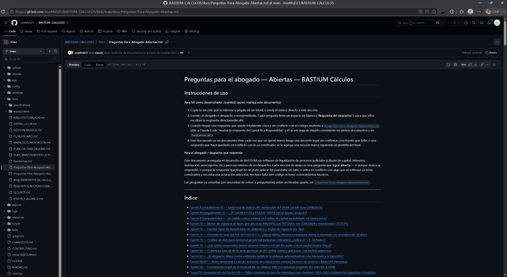
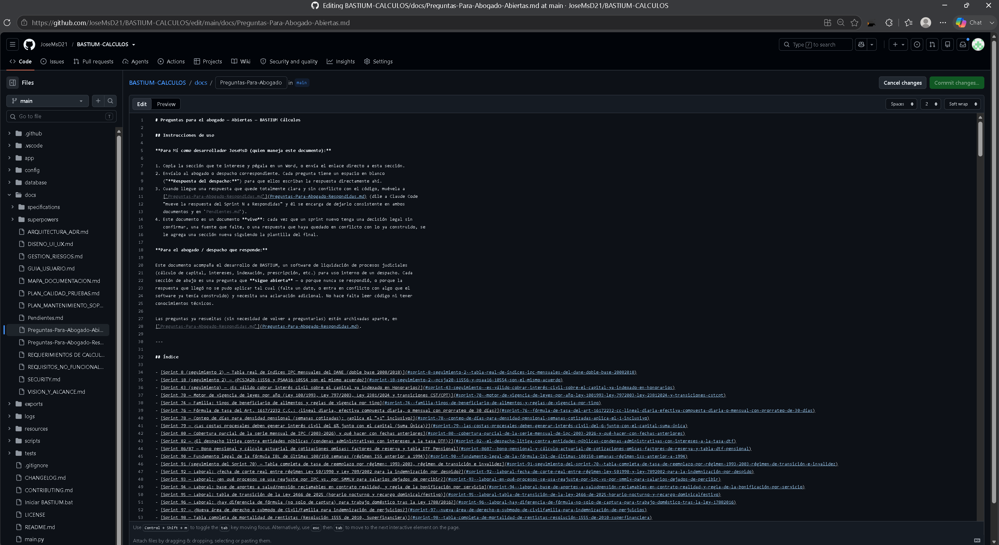

# Preguntas para el abogado — Abiertas — BASTIUM Cálculos

## Instrucciones de uso

**Para Mí como desarrollador JoseMsD (quien maneja este documento):**

1. Copia la sección que te interese y pégala en un Word, o envía el enlace directo a esta sección.
2. Envíalo al abogado o despacho correspondiente. Cada pregunta tiene un espacio en blanco
   ("**Respuesta del despacho:**") para que ellos escriban la respuesta directamente ahí.
3. Cuando llegue una respuesta que quede totalmente clara y sin conflicto con el código, muévela a
   [`Preguntas-Para-Abogado-Respondidas.md`](Preguntas-Para-Abogado-Respondidas.md) (dile a Claude Code
   "mueve la respuesta del Sprint N a Respondidas" y él se encarga de dejarlo consistente en ambos
   documentos y en `Pendientes.md`).
4. Este documento es un documento **vivo**: cada vez que un sprint nuevo tenga una decisión legal sin
   confirmar, una fuente que falte, o una respuesta que haya quedado en conflicto con lo ya construido, se
   le agrega una sección nueva siguiendo la plantilla del final.

**Para el abogado / despacho que responde:**

Este documento acompaña el desarrollo de BASTIUM, un software de liquidación de procesos judiciales
(cálculo de capital, intereses, indexación, prescripción, etc.) para uso interno de un despacho. Cada
sección de abajo es una pregunta que **sigue abierta** — o porque nunca se respondió, o porque la
respuesta que llegó no se pudo aplicar tal cual (falta un dato, o entra en conflicto con algo que el
software ya tenía construido) y necesita una aclaración adicional. No hace falta leer código ni tener
conocimientos técnicos.

Las preguntas ya resueltas (sin necesidad de volver a preguntarlas) están archivadas aparte, en
[`Preguntas-Para-Abogado-Respondidas.md`](Preguntas-Para-Abogado-Respondidas.md).

### Cómo guardar tu respuesta en GitHub (paso a paso)

Una vez hayas escrito tus respuestas directamente en este documento dentro de GitHub, sigue estos pasos
para guardarlas correctamente. Esto deja tu respuesta lista para que yo (JoseMsD) la revise y la apruebe
antes de que quede incorporada de forma definitiva — no se publica sola apenas la guardas.

1. **Abre el archivo en GitHub.** Entra al repositorio y ubica `docs/Preguntas-Para-Abogado-Abiertas.md`.
   Verás el documento en modo lectura, con las pestañas **Preview / Code / Blame** arriba del contenido.

   

2. **Haz clic en el ícono del lápiz (✏️)**, ubicado en la esquina superior derecha del visor de archivo
   (junto a los íconos de copiar/descargar). Al pasar el mouse por encima aparece el mensaje
   "**Edit this file**". Haz clic ahí para entrar al modo de edición.

   

3. **Escribe tu respuesta** en el espacio en blanco que dice "**Respuesta del despacho:**", justo debajo de
   cada pregunta que estés contestando. No borres ni modifiques las preguntas, encabezados o enlaces del
   resto del documento — agrega tu texto únicamente en el espacio indicado. Puedes usar la pestaña
   **Preview** (arriba del editor) para revisar cómo se ve tu respuesta antes de continuar.

   

4. **Cuando termines, haz clic en el botón verde "Commit changes..."** (arriba a la derecha del editor).
   Se abrirá una ventana emergente para confirmar el guardado.

5. **En el campo "Commit message"**, borra el texto que sugiere GitHub y escribe algo que identifique
   claramente qué respondiste, por ejemplo:
   `Respuestas Sprint 82 y 90 - [tu nombre o el del despacho]`
   En "Extended description" puedes agregar, opcionalmente, una nota breve como "Se respondieron 2
   preguntas pendientes."

6. **Muy importante — selecciona la segunda opción**, "**Create a new branch for this commit and start a
   pull request**" (en vez de "Commit directly to the main branch", que viene marcada por defecto). Esto
   es lo que permite que yo vea tu respuesta como una propuesta de cambio y la apruebe antes de que se una
   al documento oficial. Puedes dejar el nombre de rama que GitHub sugiere automáticamente.

   

7. **Haz clic en "Propose changes"** para confirmar. GitHub te llevará automáticamente a la pantalla de
   creación del Pull Request — ahí haz clic en "**Create pull request**" para enviarlo.

8. **Listo.** Recibiré una notificación del Pull Request y podré revisar exactamente qué agregaste
   (resaltado en verde frente al texto original). Si la respuesta queda clara y sin conflicto con el
   código, la apruebo y la fusiono ("merge") al documento oficial. Si necesito una aclaración adicional, te
   la pido ahí mismo como comentario dentro del mismo Pull Request.

---

## Índice

- [Sprint 8 (seguimiento 3) — Tabla real de IPC mensual anterior a enero de 2003](#sprint-8-seguimiento-3--tabla-real-de-ipc-mensual-anterior-a-enero-de-2003)
- [Sprint 18 (seguimiento 3) — Discrepancia numérica entre la tabla granular verificada (PSAA16-10554) y las "tarifas duras" que aportó el despacho](#sprint-18-seguimiento-3--discrepancia-numérica-entre-la-tabla-granular-verificada-psaa16-10554-y-las-tarifas-duras-que-aportó-el-despacho)
- [Sprint 70/91 (seguimiento) — Fechas exactas de vigencia por régimen, invalidez Grado 1, y "régimen de transición"](#sprint-7091-seguimiento--fechas-exactas-de-vigencia-por-régimen-invalidez-grado-1-y-régimen-de-transición)
- [Sprint 76 — Fórmula de tasa del Art. 1617/2232 C.C.: ¿lineal diaria, efectiva compuesta diaria, o mensual con prorrateo de 30 días?](#sprint-76--fórmula-de-tasa-del-art-16172232-cc-lineal-diaria-efectiva-compuesta-diaria-o-mensual-con-prorrateo-de-30-días)
- [Sprint 79 — ¿Las costas procesales deben generar interés civil del 6% junto con el capital (Suma Única)?](#sprint-79--las-costas-procesales-deben-generar-interés-civil-del-6-junto-con-el-capital-suma-única)
- [Sprint 82 (seguimiento) — ¿En qué área de BASTIUM vive el calculador de condenas administrativas (DTF)?](#sprint-82-seguimiento--en-qué-área-de-bastium-vive-el-calculador-de-condenas-administrativas-dtf)
- [Sprint 84 (seguimiento) — Imputación proporcional (Art. 804 E.T.) y tope suspensivo por demanda contenciosa](#sprint-84-seguimiento--imputación-proporcional-art-804-et-y-tope-suspensivo-por-demanda-contenciosa)
- [Sprint 85 — Retroactivo pensional: tasa de mora del Art. 141 Ley 100, y vigencia del incremento 14%/7%](#sprint-85--retroactivo-pensional-tasa-de-mora-del-art-141-ley-100-y-vigencia-del-incremento-147)
- [Sprint 86/87 (seguimiento) — Tabla actuarial completa (FAC1/FAC2), serie DTF Pensional, y cuál fórmula de FAC3 es la correcta](#sprint-8687-seguimiento--tabla-actuarial-completa-fac1fac2-serie-dtf-pensional-y-cuál-fórmula-de-fac3-es-la-correcta)
- [Sprint 89 (seguimiento) — ¿Renta Vitalicia (mesada mensual RAIS) o Retiro Programado/SPM? La Resolución 3023/2017 no parece cubrir lo que pedía el sprint original](#sprint-89-seguimiento--renta-vitalicia-mesada-mensual-rais-o-retiro-programadospm-la-resolución-30232017-no-parece-cubrir-lo-que-pedía-el-sprint-original)
- [Sprint 94 (seguimiento) — aporte a salud en contrato realidad, y si el Decreto 0320/2026 reemplaza la regla de bonificación por servicio de la plantilla L8](#sprint-94-seguimiento--aporte-a-salud-en-contrato-realidad-y-si-el-decreto-03202026-reemplaza-la-regla-de-bonificación-por-servicio-de-la-plantilla-l8)
- [Sprint 95 (seguimiento) — porcentajes de los 4 conceptos "Horas Extras..." (HED, HEN, HEFD, HEFN) tras la Ley 2466/2025](#sprint-95-seguimiento--porcentajes-de-los-4-conceptos-horas-extras-hed-hen-hefd-hefn-tras-la-ley-24662025)
- [Sprint 96 (seguimiento) — auxilio de transporte pactado por día en trabajo doméstico](#sprint-96-seguimiento--auxilio-de-transporte-pactado-por-día-en-trabajo-doméstico)
- [Sprint 97 (seguimiento) — decisión de arquitectura pendiente: ¿séptima área de derecho o submodo de Civil/Familia?, ¿cuáles variantes usa el despacho?, y tabla de mortalidad completa (hombres/mujeres inválidos)](#sprint-97-seguimiento--decisión-de-arquitectura-pendiente-séptima-área-de-derecho-o-submodo-de-civilfamilia-cuáles-variantes-usa-el-despacho-y-tabla-de-mortalidad-completa-hombresmujeres-inválidos)
- [Sprint 104 (seguimiento) — cablear la liquidación tramo por tramo a AreaStrategy, y aclarar su relación con la tasa de interés de Suma Única (Sprint 76/83)](#sprint-104-seguimiento--cablear-la-liquidación-tramo-por-tramo-a-areastrategy-y-aclarar-su-relación-con-la-tasa-de-interés-de-suma-única-sprint-7683)
- [Sprint 105 — Catálogo de tipos de proceso, subtipos de caso y obligaciones predefinidas para el intake de un expediente](#sprint-105--catálogo-de-tipos-de-proceso-subtipos-de-caso-y-obligaciones-predefinidas-para-el-intake-de-un-expediente)
- [Sprint 106 — Widget del campo de fechas anuales fijas, y modelo de datos para el año/fecha de vigencia del acta o título](#sprint-106--widget-del-campo-de-fechas-anuales-fijas-y-modelo-de-datos-para-el-añofecha-de-vigencia-del-acta-o-título)
- [Sprint 107 — ¿Mover el checkbox de indexación IPC/interés sobre capital indexado a después de proyectar la liquidación, o agregar un control posterior de solo presentación?](#sprint-107--mover-el-checkbox-de-indexación-ipcinterés-sobre-capital-indexado-a-después-de-proyectar-la-liquidación-o-agregar-un-control-posterior-de-solo-presentación)
- [Sprint 110 — ¿Extrapolar la tasa de usura del último tramo certificado, o topar el cálculo de interés al último dato disponible?](#sprint-110--extrapolar-la-tasa-de-usura-del-último-tramo-certificado-o-topar-el-cálculo-de-interés-al-último-dato-disponible)
- [Plantilla para sprints futuros](#plantilla-para-sprints-futuros)

---

## Sprint 8 (seguimiento 3) — Tabla real de IPC mensual anterior a enero de 2003

**Contexto:** el despacho ya respondió la pregunta de seguimiento 2 (ver
`Preguntas-Para-Abogado-Respondidas.md`, Sprint 8) con las fórmulas de "Límite de Vacío Absoluto" (fechas
anteriores al 01/08/1954 → índice 1.000000) y "Estimación Futura" (media geométrica de los últimos 12
meses para fechas posteriores al último mes certificado) — ambas ya implementadas y probadas. La
respuesta también afirma que la serie bajo la base Diciembre 2008 = 100 "tiene continuidad ininterrumpida
desde décadas anteriores a 2003" y que "no existe un vacío real en los datos mensuales". Sin embargo, el
único archivo con datos reales de IPC mensual accesible para el desarrollo (`ipc_mensual_dane_2003_2026.csv`
en `docs/datos_publicos_fuente/`, extraído programáticamente del Excel que aportó el despacho) solo cubre
enero de 2003 en adelante, base Diciembre 2018 = 100. Para fechas anteriores a 2003 (y, en particular,
para el tramo 1954-08 a 1966, donde tampoco hay variación anual cargada en `_IPC_VARIACION_ANUAL`), el
software sigue sin ningún índice mensual real, y la interpolación anual (que cubre 1967-2025) tampoco
llega hasta 1954.

**Pregunta:** ¿puede el despacho aportar la tabla real de índices IPC mensuales (base Diciembre 2008 = 100,
o cualquier base con su factor de enlace) para el período 01/08/1954 a diciembre de 2002 — el mismo tipo
de archivo (Excel/CSV) que ya aportaron para 2003-2026?

**Qué necesito exactamente:** igual que con la serie 2003-2026, un archivo con un valor de índice por mes
(no variación %), cubriendo desde agosto de 1954 (o el año más antiguo disponible) hasta diciembre de
2002. Si la fuente exacta que menciona el despacho no está en un archivo descargable, sirve la referencia
(nombre de la publicación DANE, o el enlace) para extraerla directamente.

**Respuesta del despacho:** Sólo se cuenta con el histórico del IPC desde 2003.

**Fecha:** 16/11/2026

---

## Sprint 18 (seguimiento 3) — Discrepancia numérica entre la tabla granular verificada (PSAA16-10554) y las "tarifas duras" que aportó el despacho

**Contexto:** la pregunta de seguimiento 2 (¿PCSJA20-11556 y PSAA16-10554 son el mismo acuerdo?) ya se
contestó (22/08/2026, ver `Preguntas-Para-Abogado-Respondidas.md`, Sprint 18): el despacho confirmó que
"el marco tarifario unificado obligatorio se rige por el Acuerdo PSAA16-10554" — coincide exactamente con
lo ya implementado y verificado contra la fuente oficial (ramajudicial.gov.co), así que no hubo que tocar
código por ese punto. La misma respuesta también confirmó, sin ambigüedad, que las agencias en derecho se
tasan con "ponderación inversa: a mayor valor, menor porcentaje, respetando los topes" — exactamente la
aproximación que ya usa `_interpolar_dentro_de_rango` (`app/engine/costs/agencias_en_derecho.py`), citando
el mismo fundamento (Parágrafo 3, Art. 3 del Acuerdo). Ninguno de esos dos puntos requiere cambio de
código.

La respuesta agregó además, bajo el encabezado "Qué podría hacerse", una tabla de "tarifas duras" para 3
categorías (Procesos Declarativos, Procesos Ejecutivos, Sucesiones y Liquidaciones) con rangos min/max que
**no coinciden** con los ya transcritos en `TARIFAS_AGENCIAS_EN_DERECHO` desde el texto oficial del Acuerdo
(ej. la respuesta da "Procesos Declarativos, Primera Instancia, Mayor Cuantía: 0.03-0.075", un rango
distinto al que trae la tabla granular actual para esa misma categoría). Como la tabla granular actual fue
verificada independientemente contra la fuente oficial del acuerdo, y como el propio despacho ya se
equivocó una vez citando un número de acuerdo inexistente ("PCSJA20-11556", Sprint 18 original) y ahora
enmarca esta tabla como una sugerencia tentativa ("por ahora se sabe", "qué **podría** hacerse", no una
instrucción categórica de reemplazo), esta rutina NO sobrescribió la tabla ya verificada con estos números
nuevos — el riesgo de introducir una cifra legal incorrecta sin una fuente primaria que la respalde es
mayor que el de dejar la pregunta abierta.

**Pregunta:** ¿la tabla de "tarifas duras" de la respuesta del 22/08/2026 debe **reemplazar** la tabla
granular ya implementada (transcrita y verificada contra el texto oficial del Acuerdo PSAA16-10554 en
ramajudicial.gov.co), o es una aproximación/resumen que no debe usarse tal cual? Si debe reemplazarla,
¿pueden confirmar la fuente exacta de esos números (para volver a verificarlos contra el texto oficial
antes de tocar el motor de cálculo)?

**Qué necesito exactamente:** un sí/no sobre si se reemplaza la tabla granular actual, y si es sí, el
artículo/página exacto del Acuerdo (o la fuente que corresponda) de donde salen esos rangos, para
verificarlos igual que se hizo con la tabla que ya está implementada.

**Respuesta del despacho:** No, la tabla de "tarifas duras" NO debe reemplazar la tabla granular oficial. La tabla granular del Acuerdo PCSJA20-11556 (que actualizó al PSAA16-10554) es el motor maestro obligatorio (Art. 366, num. 4, CGP). El rango sugerido (ej. 3% a 7.5%) corresponde exclusivamente al Artículo 2, numeral 1 para "Procesos Declarativos Verbales en Primera Instancia con pretensiones pecuniarias de Mayor Cuantía". El software debe usar la tabla granular como base y, si se permite un override manual, emitir una alerta de validación si se sale de los rangos del Acuerdo.

**Fecha:** 16/11/2026

---

## Sprint 70/91 (seguimiento) — Fechas exactas de vigencia por régimen, invalidez Grado 1, y "régimen de transición"

**Contexto:** la respuesta del despacho del 22/08/2026 (ver `Preguntas-Para-Abogado-Respondidas.md`,
"Sprint 70/91") confirmó 4 fórmulas de tasa de reemplazo pensional que ya se implementaron y probaron como
funciones aisladas en `app/engine/labor/ibl.py` (régimen 1985-1989, ISS Pre-Ley 100/Acuerdo 049-1990, Ley
100 original 1994-2003, e invalidez grado 2). Quedaron 3 puntos sin resolver que esta rutina no adivinó:

1. **Fechas exactas de vigencia de cada régimen** — la respuesta pidió un patrón "Factory" que enrute el
   cálculo por fecha de los hechos, pero no dio el día exacto en que empieza/termina cada régimen (solo
   rangos aproximados como "1985-1989" o "Pre-Ley 100"). Sin esa fecha exacta, no se construyó el router:
   enrutar una liquidación real a un régimen equivocado por una fecha de corte mal supuesta sería un error
   de dominio grave.
2. **Invalidez Grado 1** — esta respuesta da un tope de 60%, pero una fuente anterior (plantilla comercial
   P9 del despacho, con cifras concretas verificadas: 500 semanas→45,0%, ...,1500 semanas→75,0%, Sprint 91)
   ya había confirmado un tope de 75% para el mismo grado. No se implementó ninguna función para Grado 1
   mientras esta discrepancia no se resuelva.
3. **"Régimen de transición"** (Art. 36 Ley 100 de 1993, tasa fija "75%/90%/la que corresponda") — la
   pregunta original del Sprint 91 lo pedía por ese nombre; la respuesta del 22/08 no lo menciona
   explícitamente. No está claro si "Régimen 1985-1989" es la respuesta a esto, o si sigue sin contestar.

**Pregunta:** (1) ¿cuál es la fecha exacta de entrada en vigencia y de cese de cada régimen (1985-1989, ISS
Pre-Ley 100/Acuerdo 049 de 1990, Ley 100 original, Ley 797/2003)? (2) Para invalidez Grado 1, ¿el tope
correcto es 60% (esta respuesta) o 75% (la plantilla P9)? (3) ¿El "régimen de transición" del Art. 36 Ley
100/1993 (con sus reglas propias de quién puede acogerse) es un régimen aparte de los ya confirmados, o se
resuelve con la tabla de "Régimen 1985-1989"/"ISS Pre-Ley 100" ya dada?

**Qué necesito exactamente:** una tabla de régimen → fecha desde → fecha hasta (o "vigente"), la
confirmación del tope de invalidez Grado 1, y la aclaración sobre el régimen de transición.

**Respuesta del despacho:** Fechas exactas:
Ley 33 de 1985: 13 de febrero de 1985.
Ley 71 de 1988: 28 de enero de 1989.
Acuerdo 049 de 1990 (Dec. 758/1990): 18 de abril de 1990.
Ley 100 de 1993: 1° de abril de 1994 (sector privado/nacional), hasta el 30 de junio de 1995 (orden territorial).
Ley 797 de 2003: 29 de enero de 2003.
Invalidez Grado 1: El tope correcto es el 60% del IBL (45% base por 500 semanas + 1.5% por cada 50 semanas adicionales, alcanzando el tope a las 1.000 semanas). El 75% corresponde a la Invalidez Grado 2.
Régimen de transición (Art. 36 Ley 100/1993): NO es un régimen aparte. Es un mecanismo de remisión normativa que solo preserva tres elementos del régimen anterior: Edad, Tiempo/Semanas y Monto (Tasa de Reemplazo). Todas las demás condiciones (reglas de IBL, prescripción, intereses, topes) se rigen por las normas generales de la Ley 100 de 1993 y el Acto Legislativo 01 de 2005.

**Fecha:** 16/11/2026

---

## Sprint 76 — Fórmula de tasa del Art. 1617/2232 C.C.: ¿lineal diaria, efectiva compuesta diaria, o mensual con prorrateo de 30 días?

**Contexto (explicado desde cero, para quien no haya visto el código):**

El Artículo 1617 del Código Civil dice que, cuando un contrato no pactó una tasa de interés, se debe el
**6% anual**. El software necesita liquidar día por día (para saber exactamente cuánto interés se debe
en cualquier fecha, no solo al cierre de cada año), así que ese 6% anual tiene que convertirse primero en
una **tasa diaria equivalente**. El problema es que existen dos formas matemáticas distintas — y
legalmente distintas — de hacer esa conversión, y dan números diferentes.

**Opción A — Lineal (o "nominal"), la fórmula que trae el documento de requisitos:**

Es la división simple: `tasa_diaria = 6% ÷ 365 = 0,016438...%` por día (el documento
`REQUERIMIENTOS DE CALCULO Y REGLAS LOGICAS - BASTIUM.pdf` la redondea a `0,0164`). La idea detrás de esta
fórmula es que el 6% anual se "reparte" en partes iguales entre los 365 días del año — ningún día genera
más ni menos que los demás, y el interés de cada día se calcula siempre sobre el mismo porcentaje fijo.

**Opción B — Efectiva compuesta, la que usa BASTIUM hoy:**

`tasa_diaria = (1 + 6%)^(1/365) − 1 = 0,015965...%` por día — un poquito más baja que la Opción A. La idea
detrás de esta fórmula es distinta: en el mundo financiero/bancario colombiano, cuando una tasa se certifica
como "efectiva anual" (EA — así se certifican, por ejemplo, las tasas de usura de la Superfinanciera), se
asume que el interés se reinvierte (se capitaliza) cada día, y esta fórmula calcula la única tasa diaria
que, capitalizada 365 veces seguidas, reproduce exactamente ese 6% al cabo del año — ni un peso más, ni un
peso menos. Es la fórmula estándar para convertir una tasa "efectiva" (EA) a un plazo más corto.

**La tensión que hay que resolver:** el Art. 1617 nunca dice que el 6% sea una tasa "efectiva anual" en el
sentido técnico-financiero (con capitalización); podría leerse simplemente como "6% al año, repartido en
partes iguales" — que es la Opción A. Además, BASTIUM **no capitaliza** el interés día a día (el interés se
guarda aparte, nunca se le suma al capital para que genere más interés sobre sí mismo, salvo que exista
anatocismo pactado en Comercial) — así que usar hoy una tasa "diseñada para capitalizar" pero sin
capitalizar en la práctica es, como mínimo, una inconsistencia que vale la pena que el despacho confirme o
corrija.

**Ejemplo numérico simple, para entender la diferencia:** $10.000.000 de capital, 30 días, al 6% anual:

| Fórmula | Tasa diaria | Interés de 30 días |
|---|---|---|
| A — Lineal (6% ÷ 365) | 0,016438% | **$49.315,20** |
| B — Efectiva compuesta (fórmula actual de BASTIUM) | 0,015965% | **$47.896,20** |

Diferencia: **$1.419,00** (la Opción A da 2,96% más interés que la Opción B) sobre apenas 30 días y un
capital de $10 millones. La diferencia crece con el capital y con el tiempo transcurrido.

**Ejemplo con un caso real capturado en el software (Radicado 2224, prueba práctica del usuario, comparado
contra un Excel real del despacho):** cuota de $300.000/mes desde noviembre de 2023, reajustada cada 1° de
enero según el SMMLV (Sprint 41), sin indexación IPC, liquidada hasta el 31 de agosto de 2025 (~22 meses):

| | Excel del despacho | BASTIUM con la fórmula actual (B) | BASTIUM si usara la fórmula lineal (A) |
|---|---|---|---|
| Intereses | $423.063,74 | $410.700,80 | **$422.866,16** |
| Gran Total | **$7.999.230,14** | $7.990.356,08 | **$8.002.521,44** |
| Diferencia vs. el Excel | — | 0,11% por debajo | **0,04% por encima** |

Con la fórmula lineal (Opción A), BASTIUM queda casi 3 veces más cerca del resultado del Excel del despacho
que con la fórmula que usa hoy. El 0,04% que todavía quedaría de diferencia ya no sería por la tasa —
vendría de que el Excel del despacho aproxima el interés mes a mes con un 0,50% fijo (en vez de contar los
días exactos de cada mes) y redondea el porcentaje de reajuste del SMMLV (12,00%/9,53% en vez del dato
exacto 12,07%/9,50%).

**Actualización (2026-08-19, Sprint 83) — aparece una tercera opción, y es la que usa el propio despacho:**
al revisar la plantilla comercial que el despacho usa para este mismo interés civil del 6% (Art. 2232 C.C.,
gemelo del Art. 1617), `i7.INTERESES-CIVILES-6-ANUAL.xlsm` de Ediciones Sistematizadas Equidad, encontramos
que su fórmula real no es la A ni la B de arriba:

**Opción C — Tasa mensual nominal con prorrateo de 30 días, la que usa la plantilla del despacho:**

`tasa_mensual = [(1+6%)^(1/12) − 1] × 12 = 0,4867%` mensual, y el interés de cada período se calcula como
`capital × tasa_mensual × (días_del_período / 30)` — es decir, convierte el 6% EA a una tasa **mensual**
(no diaria) usando la fórmula compuesta, pero luego reparte esa tasa mensual **linealmente** entre los días
del mes, siempre sobre una base de 30 días fijos (no 28/29/30/31 reales). Verificado numéricamente contra
la propia tabla de ejemplo de la plantilla: capital $5.000.000, interés de junio/2025 (30 días) =
$24.500,00, interés de julio/2025 (31 días) = $24.500 × 31/30 = $25.316,67 — cifras que solo cuadran con
esta fórmula, no con la A ni con la B.

**Pregunta:** para el interés civil del Art. 1617/2232 C.C. (y, si aplica también a otras tasas pactadas por
las partes en Civil/Familia y Comercial, siempre que no se haya pactado capitalización/anatocismo), ¿la
conversión de la tasa anual debe hacerse con la fórmula **lineal diaria** (Opción A, `tasa_anual ÷ 365`, la
que trae el documento de requisitos), la **efectiva compuesta diaria** (Opción B, `(1+tasa_anual)^(1/365) −
1`, la que usa el software hoy), o la **mensual nominal con prorrateo de 30 días** (Opción C,
`[(1+tasa_anual)^(1/12)−1]×12` repartida entre `días/30`, la que usa la propia plantilla comercial del
despacho)? Y, relacionado: cuando el interés diario calculado NO se reinvierte en el capital (comportamiento
por defecto del software, sin anatocismo), ¿tiene sentido jurídico seguir usando una tasa derivada asumiendo
capitalización, o debería usarse siempre la lineal en ese caso?

**Qué necesito exactamente:** confirmación de cuál de las tres fórmulas (A, B o C) debe usar el software
para el interés del Art. 1617/2232 y para las tasas pactadas sin capitalización explícita — y, si la
respuesta es "depende" (ej. depende de si la tasa fue certificada como "efectiva anual" en el título
ejecutivo o no), una regla clara de cuándo aplica cada una. Ver también Sprint 83 en `Pendientes.md` para
el detalle técnico completo de la Opción C.

**Dónde vive esto en el código (para referencia del desarrollo, no hace falta leerlo para responder):**
`app/engine/interest/rate_conversion.py`, clase `EffectiveRateConverter`, método `annual_to_daily` —
implementa hoy la Opción B. Cambiarla afecta a las 6 áreas del derecho (todas pasan por el mismo motor),
no solo Civil/Familia.

**Respuesta del despacho:**
En obligaciones de dinero puro y litigios comerciales simples, el cobro del 6% se hace con la fórmula lineal de interés simple sin anatocismo. Aunque en la tasación de perjuicios y daño emergente/lucro cesante, las Altas Cortes exigen la tasa técnica mensual equivalente derivada de la E.A. Depende de la naturaleza de la obligación, resolviendo la contradicción así:
Obligación Civil de Crédito Ordinario (Simple): Debe usarse la Opción A (Fórmula Lineal Simple: 0.06 / 365). Usar fórmulas compuestas (Opción C) en deuda civil pura viola la prohibición de anatocismo de los Arts. 1617 y 2235 del C.C.
Liquidación de Perjuicios (Daño emergente/Lucro cesante en sentencias declarativas): Debe usarse la tasa pura actuarial mensual (0.0048676), conforme a la doctrina de la Sala de Casación Civil de la CSJ para fórmulas de descuento a valor presente. Podría estudiarse si se deja lineal simple para ejecución de títulos civiles y una tasa pura actuarial mensual (0.0048676) para cuantificación de perjuicios.

Qué podría hacerse?
El sistema puede tener un conmutador (flag en UI):

Si es Obligación Civil de Crédito Ordinario (Simple): tasa_diaria = 0.06 / 365

Si es Liquidación de Perjuicios / Valor (Fórmula de Cortes): tasa_mensual_pura = 0.0048676
El tiempo se puede convertir todo a meses comerciales: n = (Años * 12) + Meses + (Dias_Restantes / 30).
Fórmula de liquidación: Capital * (1 + 0.0048676)^n.

CONCRETAMENTE:
# OPCIÓN A: OBLIGACIÓN CIVIL DE CRÉDITO COMÚN (Interés Lineal / Simple)
# Se usa división simple de la tasa anual. No hay capitalización.
tasa_diaria_simple = 0.06 / 365.0
Intereses = Capital * tasa_diaria_simple * Dias_Mora_Reales

# OPCIÓN B: LIQUIDACIÓN DE PERJUICIOS JUDICIALES (Fórmula de las Cortes)
# Exige convertir el tiempo a meses comerciales exactos y usar tasa efectiva.
tasa_mensual_pura = 0.0048676  # Constante matemática inmutable (0.48676% expresado en decimal)

# Cálculo de la variable n (tiempo en meses)
n_meses = (Anios_Transcurridos * 12) + Meses_Enteros_Transcurridos + (Dias_Sobrantes / 30.0)

# Aplicación sobre el capital
Capital_Actualizado = Capital_Historico * (IPC_Final / IPC_Inicial)
Gran_Total = Capital_Actualizado * ((1.0 + tasa_mensual_pura) ** n_meses)

**Fecha:**
22/08/2026

**Bloqueado, pendiente del USUARIO (no del despacho) — 2026-08-23:** esta respuesta ya resuelve la pregunta
legal (qué fórmula usar según el tipo de obligación), pero la implementación que propone (un "conmutador"
que bifurca el motor central de tasas — usado por las 6 áreas — entre esta fórmula y la lineal, con un
régimen de conteo de tiempo nuevo de "meses comerciales") es demasiado grande y de demasiado impacto
retroactivo para que la rutina autónoma la ejecute sola. Ver `Pendientes.md`, Sprint 76, sección "Bloqueo
no previsto" para el detalle completo de por qué se detuvo, y qué necesita confirmar el usuario antes de
que se pueda programar (el mapeo exacto de "crédito ordinario simple" vs. "liquidación de perjuicios" a
los datos que ya captura BASTIUM, y si aplica con o sin recálculo retroactivo de liquidaciones existentes).

**Decisión del usuario (2026-08-25):** (1) el riesgo retroactivo queda descartado — se verificó el único
expediente real en la base de datos local (Radicado 2224, 10 liquidaciones del 13-14/08/2026) y el usuario
confirmó que fue exclusivamente para probar el software contra el Excel del despacho, nunca se entregó a un
cliente ni se presentó ante el juzgado 521; no aplica ningún protocolo de recálculo histórico (Sprint 47).
(2) El usuario pide volver a preguntarle al despacho señalando la contradicción exacta, en vez de elegir
entre A y C a ciegas.

**Pregunta de seguimiento:** para el interés civil ordinario del 6% (Art. 1617/2232 C.C., "obligación de
dinero puro" — el caso de uso mayoritario hoy en Civil/Familia, Comercial y Honorarios, ya que el dominio de
"liquidación de perjuicios" que menciona esta misma respuesta todavía no existe en BASTIUM, ver Sprint 97),
la respuesta escrita del 22/08/2026 confirma la fórmula **lineal simple** (Opción A, `6%/365`). Pero al
revisar `i7.INTERESES-CIVILES-6-ANUAL.xlsm` — la propia plantilla comercial del despacho para este mismo
interés — encontramos que esa plantilla usa una fórmula distinta (Opción C, mensual nominal con prorrateo de
30 días, verificada cifra por cifra contra su propio ejemplo: $24.500,00 en junio/30 días, $25.316,67 =
$24.500×31/30 en julio/31 días). ¿Cuál de las dos deben usar las obligaciones de dinero puro: la que
confirmaron por escrito (A), o la que su propia plantilla demuestra en la práctica (C)? Necesitamos que
resuelvan esta contradicción explícitamente antes de tocar el motor central de tasas, que afecta a las 6
áreas.

---

## Sprint 79 — ¿Las costas procesales deben generar interés civil del 6% junto con el capital (Suma Única)?

**Contexto:** cuando una obligación tiene marcado "Interés sobre capital ya indexado" (algoritmo Suma
Única, disponible en Civil/Familia y ahora también en Comercial y Honorarios) y además tiene costas
procesales, el software hoy suma las costas al mismo monto de capital que genera el interés civil del 6%
anual — es decir, las costas también generan ese interés, no solo el capital original de la obligación.

**Pregunta:** ¿es correcto que las costas procesales generen interés junto con el capital bajo este
algoritmo, o las costas deberían sumarse al final del cálculo sin generar interés adicional?

**Qué necesito exactamente:** un sí/no sobre si las costas deben incluirse en la base que genera interés
bajo Suma Única.

**Respuesta del despacho:**
Las costas procesales como expensas y agencias en derecho son una sanción de moralización, no son un capital de crédito. Es decir, las costas procesales NO generan intereses.

Qué se debe hacer:
Un SÍ a que la regla es general: aplica en cualquier área del derecho y algoritmo. Las costas se suman "en seco" al final: Gran_Total = Capital_Indexado + Intereses_Mora + Costas_Aprobadas.
Prelación de pagos (imputación): 1°) Costas procesales aprobadas y gastos de cobro; 2°) Intereses moratorios causados; 3°) Indexación/Reajuste de capital; 4°) Capital principal (Arts. 1629, 1653, 2495 C.C. y 446 CGP). Las costas procesales NO deben incluirse en la base que genera el interés civil del 6% bajo el algoritmo de Suma Única. Se suman al final, en seco: Gran_Total = Capital_Indexado + Intereses_Mora_Calculados + Costas_Aprobadas.

En síntesis:
# 1. HONORARIOS (Interés civil sobre capital indexado)
Capital_Indexado = Capital_Original * (IPC_Final / IPC_Inicial)

# El interés se calcula usando el Capital_Indexado como base
Interes_Mora = Calcular_Interes_Civil(Base=Capital_Indexado, Tasa_Anual=0.06)

# 2. COSTAS PROCESALES (Suma plana al final, NUNCA generan intereses)
Gran_Total_Liquidacion = Capital_Indexado + Interes_Mora + Costas_Aprobadas

**Fecha:**
22/08/2026

**Bloqueado, pendiente del USUARIO (no del despacho) — 2026-08-23:** esta respuesta ya resuelve la pregunta
legal, pero implementarla exige tocar el modelo central de deuda (`PendingDebt`, 3 componentes hoy:
principal/interés/indexación) para agregar costas como un 4° componente que nunca genera interés — y la
respuesta no dice en qué posición de la prelación de pago (imputación) entra costas frente a
indexación/intereses/capital, una decisión que ninguna respuesta anterior (tampoco el Sprint 18) cubrió.
Además, la propia fórmula de síntesis sugiere que el alcance real es más amplio que "solo bajo Suma
Única" (el código de hoy ya genera interés sobre costas incluso SIN Suma Única, porque están mezcladas con
`principal`). Ver `Pendientes.md`, Sprint 79, sección "Bloqueo no previsto" para el detalle completo y lo
que necesita confirmar el usuario.

**Decisión del usuario (2026-08-25):** prefiere que ambos puntos se le devuelvan al despacho en vez de
decidirlos sin ellos.

**Pregunta de seguimiento:** (a) ¿la regla "las costas nunca generan interés civil" es general — aplica en
cualquier área y con cualquier algoritmo de liquidación — o es específica del algoritmo "Suma Única" (interés
sobre capital ya indexado)? Hoy el motor de BASTIUM genera interés sobre las costas **siempre**, con o sin
Suma Única activa, porque comparten el mismo componente de capital — necesitamos saber si eso también hay
que corregirlo en el caso general. (b) Cuando se hace un abono/pago parcial, ¿en qué posición de la
prelación de pago entran las costas frente a la indexación, los intereses y el capital — se pagan de
últimas (después de indexación → intereses → capital), de primeras, o en otra posición?

---

## Sprint 82 (seguimiento) — ¿En qué área de BASTIUM vive el calculador de condenas administrativas (DTF)?

**Contexto:** la respuesta del despacho (22/08/2026, ver `Preguntas-Para-Abogado-Respondidas.md`, Sprint
82) dio la fórmula completa del interés de mora en condenas contra el Estado (Art. 195 núm. 4 Ley
1437/2011, régimen dual DTF/1,5x IBC), ya implementada y probada como función aislada
(`app/engine/interest/condena_administrativa_dtf.py`). Pero la pregunta original — la que en realidad
bloqueaba conectar esta fórmula a una liquidación real — nunca se contestó: ¿el despacho maneja casos de
litigio contra entidades públicas, y si es así, en cuál de las 6 áreas actuales de BASTIUM (Civil/Familia,
Comercial, Laboral, Sancionatorio, Honorarios, Tributario) deberían vivir, o hace falta un área/flujo
nuevo?

**Pregunta:** ¿pueden confirmar (1) si el despacho realmente tiene o espera tener casos de este tipo, y (2)
en qué área de BASTIUM debería aparecer el formulario/cálculo (o si se necesita una séptima área nueva)?

**Qué necesito exactamente:** un sí/no sobre si es relevante para el despacho, y la asignación de área para
poder conectar la fórmula (ya lista) a una pantalla y a una liquidación real.

**Respuesta del despacho:** Sí, a futuro mediano se espera tener este tipo de casos, por ello la maxima prioridad es desarrollar primero los cálculos en derecho de familia, civil y laboral, este tipo de casos de derecho administrativo pueden venir paulatinamente a la firma. Sí, es relevante para litigio contra entidades públicas. Debe residir en un módulo independiente y aislado (ej. una 7ª área o submódulo específico de "Condenas Estado CPACA"). No puede mezclarse con el motor civil/comercial/tributario porque posee un régimen dual único (10 meses a tasa DTF, luego 1.5x IBC) y una causal de cese de intereses a los 3 meses por inactividad del acreedor (Art. 192.4 CPACA), lo que rompería la lógica de los otros motores.

**Fecha:** 16/11/2026

---

## Sprint 84 (seguimiento) — Imputación proporcional (Art. 804 E.T.) y tope suspensivo por demanda contenciosa

**Contexto:** la respuesta del despacho a la pregunta original del Sprint 84 (¿366 días lineal o 365
compuesto para el interés moratorio tributario?) ya se implementó — ver
`Preguntas-Para-Abogado-Respondidas.md`, Sprint 84. La misma respuesta trajo además dos reglas que van más
allá de esa pregunta y quedaron sin implementar:

1. **Imputación proporcional (Art. 804 E.T.):** cuando hay un abono, en vez de la regla civil (intereses
   primero, luego capital), el abono se reparte proporcionalmente entre capital/sanción/interés según el
   peso de cada uno en la deuda total. Hoy `calcular_interes_moratorio_tributario` no maneja abonos en
   absoluto ("Capital fijo, sin abonos ni imputación de pagos -- eso es Sprint 11b", según su propio
   docstring) — implementar esto requiere construir esa imputación desde cero, con su propio diseño.
2. **Tope suspensivo:** a los 24 meses de admitida una demanda contenciosa, el interés deja de causarse
   hasta 11 días después de la sentencia. Esto necesita datos que el modelo de `Obligacion` no captura hoy
   (fecha de admisión de la demanda, fecha de la sentencia).

**Pregunta:** ¿estas dos reglas aplican de forma general a toda obligación Tributaria, o solo a un
escenario específico (ej. solo cuando ya existe un proceso contencioso administrativo en curso)? ¿Qué
campos nuevos necesitaría capturar el formulario de Obligación Tributaria para poder calcularlas (fecha de
admisión de demanda, fecha de sentencia, u otros)?

**Qué necesito exactamente:** confirmación de si estas reglas son prioritarias para el despacho ahora
mismo, y si es así, los campos exactos que hacen falta capturar para implementarlas correctamente.

**Respuesta del despacho:** Ambas reglas aplican de forma general a toda obligación tributaria. La imputación proporcional es imperativa (no se imputa primero a intereses como en lo civil). Campos nuevos obligatorios en el formulario: fecha_admision_demanda, fecha_tope_24m (calculado: admisión + 24 meses), fecha_notificacion_sentencia y fecha_reanudacion_interes (calculado: notificación + 11 días).

**Fecha:** 16/11/2026

---

## Sprint 85 — Retroactivo pensional: tasa de mora del Art. 141 Ley 100, y vigencia del incremento 14%/7%

**Contexto:** el retroactivo y reliquidación pensional (mesada por mesada, con incrementos e intereses de
mora) es la funcionalidad más solicitada de las 16 plantillas de referencia del despacho (4 de 16 la
necesitan). Dos piezas de esta funcionalidad requieren confirmación legal antes de poder programarse — el
recálculo mesada a mesada contra el SMLMV histórico y la indexación IPC de cada mesada (Art. 21 Ley 100) no
dependen de ninguna de las dos preguntas de abajo y se documentan aparte como la pieza aislable de este
sprint.

**Pregunta 1 — tasa del interés de mora (Art. 141 Ley 100):** el Art. 141 de la Ley 100 de 1993 dice que, en
caso de mora en el pago de mesadas pensionales, la entidad debe reconocer "la tasa máxima de interés
moratorio vigente en el momento en que se efectúe el pago". BASTIUM ya calcula un tope de usura vigente por
fecha (`calcular_tope_usura`, `app/engine/interest/usury_validator.py`, usado para el techo del Art. 867-1
E.T., Sprint 15). ¿Es esa la misma tasa que exige el Art. 141 Ley 100, o es una tasa distinta (por ejemplo,
el interés bancario corriente puro, sin el multiplicador de usura)?

**Pregunta 2 — vigencia del incremento 14%/7%:** la plantilla `P1A.RETROACTIVO-PENSIONAL-SALARIO-MINIMO-INDEXADO-O-INCREMENTO-PENSIONAL-DEL-14-o-7.md`
trae un incremento pensional del 14% (cónyuge) o 7% (hijo) sobre la mesada, citando las sentencias SU-140-19
y SL-2334-19 como referencia de vigencia — pero la propia plantilla marca esa vigencia como dudosa, sin
confirmarla. ¿Sigue vigente hoy ese incremento, o ya no aplica?

**Qué necesito exactamente:** (1) confirmación de si el interés de mora del Art. 141 es la misma tasa de
usura que ya calcula BASTIUM, o el fundamento y la tabla de la tasa correcta si es distinta; (2) un sí/no
sobre la vigencia actual del incremento 14%/7%, con la norma/sentencia que lo respalde si sigue vigente.

**Respuesta del despacho:** 1. Tasa de mora: Es la tasa máxima de interés moratorio vigente (tasa de usura) certificada por la Superfinanciera. Excepción: Si la entidad prueba buena fe estricta o cambio jurisprudencial, solo aplica la indexación por IPC, sin intereses de usura.
2. Incremento 14%/7%: NO sigue vigente. La Corte Constitucional (SU-140 de 2019) determinó que no aplican para pensiones causadas con posterioridad a la Ley 100 de 1993 o al Acto Legislativo 01 de 2005.

**Fecha:** 16/11/2026

---

## Sprint 86/87 (seguimiento) — Tabla actuarial completa (FAC1/FAC2), serie DTF Pensional, y cuál fórmula de FAC3 es la correcta

**Contexto:** la respuesta del despacho del 22/08/2026 (ver `Preguntas-Para-Abogado-Respondidas.md`, Sprint
86/87) dio la estructura de la fórmula de reserva actuarial y la regla de Auxilio Funerario, pero no lo que
realmente pedía la pregunta original:

1. **FAC1/FAC2**: solo se dio UN punto de la Tabla 2 (hombres, 55 años: FAC1=258.712212, FAC2=0.369543) —
   se necesita la tabla completa (todas las edades relevantes, ambos sexos).
2. **DTF Pensional**: la serie histórica mensual desde enero de 1994 sigue sin llegar.
3. **FAC3**: el propio despacho señaló que el PDF oficial tiene "corrupción de caracteres" en la fórmula, y
   ofreció dos posibles lecturas ("el estándar actuarial derivado" o "la variación técnica corregida") sin
   confirmar cuál es la correcta.
4. **Salario Medio Nacional (SMN)**: se dio la fórmula de interpolación pero no la tabla de valores.

**Pregunta:** ¿puede el despacho aportar (1) la tabla completa de FAC1/FAC2 por edad y sexo (Tabla 2), (2)
la serie DTF Pensional mensual desde 1994, (3) la fórmula exacta de FAC3 sin la corrupción de caracteres
del PDF (o confirmar cuál de las dos variantes propuestas es la correcta), y (4) la tabla de Salario Medio
Nacional? Alternativamente, ¿pueden aportar los archivos Excel originales de P10/P12/P13/P14 sin convertir?

**Qué necesito exactamente:** los 4 datos/tablas de arriba, o el archivo Excel original.

**Respuesta del despacho:** Al tratarse de datos de entidades oficiales, dificilmente creo que pueden generarse por fórmula dinámica. Podríamos importarlas como tablas de datos parametrizadas (.csv / DB Table) con interpolación lineal. Sólo se tienen los siguientes datos:

1. TABLA 2: FACTORES ACTUARIALES FAC1 Y FAC2 POR EDAD Y SEXO (Fuente: Decreto 1296 de 2022, Artículo 1, Tabla 2 - Resolución 1555 de 2010 SFC)

| Edad | FAC1_Hombres | FAC1_Mujeres | FAC2_Hombres | FAC2_Mujeres |
|---|---|---|---|---|
| 55 | 258.712212 | 243.005182 | 0.369543 | 0.311687 |
| 56 | 255.775386 | 239.546338 | 0.381199 | 0.322235 |
| 57 | 252.738260 | 235.977078 | 0.393132 | 0.333081 |
| 58 | 249.598775 | 232.296362 | 0.405334 | 0.344225 |
| 59 | 246.355000 | 228.506137 | 0.417797 | 0.355667 |
| 60 | 243.005182 | 224.606020 | 0.430511 | 0.367403 |
| 61 | 239.546338 | 220.596052 | 0.443465 | 0.379431 |
| 62 | 235.977078 | 216.476560 | 0.456646 | 0.391747 |
| 63 | 232.296362 | 212.248425 | 0.470038 | 0.404345 |
| 64 | 228.506137 | 207.912956 | 0.483532 | 0.417217 |
| 65 | 224.606020 | 203.471943 | 0.497111 | 0.430356 |
| 66 | 220.596052 | 198.927674 | 0.510762 | 0.443751 |
| 67 | 216.476560 | 194.283137 | 0.524466 | 0.457390 |
| 68 | 212.248425 | 189.541818 | 0.538207 | 0.471261 |
| 69 | 207.912956 | 184.707913 | 0.551966 | 0.485348 |
| 70 | 203.471943 | 179.786208 | 0.565725 | 0.499635 |
| 71 | 198.927674 | 174.782204 | 0.579465 | 0.514104 |
| 72 | 194.283137 | 169.702078 | 0.593165 | 0.528734 |
| 73 | 189.541818 | 164.552725 | 0.606808 | 0.543503 |
| 74 | 184.707913 | 159.341662 | 0.620372 | 0.558388 |
| 75 | 179.786208 | 154.077066 | 0.633837 | 0.573365 |
| 76 | 174.782204 | 148.767735 | 0.647184 | 0.588406 |
| 77 | 169.702078 | 143.423124 | 0.660392 | 0.603484 |
| 78 | 164.552725 | 138.053206 | 0.673442 | 0.618571 |
| 79 | 159.341662 | 132.668444 | 0.686313 | 0.633634 |
| 80 | 154.077066 | 127.279561 | 0.698988 | 0.648645 |
| 81 | 148.767735 | 121.897577 | 0.711448 | 0.663572 |
| 82 | 143.423124 | 116.533716 | 0.723675 | 0.678385 |
| 83 | 138.053206 | 111.199165 | 0.735655 | 0.693051 |
| 84 | 132.668444 | 105.904739 | 0.747370 | 0.707542 |
| 85 | 127.279561 | 100.661169 | 0.758807 | 0.721827 |
| 86 | 121.897577 | 95.478330 | 0.769955 | 0.735880 |
| 87 | 116.533716 | 90.365266 | 0.780801 | 0.749677 |
| 88 | 111.199165 | 85.329825 | 0.791336 | 0.763196 |
| 89 | 105.904739 | 80.378652 | 0.801555 | 0.776422 |
| 90 | 100.661169 | 75.516659 | 0.811453 | 0.789343 |

2. FORMULACIÓN DE LA SERIE Y ACTUALIZACIÓN CON DTF PENSIONAL (Fuente: Decreto 1296 de 2022, Artículo 1)

Para actualizar la Reserva Actuarial ($VR$) a la fecha de cálculo con el DTF Pensional, se utiliza una Tasa Real de Rendimiento (TIRR) del 3% ($1.03$).

La fórmula de cálculo del DTF Pensional por período anual es:

```
DTF_Pensional_i = 1.03 * (1 + (INF_i / 100))
```

Donde:
- INF_i: Variación anual del Índice de Precios al Consumidor (IPC) certificado por el DANE para el año calendario inmediatamente anterior.
- Prorrateo: Se prorratea según la cantidad de días efectivamente transcurridos dentro de cada período.

3. FÓRMULA EXACTA DEL FACTOR ACTUARIAL 3 (FAC3) (Fuente: Decreto 1296 de 2022, Artículo 1)

Ambas variantes propuestas en la normativa son correctas y complementarias, dependiendo de si el trabajador registra cotizaciones o tiempos reconocidos previos al período omitido objeto del cálculo actuarial:

Variante 1: Estándar (Sin tiempos cotizados previos al período omitido). Se utiliza cuando $t$ corresponde únicamente al tiempo a convalidar del período omitido actual:

```
FAC3 = ( (1.03^t) - 1 ) / ( (1.03^(t + n)) - 1 )
```

Variante 2: Con tiempo acumulado previo ($t_1$). Se utiliza cuando existe sumatoria de tiempos cotizados u omitidos previos ($t_1 = t + \text{tiempos previos}$):

```
FAC3 = [ ((1.03^t1) - 1) / t1 ] / [ ((1.03^(t1 + n)) - 1) / (t1 + n) ]
```

Donde:
- t: Tiempo de convalidación a la fecha de corte (en años y fracción, redondeado a 6 decimales).
- n: Tiempo faltante desde la fecha de corte ($FC$) hasta la edad de referencia ($FR$).
- t1: Sumatoria del tiempo omitido actual más los tiempos cotizados u omitidos previos de los que exista un pago.

4. TABLA 1: SALARIOS MEDIOS NACIONALES (SMN) (Fuente: Decreto 1296 de 2022, Artículo 1, Tabla 1 - Decreto 2779 de 1994 / Res. 1588 de 1994 DANE)

Expresada en términos de índice con base 1.000000 a los 12 años:

| Edad | Salario_Medio | Edad | Salario_Medio |
|---|---|---|---|
| 12 | 1.000000 | 42 | 3.020004 |
| 13 | 1.006649 | 43 | 3.041946 |
| 14 | 1.135599 | 44 | 3.058210 |
| 15 | 1.206678 | 45 | 3.068682 |
| 16 | 1.279752 | 46 | 3.073323 |
| 17 | 1.354687 | 47 | 3.072096 |
| 18 | 1.431251 | 48 | 3.065019 |
| 19 | 1.509273 | 49 | 3.052111 |
| 20 | 1.588504 | 50 | 3.033468 |
| 21 | 1.668693 | 51 | 3.009187 |
| 22 | 1.749612 | 52 | 2.979401 |
| 23 | 1.830933 | 53 | 2.944284 |
| 24 | 1.912388 | 54 | 2.904026 |
| 25 | 1.993652 | 55 | 2.858858 |
| 26 | 2.074416 | 56 | 2.809030 |
| 27 | 2.154318 | 57 | 2.754790 |
| 28 | 2.233031 | 58 | 2.696446 |
| 29 | 2.310209 | 59 | 2.634304 |
| 30 | 2.385489 | 60 | 2.568691 |
| 31 | 2.458524 | 61 | 2.499933 |
| 32 | 2.528971 | 62 | 2.428355 |
| 33 | 2.596463 | 63 | 2.354341 |
| 34 | 2.660676 | 64 | 2.278237 |
| 35 | 2.721264 | 65 | 2.200368 |
| 36 | 2.777921 | 66 | 2.121119 |
| 37 | 2.830357 | 67 | 2.040814 |
| 38 | 2.878287 | 68 | 1.959800 |
| 39 | 2.941441 | 69 | 1.878421 |
| 40 | 2.959570 | 70 | 1.796985 |
| 41 | 2.992482 | 71+ | 1.715798 |

Regla de Interpolación para Edades No Enteras:

```
v0 = (d1 * v2 + d2 * v1) / (d1 + d2)
```

- v0: Salario Medio Nacional interpolado a la fecha intermedia.
- v1: SMN a la edad en años cumplidos.
- v2: SMN a la edad posterior.
- d1: Días transcurridos desde el último cumpleaños.
- d2: Días faltantes para el siguiente cumpleaños.

5. REGISTRO DIRECTO DE LOS APARTADOS P10/P12/P13/P14 (Fuente: Decreto 1296 de 2022, Art. 1, incisos de cálculo actuarial)

Los parámetros correspondientes a las secciones técnicas sin convertir expresan:

Fórmula del Valor de la Reserva Actuarial (VRA):

```
VRA = [ (FAC1 * PR) + (FAC2 * AR) ] * FAC3
```

Comisión de Administración (CA) y Valor Final de la Reserva (VR):

```
CA = 0.005 * VRA   (0.5% del valor de la reserva)
VR = VRA / (1 - CA) = VRA / 0.995
```

Salario de Referencia (SR):

```
SR = SB * ( SMN_FR / SMN_FC )
```

- SB: Salario Base de Liquidación actualizado a la fecha de corte.
- SMN_FR: Salario Medio Nacional a la edad de referencia.
- SMN_FC: Salario Medio Nacional a la edad a la fecha de corte.

Auxilio Funerario de Referencia (AR):

```
Si PR < 5 SMLV   => AR = 5 SMLV
Si 5 SMLV <= PR <= 10 SMLV => AR = PR
Si PR > 10 SMLV  => AR = 10 SMLV
```

**Fecha:** 16/11/2026

---

## Sprint 94 (seguimiento) — aporte a salud en contrato realidad, y si el Decreto 0320/2026 reemplaza la regla de bonificación por servicio de la plantilla L8

**Contexto:** la primera ronda de esta pregunta (ver `Preguntas-Para-Abogado-Respondidas.md`, "Sprint 94")
obtuvo respuesta el 22/08/2026, pero deja dos puntos sin resolver:

1. **Aporte a salud**: la respuesta solo habla de pensión ("el empleador sancionado debe cubrir el 100% del
   cálculo actuarial de pensión"), sin mencionar salud en absoluto. Además, esa respuesta revela que el
   aporte a pensión de contrato realidad no es un simple porcentaje sobre una base, sino un **cálculo
   actuarial** — que depende de los mismos datos que siguen bloqueando el Sprint 86/87 (factores
   FAC1/FAC2/FAC3 completos por edad/sexo, y la serie DTF Pensional). No es una pregunta nueva, es el mismo
   bloqueo de fondo del Sprint 86/87.
2. **Bonificación por servicio**: la respuesta trae una regla del "Decreto 0320 de 2026" para "servidores
   territoriales" (53%/38% desde 2026, 54%/39% desde 2027, tope $2.968.262 sobre Asignación Básica + Gastos
   de Representación) que no coincide en nada — ni porcentajes, ni base, ni condición del tope — con la
   regla que citaba textualmente la plantilla L8 del despacho (35%/50%, tope 2 SMMLV). ¿El Decreto
   0320/2026 reemplaza/actualiza la regla que traía L8, o son dos bonificaciones distintas y la pregunta
   original sigue sin responder?

**Pregunta:** (a) ¿qué porcentaje(s) de aporte a salud son reclamables en un contrato realidad (total o solo
la porción del empleador)? (b) ¿el Decreto 0320/2026 es la norma que reemplaza la regla 35%/50% de la
plantilla L8, o es una bonificación distinta? Si reemplaza la regla de L8, ¿aplica también al contrato
realidad del sector privado (L7) o es exclusiva de "servidores territoriales"?

**Qué necesito exactamente:** el porcentaje de aporte a salud reclamable, y una confirmación explícita de
si el Decreto 0320/2026 sustituye la regla de bonificación de L8 o es un concepto aparte.

**Respuesta del despacho:** 1. Salud en contrato realidad: El empleador sancionado debe cubrir el 100% del cálculo actuarial o de la cotización omisa. No puede descontar retroactivamente la porción del 4% a cargo del trabajador, pues sería beneficiarse de su propia culpa.
2. Decreto 0320/2026: Es una bonificación exclusiva para servidores públicos y empleados territoriales. NO reemplaza ni aplica a las relaciones de trabajo del sector privado (plantilla L8), donde rigen las reglas del CST y la prohibición de bonificaciones pensionales extralegales posteriores a julio de 2010.

**Fecha:** 23/08/2026 (reformulación tras respuesta no concluyente del 22/08/2026)

---

## Sprint 95 (seguimiento) — porcentajes de los 4 conceptos "Horas Extras..." (HED, HEN, HEFD, HEFN) tras la Ley 2466/2025

**Contexto:** la primera ronda de esta pregunta (ver `Preguntas-Para-Abogado-Respondidas.md`, "Sprint 95")
obtuvo respuesta el 22/08/2026, confirmando la vigencia de 3 de los 7 conceptos de la plantilla L3: horario
de inicio de la jornada nocturna (`hora_inicio_jornada_nocturna`), porcentaje del recargo nocturno (35%,
constante) y la tabla progresiva del recargo dominical/festivo (`porcentaje_recargo_dominical_festivo`),
todos implementados en `app/engine/labor/horas_extra.py`. La respuesta NO restableció los porcentajes de los
otros 4 conceptos — "Horas Extras Ordinarias Diurnas", "Horas Extras Ordinarias Nocturnas", "Horas Extras
Festivas Diurnas", "Horas Extras Festivas Nocturnas" (HED/HEN/HEFD/HEFN) — que combinan hora extra con
festivo/nocturno, y no es evidente si estos se calculan aplicando directamente los porcentajes tradicionales
del CST (25%/75%/100%/150%) sin cambio, o si también están sujetos a alguna transición de la Ley 2466/2025
(en particular HEFD/HEFN, que incorporan el recargo festivo que SÍ cambia progresivamente).

**Pregunta:** ¿cuáles son los porcentajes vigentes (y su vigencia por fecha, si aplica) de los 4 conceptos
"Horas Extras..." de la plantilla L3 — diurna/nocturna, ordinaria/festiva? En particular, ¿las horas extra
festivas (HEFD/HEFN) incorporan la misma tabla progresiva del recargo dominical/festivo (75%→80%→90%→100%),
o tienen su propio porcentaje fijo?

**Qué necesito exactamente:** el porcentaje (o tabla de vigencia) de cada uno de los 4 conceptos.

**Respuesta del despacho:** Las horas extra festivas SÍ incorporan la tabla progresiva del recargo dominical/festivo. HED: 25% (Factor 1.25).
HEN: 75% (Factor 1.75).
HEFD y HEFN (Tramo 1: Jul 2025 - Jun 2026, recargo festivo 80%): HEFD = 105% (Factor 2.05); HEFN = 155% (Factor 2.55).
HEFD y HEFN (Tramo 2: Jul 2026 - Jun 2027, recargo festivo 90%): HEFD = 115% (Factor 2.15); HEFN = 165% (Factor 2.65).
HEFD y HEFN (Tramo 3: Jul 2027 en adelante, recargo festivo 100%): HEFD = 125% (Factor 2.25); HEFN = 175% (Factor 2.75).

**Fecha:** 23/08/2026 (reformulación tras respuesta parcial del 22/08/2026)

---

## Sprint 96 (seguimiento) — auxilio de transporte pactado por día en trabajo doméstico

**Contexto:** la primera ronda de esta pregunta (ver `Preguntas-Para-Abogado-Respondidas.md`, "Sprint 96")
confirmó que no hay diferencia de fórmula para las prestaciones sociales (cesantías/intereses/prima/
vacaciones) del trabajo doméstico, y ya se implementó la conversión salario_diario→mensual y el piso de IBC
de seguridad social. La plantilla L2A también menciona un "auxilio de transporte" pactado por día con la
misma lógica de conversión, pero **el motor de liquidación no tiene ningún concepto de auxilio de
transporte hoy** (no existe en ninguna parte de `app/engine/`) — construirlo desde cero (cuándo aplica, con
qué tope de salarios, cómo se indexa) está fuera del alcance de la respuesta ya recibida.

**Pregunta:** ¿el auxilio de transporte es un concepto que el despacho necesita liquidar en un contrato de
trabajo doméstico? Si es así, ¿bajo qué regla se causa (tope de salarios, valor vigente por año) y se
liquida junto con las demás prestaciones?

**Qué necesito exactamente:** confirmación de si esta funcionalidad es necesaria, y si lo es, la regla
completa del auxilio de transporte a implementar.

**Nota adicional (resuelta 2026-08-26):** la captura de `salario_diario`/`dias_laborados_semana` en el
formulario Laboral (`app/views/obligaciones.py`) ya se conectó — no dependía de ninguna respuesta adicional
del despacho, era solo trabajo de UI pendiente (ver `Pendientes.md`, Sprint 96, "Cierre"). Esta nota queda
solo como registro histórico; la única pregunta que sigue abierta en esta sección es la del auxilio de
transporte, arriba.

**Respuesta del despacho:** Sí, es un concepto que debe liquidarse. Aplica para salarios de hasta 2 SMMLV. Para trabajo doméstico por días o jornadas fraccionadas, se liquida estricta y proporcionalmente a los días efectivamente laborados en el mes (Auxilio_Mensual / 30) * Días_Trabajados. Además, este auxilio forma parte obligatoria de la base de liquidación para cesantías y prima de servicios.

**Fecha:** 23/08/2026 (seguimiento tras respuesta del 22/08/2026)

---

## Sprint 97 (seguimiento) — decisión de arquitectura pendiente: ¿séptima área de derecho o submodo de Civil/Familia?, ¿cuáles variantes usa el despacho?, y tabla de mortalidad completa (hombres/mujeres inválidos)

**Contexto:** la primera ronda de esta pregunta (ver `Preguntas-Para-Abogado-Respondidas.md`, "Sprint 97")
obtuvo respuesta el 22/08/2026, pero la respuesta no contestó la pregunta que se hizo — en vez de la decisión
de arquitectura y el alcance real de uso, trajo las fórmulas matemáticas de anualidad (ya implementadas de
forma aislada, sin conectar: `app/engine/civil/lucro_cesante_actuarial.py`) y una tabla de mortalidad
parcial. La pregunta original sigue exactamente igual de abierta:

1. **Arquitectura**: ¿este motor se construye como una séptima área de derecho separada, o como una
   extensión de Civil/Familia?
2. **Alcance real**: ¿cuáles de las 6 variantes de reparto de beneficiario (víctima incapacitada, cónyuge e
   hijos, padres de víctima adulta, padres de hijo menor, pensionado de fondo privado, beneficio dejado de
   percibir) litiga realmente el despacho?
3. **Tabla de mortalidad incompleta**: la respuesta trajo `hombres_validos` y `mujeres_validas` completas
   (edades 15-110), pero `hombres_invalidos` llegó truncada ("...25: 33.70... 90: 3.68...", con un salto sin
   explicar entre esos dos puntos) y **no incluye ninguna tabla `mujeres_invalidas`** — necesaria para
   cualquier víctima incapacitada mujer.
4. **Doctrina de "fruto civil" (Sprint 100, ligado a esta misma decisión de arquitectura):** el "beneficio
   dejado de percibir como fruto civil" (`X6.LIQUIDACION-BENEFICIO-DEJADO-DE-PERCIBIR-COMO-FRUTO-CIVIL.md`)
   usa una mecánica casi idéntica a la de cuotas recurrentes + reajuste anual que BASTIUM ya tiene construida
   para Civil/Familia (Sprint 41/75: `IBL × tasa de reemplazo` como cuota inicial, reajustada una vez al año
   e indexada por IPC mes a mes). El usuario prefiere que el despacho confirme la doctrina exacta antes de
   conectar ese mecanismo existente a este nuevo caso de uso, en vez de asumirlo por similitud estructural.

**Pregunta:** (a) ¿nueva área de derecho o submodo de Civil/Familia? (b) ¿cuáles variantes construir
primero? (c) ¿pueden completar la tabla `hombres_invalidos` (todas las edades, sin saltos) y aportar la
tabla `mujeres_invalidas` completa? (d) Para el "beneficio dejado de percibir como fruto civil": ¿el
mecanismo de cuota recurrente (`IBL × tasa de reemplazo`, reajustada anualmente e indexada mes a mes por
IPC) reproduce fielmente esta figura, o hay algo en la doctrina de "fruto civil" que la distinga de una
cuota alimentaria/pensional a efectos de cómo se calcula o se reporta?

**Qué necesito exactamente:** la decisión de arquitectura y alcance, las dos tablas de mortalidad de
inválidos completas, y la confirmación sobre la mecánica de "fruto civil".

**Respuesta del despacho:** 1. Arquitectura: El módulo de "Fruto Civil" debe residir en el área Civil (acciones reivindicatorias, resolución de contratos), no como submodo de familia.
2. Fruto Civil: NO debe usar el mecanismo de cuota recurrente pensional (IBL × tasa de reemplazo). Eso es un error de derecho sustancial. El fruto civil se calcula sobre el rendimiento financiero u operativo real del activo (ej. canon de arrendamiento de mercado), indexado mes a mes por IPC, deduciendo solo gastos ordinarios de conservación (Art. 964 C.C.).
3. Tablas de mortalidad: Las tablas completas de hombres y mujeres inválidos son dependencias de datos externos (SFC) que deben importarse como tablas parametrizadas, no generarse por fórmula.

**Fecha:** 23/08/2026 (reformulación tras respuesta no concluyente del 22/08/2026); punto (d) agregado
2026-08-25 tras revisión con el usuario.

---

Nota: la pregunta del Sprint 98 (tabla completa de mortalidad de rentistas) recibió la misma respuesta que
llegó bajo la pregunta del Sprint 97 en la misma ronda (22/08/2026) — ver
`Preguntas-Para-Abogado-Respondidas.md`, "Sprint 98", y el seguimiento ya consolidado en "Sprint 97
(seguimiento)" arriba, que cubre exactamente lo que sigue faltando (tabla `hombres_invalidos` completa y
`mujeres_invalidas`, ausente por completo).

## Sprint 105 — Catálogo de tipos de proceso, subtipos de caso y obligaciones predefinidas para el intake de un expediente

**Contexto:** el despacho pidió (2026-08-13/2026-08-22) que al crear un expediente, después de elegir el
área del derecho, aparezca un campo de tipo de proceso (declarativo, monitorio, ejecutivo) y, según ese tipo,
una lista de subtipos de caso (ej. Civil/Familia + Ejecutivo → "Ejecutivo de alimentos"); al elegir el
subtipo, el sistema ya debería tener preparadas las obligaciones típicas de ese subtipo (para un ejecutivo de
alimentos: la cuota de alimentos recurrente siempre está, opcionalmente subsidios/vestuario/50% de
educación-salud). Hoy no existe ningún campo de tipo de proceso ni de subtipo de caso en el sistema — es
alcance enteramente nuevo, y el catálogo exacto es un catálogo jurídico, no una decisión de UI.

**Pregunta:** (a) ¿cuál es el catálogo completo de tipos de proceso por área del derecho, y de subtipos de
caso por cada tipo de proceso? Empezando por el ejemplo dado (Civil/Familia + Ejecutivo → "Ejecutivo de
alimentos"), ¿cuáles son los demás subtipos que el despacho maneja regularmente? (b) para cada subtipo, ¿cuál
es la lista exacta de obligaciones predefinidas (nombre, periodicidad, si es obligatoria u opcional)? (c)
cuando el abogado elige un subtipo, ¿las obligaciones predefinidas deben crearse automáticamente, o solo
quedar sugeridas/marcables en una lista para que el abogado confirme cuáles aplican a ese caso?

**Qué necesito exactamente:** el catálogo completo (tipo de proceso → subtipo → obligaciones predefinidas),
empezando por Civil/Familia si es el área de mayor volumen, y la respuesta a (c).

**Respuesta del despacho:** Se plantea la siguiente estructura general de procesos por area jurídica, aunque puede nutrirse más adelante:

**1. Rama Civil y Comercial**

- [PUERTA LÓGICA] ¿La obligación dineraria es expresa, clara, exigible y no está siendo objetada por el deudor/aseguradora?
  - SÍ: Proceso Ejecutivo. Descripción: Trámite de cobro forzado. Requiere presentación del título y, en materia de seguros, acreditar la reclamación formal y el vencimiento de un mes sin objeción de la compañía.
  - NO: Proceso Declarativo (Verbal o Verbal Sumario). Descripción: Resuelve controversias sustanciales o negociales donde el derecho está en debate (ej. objeción de pólizas, responsabilidad civil). Exige como requisito ineludible de procedibilidad la audiencia de conciliación extrajudicial.
- [PUERTA LÓGICA] ¿Se busca finiquitar la comunidad sobre un derecho real?
  - Proceso Divisorio. Descripción: Liquidación material o venta del bien común al 100% del avalúo; está expresamente excluido de requerir conciliación previa.
- [PUERTA LÓGICA] ¿El deudor es persona natural (no comerciante) en cesación de pagos?
  - Trámite de Insolvencia. Descripción: Procedimiento de negociación de deudas con salvaguardas legales que prohíben condonar impuestos e imponen una prelación estricta de pagos (1ra clase: alimentos, créditos laborales, fisco).

**2. Rama de Familia**

- [PUERTA LÓGICA] ¿Se busca el pago de obligaciones de sustento incumplidas?
  - Ejecutivo de Alimentos. Descripción: Ejecución que incluye la liquidación pormenorizada de capital vencido e intereses moratorios (0,5% mensual), permitiendo el embargo y la retención anticipada de depósitos judiciales.
- [PUERTA LÓGICA] ¿Una persona mayor de edad con discapacidad requiere formalizar asistencia jurídica?
  - Proceso de Adjudicación Judicial de Apoyos. Descripción: Proceso de jurisdicción voluntaria o verbal sumario utilizado cuando los apoyos no han sido formalizados de mutuo acuerdo ante notario o centro de conciliación.

**3. Rama Laboral y de Seguridad Social**

- [PUERTA LÓGICA] ¿Existe litigio sobre expectativas de derechos (ej. transición pensional, afiliaciones omitidas)?
  - Proceso Ordinario Laboral. Descripción: Proceso que dirime controversias sustantivas (como el régimen de transición o cálculos actuariales), donde la conciliación extrajudicial es apenas potestativa y no un requisito de procedibilidad.

**4. Rama Penal**

- [PUERTA LÓGICA] ¿En qué etapa se encuentra la acción penal?
  - Fase Previa: Audiencias Preliminares. Descripción: Trámites ante el juez de control de garantías para dictar medidas de aseguramiento, imputaciones o legalidad probatoria. Puede fenecer mediante archivo (orden del fiscal) o preclusión (decisión del juez).
  - Fase Resolutiva: Juicio Oral / Preacuerdos. Descripción: Práctica de pruebas con inmediación, o bien, negociación de culpabilidad que requiere la verificación judicial para evitar vicios del consentimiento.
  - Fase Post-Condena: Incidente de Reparación Integral. Descripción: Trámite de naturaleza estrictamente civil extracontractual incrustado en el proceso penal. Requiere demanda en regla, formulación de pretensiones jurídicas directas e indirectas, y no admite variaciones oficiosas por el juez.

**5. Rama Contencioso Administrativa**

- [PUERTA LÓGICA] ¿Se persigue una pretensión patrimonial o resarcimiento contra el Estado?
  - Medios de Control Ordinarios. Descripción: Demandas (ej. reparación directa, nulidad y restablecimiento) que exigen la notificación personal y obligatoria a la entidad demandada, al Ministerio Público y a la Agencia Nacional de Defensa Jurídica del Estado.
- [PUERTA LÓGICA] ¿Se busca el pago de una decisión ya en firme?
  - Trámite de Pago Oficioso. Descripción: Procedimiento de cobro derivado de sentencias, laudos o conciliaciones ejecutoriadas.

**6. Rama Disciplinaria y Sancionatoria**

- [PUERTA LÓGICA] ¿Se imputan faltas o incumplimientos a un contratista estatal?
  - Procedimiento Sancionatorio Contractual (Ley 1474). Descripción: Trámite que garantiza el derecho de uso de la palabra, la motivación de la decisión, y la posibilidad de finalizar por cesación del incumplimiento.

**Fecha:** 26/08/2026

---

## Sprint 106 — Widget del campo de fechas anuales fijas, y modelo de datos para el año/fecha de vigencia del acta o título

**Contexto:** el despacho pidió (2026-08-22) un solo formato de fecha (día/mes/año) en todo el sistema, y que
el año en que entró en vigencia el acta/título del caso se capture una sola vez en los datos del expediente
en vez de repetirse en cada obligación. La parte mecánica (`setDisplayFormat("dd/MM/yyyy")` en todos los
`QDateEdit`, y cambiar el placeholder `MM-DD` del campo de fechas anuales fijas a `DD-MM`) no necesita
confirmación, pero dos piezas sí:

**Pregunta:** (a) el campo de fechas anuales fijas (Sprint 73) hoy es texto libre (`QLineEdit` con formato
`MM-DD`) — ¿debe pasar a un widget estructurado (ej. 2 `QSpinBox` día/mes) para eliminar la ambigüedad de
raíz, o basta con cambiar el placeholder/tooltip a `DD-MM` manteniendo el texto libre? (b) ¿qué campo(s)
exactos necesita `Expediente` para "tipo de título y su fecha/año de vigencia" (ej. Sentencia, Acta de
Conciliación, Resolución — con año y fecha exacta), y esto depende del catálogo de tipos de proceso del
Sprint 105 o es independiente?

**Qué necesito exactamente:** confirmación de (a) y la lista de campos exactos para (b).

**Respuesta del despacho:** En lugar de solo texto debería ser un widget estructurado (Día/Mes). Un campo de texto libre es inviable por la gestión de años bisiestos, el cómputo de días hábiles/festivos (Art. 118 CGP) y la necesidad de indexación en base de datos.
Campos exactos para el título: tipo_titulo (Enum: Sentencia, Acta, Laudo, etc.), numero_identificador_titulo, fecha_expedicion_otorgamiento, fecha_exigibilidad, es_primera_copia_ejecutiva (Boolean), fecha_ejecutoria, termino_prescripcion_anos y fecha_limite_prescripcion (calculado).

**Fecha:** 26/08/2026

---

## Sprint 107 — ¿Mover el checkbox de indexación IPC/interés sobre capital indexado a después de proyectar la liquidación, o agregar un control posterior de solo presentación?

**Contexto:** el despacho pidió (2026-08-10) que la casilla de indexación IPC (y la de interés sobre capital
indexado, Suma Única) aparezca cuando la liquidación ya esté hecha (indexando por defecto), y solo después,
sobre el resultado ya proyectado, se pueda decidir presentar también una versión sin indexar con fines
pedagógicos ante el juez. Hoy ambos checkboxes viven en `ObligacionFormDialog` (se marcan antes de liquidar,
quedan fijos en la base de datos) y no existe ningún control en la pantalla de resultado para alternarlos
sobre una liquidación ya calculada.

**Pregunta:** ¿la liquidación debe indexar por defecto siempre que la obligación lo permita (sin checkbox
previo en el formulario de captura), moviendo el control por completo a la pantalla de resultado como un
toggle que recalcula in situ (ej. "Ver sin indexación (pedagógico)")? ¿O el checkbox de captura se mantiene
como está hoy, y se agrega un segundo control posterior, puramente de presentación, que no cambia el dato
guardado en la obligación?

**Qué necesito exactamente:** una respuesta entre las dos opciones — determina si `ObligacionFormDialog`
pierde el checkbox actual o lo conserva.

**Respuesta del despacho:** Implementación Híbrida. Mantener el checkbox en el formulario de captura (ObligacionFormDialog) para fijar la intención jurídica sustancial en la base de datos, Y ADEMÁS agregar un Toggle In-Situ de presentación en la pantalla de resultados ("Ver con/sin indexación"). Esto permite recalcular la vista en tiempo real para análisis de sensibilidad o debate pedagógico ante el juez, sin alterar el dato guardado de la obligación.

**Fecha:** 26/08/2026

---

## Sprint 104 (seguimiento) — cablear la liquidación tramo por tramo a AreaStrategy, y aclarar su relación con la tasa de interés de Suma Única (Sprint 76/83)

**Contexto:** la primera ronda de esta pregunta (registrada bajo "Sprint 102", ver
`Preguntas-Para-Abogado-Respondidas.md`) confirmó que la reindexación tramo por tramo (patrón X9) es el
criterio correcto, con imputación Art. 1653 C.C., y aportó el algoritmo completo. Ya se implementó como
función aislada y probada (`app/engine/indexation/suma_unica_con_abonos.py`), pero **no se cableó** a
`AreaStrategy`/`LaboralStrategy` todavía por dos razones:

1. **Cambio de arquitectura**: `_eventos_de_obligacion` necesita conocer las fechas de los abonos al generar
   los eventos de causación, algo que hoy no hace (los abonos solo llegan después, al motor de liquidación
   consolidado) — es un cambio real del pipeline, no una corrección mecánica.
2. **Solapamiento con el Sprint 76/83**: el algoritmo del despacho integra el cálculo de intereses junto con
   la indexación (usando una tasa mensual, `tasa_interes_mensual_pura`), pero Suma Única
   (`interes_sobre_capital_indexado`) todavía no está conectada a ningún área real, y la fórmula de interés
   exacta que le corresponde sigue sin confirmar (ver Sprint 76/83).

**Pregunta:** (a) ¿la tasa `tasa_interes_mensual_pura` de este algoritmo es la misma tasa que debe resolver
el Sprint 76/83 para Suma Única, o son conceptos distintos? (b) ¿confirma que el cableado a producción puede
esperar a que esas dos piezas (arquitectura del pipeline, tasa de interés) estén resueltas, o hay urgencia de
un caso real pendiente que dependa de esto ahora mismo?

**Qué necesito exactamente:** confirmación de si la tasa de este algoritmo y la del Sprint 76/83 son la
misma pieza, y si hay urgencia real de cablear esto a producción antes de resolver ambos puntos.

**Respuesta del despacho:** Sí, la tasa_interes_mensual_pura del algoritmo tramo a tramo es exactamente la misma pieza (0.0048676) que debe usarse para la "Liquidación de Perjuicios / Valor" confirmada en el Sprint 76/83. Se puede usar lineal simple para ejecución de títulos civiles, y la tasa pura mensual (0.0048676) para cuantificación de perjuicios y algoritmos de suma única con abonos.

**Fecha:** 23/08/2026 (seguimiento tras respuesta del 22/08/2026)

---

## Sprint 89 (seguimiento) — ¿Renta Vitalicia (mesada mensual RAIS) o Retiro Programado/SPM? La Resolución 3023/2017 no parece cubrir lo que pedía el sprint original

**Contexto:** el 2026-08-25 se decidió pedir "la fórmula oficial completa de la Resolución 3023 de 2017"
en vez de la anualidad simplificada de la plantilla `P11.MONTO-MENSUAL-DE-PENSION-REGIMEN-AHORRO-INDIVIDUAL.md`
(`MMP = VP × i × (1+i)^n / ((1+i)^n - 1)`, Renta Vitalicia con tasa técnica del 4% EA y tabla de mortalidad
de rentistas). Al investigar esa resolución (búsqueda web pública; el acceso directo a los sitios oficiales
`funcionpublica.gov.co`, `alcaldiabogota.gov.co` y a `vlex.com.co` está bloqueado por el proxy de red del
entorno donde corre esta rutina — no se pudo leer el texto completo palabra por palabra), varias fuentes
independientes coinciden en que la norma que la acompaña/modifica (Resolución 3099 de 2015 del Ministerio de
Hacienda, sobre RAIS) regula dos cosas que **no son** una mesada mensual de Renta Vitalicia:

1. El **Saldo de Pensión Mínima (SPM)** — una prueba de si el afiliado tiene capital suficiente para acceder
   a la Garantía de Pensión Mínima (Art. 35 Ley 100/1993), con variables propias (factor de gastos 5%, factor
   de seguridad μ=0,6%, Δ=incremento esperado del SMLMV, número de beneficiarios a considerar).
2. Los **parámetros técnicos del Retiro Programado** — una modalidad de pago administrada por el propio fondo
   de pensiones, con recálculo periódico del saldo restante, distinta de la Renta Vitalicia (un producto de
   seguro con tasa técnica fija y tabla de mortalidad, pagado por una aseguradora).

Es decir: parece que la resolución que se pidió replicar responde una pregunta distinta a la que el sprint
original planteaba ("¿cuánto le queda mensualmente a alguien con Renta Vitalicia?"). Construir el código de
SPM/Retiro Programado y llamarlo "monto mensual de pensión RAIS" arriesgaría entregar un cálculo
jurídicamente distinto al que promete el título del sprint.

**Pregunta:** (a) ¿el despacho necesita liquidar RAIS bajo la modalidad **Renta Vitalicia** (la anualidad de
P11, o su versión más precisa), bajo **Retiro Programado** (los parámetros técnicos de la Resolución
3099/2015 y su modificatoria), o ambas? (b) Si es Retiro Programado y/o el SPM/Garantía de Pensión Mínima,
¿puede el despacho aportar el texto completo de la resolución (PDF o copia), dado que el entorno de esta
rutina no tiene acceso directo a los sitios oficiales colombianos para verificarlo por su cuenta?

**Qué necesito exactamente:** confirmación de cuál modalidad de RAIS (Renta Vitalicia / Retiro Programado /
ambas) debe implementar este sprint, y si aplica, el texto de la norma correspondiente.

**Respuesta del despacho:** La Resolución 3023/2017 y 3099/2015 regulan el Saldo de Pensión Mínima (SPM) y parámetros de Retiro Programado, NO la mesada mensual de Renta Vitalicia. Bajo ninguna circunstancia la fórmula del Saldo de Pensión Mínima (SPM) ni los parámetros del Retiro Programado de la Resolución 3099 de 2015 (y su modificatoria la Resolución 3023 de 2017) equivalen o representan el cálculo de una mesada pensional bajo la modalidad de Renta Vitalicia Inmediata.

Denominar el resultado del cálculo de retiro programado o la prueba de suficiencia del saldo de pensión mínima (SPM) como "Monto Mensual de Renta Vitalicia RAIS" sería un vicio de tipicidad pensional y una incorrección actuarial grave. En el ordenamiento jurídico colombiano, la Renta Vitalicia y el Retiro Programado son productos jurídicos y financieros sustancialmente distintos, administrados por entidades diferentes y sujetos a regímenes de riesgo y recálculo contrapuestos. Se pueden implementar mejor estos modulos:

Módulo 1: Renta Vitalicia Inmediata (Anualidad P11 / Cálculo de Aseguradora): Este módulo calcula la mesada fija e irrevocable que otorgaría una compañía de seguros a partir del capital total aportado, utilizando la fórmula actuarial de prima única (factor de capital necesario $\text{FAC1}$ / tablas de mortalidad de la Superintendencia Financiera).

Módulo 2: Retiro Programado y Test de Suficiencia de Saldo (Res. 3099/2015 y Res. 3023/2017): Este módulo liquida la mesada variable para el primer año de Retiro Programado y efectúa la prueba del Saldo de Pensión Mínima (SPM) para verificar si el afiliado califica para la Garantía Estatal de Pensión Mínima del artículo 65 de la Ley 100 de 1993.

**1. Fórmulas de Evaluación del Saldo de Pensión Mínima (SPM)**

El documento establece matemáticamente cómo calcular si el saldo de la cuenta individual es suficiente para cubrir una pensión mínima vitalicia. La fórmula principal para el Saldo de Pensión Mínima ($SPM$) según el mes de cálculo ($s$) es:

$$SPM(s) = \frac{VA[SMM, \Omega(x,y,...), r, f, \Delta, \mu, TM^{\Omega}, s] + AF(SMM, x, r, f, \Delta, TM^x, s)}{(1 - g)}$$

Donde:
- $s$: Mes de cálculo (0 = enero, 1 = febrero, ..., 11 = diciembre).
- $VA$: Valor presente actuarial de la renta vitalicia para el causante y beneficiarios.
- $AF$: Valor presente actuarial del auxilio funerario.
- $g$: Factor de gastos, fijado en 5% ($0.05$).
- $SMM$: Salario Mínimo Mensual vigente.

Despliegue del Valor Presente Actuarial ($VA$) y Auxilio Funerario ($AF$). Para enero ($s=0$):

$VA = SMM \left[ \sum_{k=1}^{w(\Omega)} \sum_{t=1}^{12} \frac{M_t \cdot (1+f)^{k-1}(1+\Delta)^{k-1}}{(1+i)^{k-1+t/12}} {}_{k-1+t/12}p_{\Omega} \right] (1+\mu)$

$AF = 5 \cdot SMM \sum_{k=1}^{w-x} \frac{(1+f)^{k-1}(1+\Delta)^{k-1}}{(1+i)^{k-1/2}} {}_{k-1\vert{}q_x}$

Tasa de descuento compuesta: $1+i = (1+f) \cdot (1+r)$

Para los demás meses ($s = 1, 2, ..., 11$):

$VA = SMM \left[ \sum_{k=1}^{w(\Omega)} \sum_{t=1}^{12} \frac{M_t(1+f)^{k-1}(1+\Delta)^{k-1}}{(1+i)^{k-1+t/12}} {}_{k-1+t/12}p_{\Omega} - \sum_{t=1}^{s} \frac{M_t}{(1+i)^{t/12}} {}_{t/12}p_{\Omega} \right] \frac{(1+i)^{s/12}}{{}_{s/12}p_{\Omega}} (1+\mu)$

$AF = (1 - \frac{s}{12}) \cdot AF[..., 0] + \frac{s}{12} \cdot AF[SMM(1+\Delta), x+1, ..., 0]$

Variables Paramétricas para el Motor de Cálculo:
- $M_t$ (Mesadas): 2 en junio (14 mesadas), 2 en diciembre (13 y 14 mesadas), 1 en los demás meses.
- $r$ (Tasa de interés real): Fijada inicialmente en 3.81% efectivo anual, pero actualizada semestralmente por el Ministerio de Hacienda.
- $f$ (Inflación): Promedio móvil ponderado de la inflación de los últimos 3 años: $f = \frac{3 \cdot f_{A-1} + 2 \cdot f_{A-2} + f_{A-3}}{6}$.
- $\Delta$: Incremento real esperado del salario mínimo.
- $\mu$ (Factor de seguridad): Estimado en 0.6%, revisado semestralmente.
- Mortalidad ($p$ y $q$): Basada en las Tablas de Mortalidad ($TM$) de la Superintendencia Financiera, considerando causante ($x$) y hasta 2 beneficiarios ($y, z$).

**2. Retiro Programado**

Nota Crítica para el Desarrollador: La Resolución 3023 de 2017 no provee una ecuación universal para liquidar la mesada en la modalidad de Retiro Programado.

En su lugar, establece la siguiente regla de negocio algorítmica:
- Si el capital en la cuenta individual es mayor o igual al $SPM$ calculado, la Administradora de Fondos de Pensiones (AFP) debe verificar si alcanza para un Retiro Programado.
- Para hacer este cálculo, la AFP debe emplear su propia fórmula de cálculo según su nota técnica particular, la cual debe estar depositada y no objetada ante la Superintendencia Financiera.

Impacto en Bastium: No se puede programar una única "fórmula de retiro programado de la Ley" basada en este documento, porque el cálculo dependerá de la estructura financiera y las bases técnicas específicas de la AFP correspondiente.

**3. Renta Vitalicia Inmediata (Seguro de Anualidad)**

La resolución define la Renta Vitalicia como una de las modalidades de pensión que el afiliado puede elegir. Su comportamiento dentro del flujo de la resolución es el siguiente:
- El cálculo del SPM se usa como referente consultando los precios de las pólizas de Renta Vitalicia vigentes en el mercado.
- Si el capital del afiliado es insuficiente para acceder a un Retiro Programado (según los cálculos de la AFP), la AFP está obligada a iniciar un proceso de cotización en el mercado asegurador para modalidades como la Renta Vitalicia.
- Si ninguna Compañía Aseguradora de Vida presenta una oferta (es decir, el saldo es muy bajo para comprar la renta vitalicia), la AFP guarda el soporte de las cotizaciones fallidas e inicia el estudio para acceder a la Garantía de Pensión Mínima (si cumple edad y 1.150 semanas).

**Fecha:** 20/09/2026

---

## Sprint 110 — ¿Extrapolar la tasa de usura del último tramo certificado, o topar el cálculo de interés al último dato disponible?

**Contexto:** `_TRAMOS_IBC_USURA` (`app/engine/indexation/historical_index.py`) es la tabla de tasas de IBC/
usura certificadas mes a mes por la Superfinanciera; hoy termina el 2026-07-31 porque nadie la actualiza
mes a mes todavía. Cualquier liquidación con una fecha de corte posterior a esa fecha — que incluye "hoy"
en cualquier liquidación normal — necesita una tasa de usura que la tabla no tiene.

Auditoría de código (2026-08-25) confirmó que esto ya no es un caso borde: **cualquier indemnización
moratoria Laboral (Art. 65 CST) cuya fase 2 cruce esa fecha, y cualquier liquidación Tributaria de un
`IMPUESTO_A_CARGO` con mora, corridas con la fecha de hoy, lanzaban una excepción sin capturar**. El caso
Laboral y la actualización IPC del Art. 867-1 Tributario ya quedaron con una alerta no bloqueante en vez de
tumbar la liquidación (`docs/Pendientes.md`, Sprint 110, cierre parcial 2026-08-27) — pero el interés E.T.
635 **base** de Tributario (`TributarioStrategy._construir_rate_provider_obligacion` →
`construir_rate_provider_moratorio_tributario`, `app/engine/tax/moratory_interest.py`) sigue rompiéndose:
ahí no hay un rubro aislado que se pueda omitir, es la construcción del `rate_provider` de toda la
liquidación.

**Pregunta:** cuando la fecha de corte de una liquidación es posterior al último tramo de tasa de usura
certificado, ¿el sistema debe:
(a) **extrapolar** la tasa del último tramo conocido hacia adelante indefinidamente (mismo criterio que ya
se usa para el IPC desde el Sprint 8, vía `get_ipc_interpolado_for_date`/`ultimo_anio_disponible`), o
(b) **limitarse a calcular intereses solo hasta el último dato certificado**, mostrando una advertencia
clara de que el período posterior queda pendiente de liquidar hasta que se actualice la tabla?

**Qué necesito exactamente:** una respuesta sí/no a cuál de las dos opciones (a o b) es la correcta desde
el punto de vista jurídico — la tasa de usura es un techo legal certificado, no un índice que se pueda
inferir como el IPC, así que no es una decisión que el código pueda tomar por su cuenta.

**Respuesta del despacho:** NUNCA extrapolar. Opción (b). El sistema debe calcular intereses moratorios con precisión quirúrgica únicamente hasta el último día calendario con tasa de usura oficialmente certificada por la Superfinanciera. Para el período posterior, el sistema debe dejar el rubro como "Pendiente de Certificación Oficial" y emitir una alerta explícita en la interfaz y el reporte PDF, advirtiendo que el cálculo se suspende hasta la actualización de la tabla, en cumplimiento del principio de legalidad y certeza tributaria (Art. 338 C.P.).

**Fecha:** 26/08/2026

---

## Plantilla para sprints futuros

Copiar este bloque y completarlo cuando un sprint nuevo tenga una decisión legal sin confirmar, una fuente
que falte, o una respuesta que haya quedado en conflicto con el código ya construido:

```
## Sprint N — [Nombre del sprint]

**Contexto:** [Explicación en lenguaje llano de qué decisión se tomó o qué falta, y por qué importa.]

**Pregunta:** [Pregunta puntual, lo más cerrada posible — idealmente respondible con un sí/no o un dato
concreto.]

**Qué necesito exactamente:** [Formato exacto de la respuesta esperada: confirmación, corrección, tabla,
documento, ejemplo numérico, etc.]

**Respuesta del despacho:**


**Fecha:**
```
