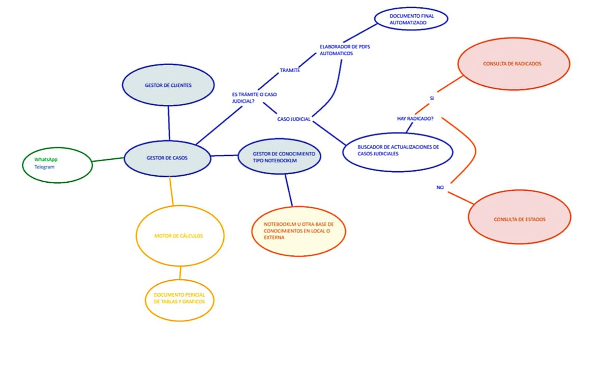

# Visión y alcance — BASTIUM

> Documento de referencia rápida. Para el detalle del alcance actual, área por área, ver
> [FUNCIONALIDADES.md](FUNCIONALIDADES.md); para el alcance jurídico completo previsto, ver
> `REQUERIMIENTOS DE CALCULO Y REGLAS LOGICAS - BASTIUM.pdf`.

## Objetivo del producto

BASTIUM es una aplicación de escritorio para abogados y despachos jurídicos en Colombia. Reemplaza la
liquidación manual en Excel (capital, intereses, indexación, sanciones) por un motor que aplica las mismas
reglas legales de forma consistente, versionada y auditable, con el mismo rigor matemático y jurídico que
se usaría en un juzgado.

## Público objetivo

- Abogados litigantes y despachos jurídicos en Colombia que liquidan procesos en las áreas Civil/Familia,
  Comercial, Sancionatorio, Honorarios/Litigio, Laboral y Tributario.
- Uso previsto: **interno de un despacho**, un caso (expediente) a la vez — no es un producto multiusuario
  ni multi-despacho (ver [Requisitos no funcionales](REQUISITOS_NO_FUNCIONALES.md)).

## Beneficios de negocio

- **Reduce el error humano de cálculo** en liquidaciones con efectos jurídicos reales (intereses mal
  capitalizados, topes de usura no aplicados, fechas de prescripción pasadas por alto).
- **Trazabilidad legal:** cada liquidación queda en un historial de auditoría append-only (quién, cuándo,
  con qué parámetros), reconstruible en cualquier momento — ver
  [Registro de Decisiones de Arquitectura](ARQUITECTURA_ADR.md#adr-003-auditlogresultado_json-append-only).
- **Parámetros legales versionados sin depender de un desarrollador:** tasas, topes y plazos se agregan
  desde la interfaz, con fecha de vigencia e historial completo.
- **Un solo criterio entre las 6 áreas del derecho**, en vez de una hoja de cálculo distinta (y
  potencialmente inconsistente) por abogado o por caso.

## Alcance actual (lo que entra)

Funcional y en producción hoy (ver el detalle exacto, con artículos y sprints, en
[FUNCIONALIDADES.md](FUNCIONALIDADES.md)):

- Liquidación real de las áreas **Civil/Familia, Comercial, Sancionatorio, Honorarios/Litigio, Laboral y
  Tributario**, cada una con sus propias reglas de intereses, topes e imputación de pagos.
- Indexación IPC opcional por obligación, con las reglas de exclusión/coexistencia propias de cada área.
- Historial de auditoría por expediente, con reconstrucción exacta de cualquier liquidación pasada.
- Exportación de resultados a PDF y Word.
- Parámetros legales versionados y editables desde la interfaz (⚙ Configuraciones → Parámetros).
- Alerta de vencimiento (prescripción/caducidad) para 13 tipos de acción/proceso.

## Fuera de alcance (por ahora)

- **Módulo pensional:** existe en `docs/superpowers/specs/2026-07-26-sprint17-modulo-pensional-design.md`
  pero no está conectado a la liquidación real (Sprint 17, ver [Pendientes.md](Pendientes.md)).
- **Costas judiciales por tabla real de rangos:** hoy se ingresan como porcentaje manual; el cálculo
  automático por tabla ya existe en el motor pero no tiene campos propios en pantalla (Sprint 18,
  bloqueado pendiente de confirmación del despacho).
- **IPC mensual real del DANE:** el mecanismo de indexación mensual está construido y probado, pero la
  tabla de datos está vacía a la espera de que el despacho aporte la fuente oficial (Sprint 8, seguimiento
  2 en [Preguntas-Para-Abogado-Abiertas.md](Preguntas-Para-Abogado-Abiertas.md)).
- **Multiusuario, sincronización en la nube, o telemetría/analítica remota:** decisión explícita de
  arquitectura, no una limitación temporal — ver [ADR-005](ARQUITECTURA_ADR.md#adr-005-sin-telemetría-ni-analítica-remota).
- Cualquier otro punto marcado 📋/🔵/🔴 en [Pendientes.md](Pendientes.md), que es la fuente de verdad
  actualizada del backlog completo.

## Criterios de éxito

- Cada área jurídica implementada reproduce, para un caso de prueba real aportado por el despacho, el
  mismo resultado numérico que el despacho calculó manualmente (criterio ya aplicado en la "Auditoría
  cruzada contra las respuestas del despacho" documentada en `Pendientes.md`).
- Ninguna liquidación se exporta o audita sin que su cálculo sea reconstruible después, con los mismos
  parámetros vigentes en el momento en que se ejecutó.
- README y Guía de Usuario nunca quedan desactualizados respecto al código real (regla ya vigente, ver
  "Mantenimiento de esta documentación" en el [README](../README.md)).

## Mapa de flujo del producto

Árbol de ideas del equipo (20-nov-2026) sobre cómo va a crecer BASTIUM a partir de lo que existe hoy:

| Bloque | Qué es | Estado en el repo |
|---|---|---|
| **Gestor de casos** (centro) | Núcleo que conecta todo lo demás | Hoy: expedientes en la app de escritorio. Propuesta de gestor completo en el [parche de plataforma](REVISION_PLATAFORMA_2026-11-17.md) |
| Gestor de clientes | Datos de los clientes y su relación con los casos | No existe todavía |
| WhatsApp / Telegram | Canales por donde llega la narración del cliente | No existe todavía (fase futura) |
| **Motor de cálculos** → documento pericial de tablas y gráficos | Liquidación determinista con su informe | ✅ Es lo que BASTIUM hace hoy (PDF/Word con tablas y gráficas) |
| Gestor de conocimiento tipo NotebookLM → NotebookLM u otra base de conocimiento local o externa | Consultar normas, jurisprudencia y doctrina curadas por el despacho | Evaluado en [PLAN_INTEGRACION_NOVIEMBRE.md](PLAN_INTEGRACION_NOVIEMBRE.md) (sección 8); decisión del equipo pendiente (#39) |
| ¿Es trámite o caso judicial? → **Trámite** → elaborador de PDFs automáticos → documento final automatizado | Documentos de trámite (derechos de petición, poderes, memoriales) generados solos | Parcial: memoriales PDF (Sprint 107); plantillas `.docx` en el parche de plataforma |
| ¿Es trámite o caso judicial? → **Caso judicial** → buscador de actualizaciones de casos judiciales | Seguimiento del proceso en la Rama Judicial | No existe todavía |
| ¿Hay radicado? Sí → consulta de radicados / No → consulta de estados | Cómo se busca el proceso según si ya tiene radicado de 23 dígitos | No existe todavía (el parche trae validación del radicado y un cliente de la Rama Judicial sin probar en real) |

## Visión de plataforma a futuro

El documento maestro del equipo ([Guía de identidad](identidad/GUIA_DE_IDENTIDAD.md), PDF p. 3-6) y los
[mockups](identidad/GUIA_DE_IDENTIDAD.md#mockups-de-la-plataforma) describen un SaaS *local-first* con este flujo:

1. El abogado o el cliente narra los hechos (formulario, WhatsApp o Telegram).
2. Un orquestador (n8n) los recibe y un clasificador decide si es cálculo o redacción.
3. Un agente extrae los datos (partes, fechas, montos) sin calcular nada; con un modelo local para no sacar datos
   personales del equipo.
4. Doble validación: un agente normativo (NotebookLM o base local), uno de contexto del expediente y un auditor
   que cruza ambos y devuelve el flujo si encuentra inconsistencias.
5. **Cálculo determinista en el motor de BASTIUM** (Decimal estricto). Regla central: **la IA jamás multiplica ni
   suma.**
6. Redacción jurídica asistida y documento final con membrete, tabla de liquidación y sello SHA-256.

Esto **no** cambia el alcance actual: la aplicación de escritorio y su motor siguen siendo el producto. La visión
orienta las decisiones abiertas del equipo: capa de API (#7), base de conocimiento (#39) y el
[parche de plataforma del 17-nov](REVISION_PLATAFORMA_2026-11-17.md), que da los primeros pasos (API forense y
gestor de casos).
